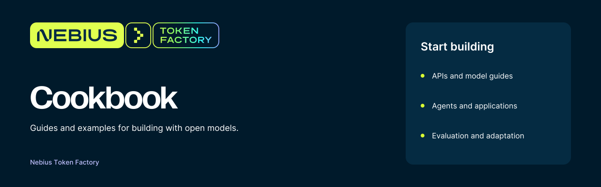

<a href="https://tokenfactory.nebius.com/">
  
</a>

# Nebius Token Factory Cookbook

Runnable examples for building applications with open models on [Nebius Token Factory](https://tokenfactory.nebius.com/). Explore an API, build an agent, evaluate a model, or adapt a complete application.

[Start here](start-here/README.md) · [Browse recipes](#browse-recipes) · [Model guides](models/README.md) · [Documentation](https://docs.tokenfactory.nebius.com/) · [Contribute](CONTRIBUTING.md)

## Start building

**New to Token Factory?** Follow the [quick tour](start-here/README.md) and [environment setup](start-here/setup.md). Each recipe has its own dependencies and run instructions.

```bash
git clone https://github.com/nebius/token-factory-cookbook.git
cd token-factory-cookbook
cp env_sample.txt .env
```

Add your API key and choose a text model from the [live model catalog](https://tokenfactory.nebius.com/models). Then make a first call with [uv](https://docs.astral.sh/uv/):

```bash
uv run --with openai --env-file .env python - <<'PYTHON'
import os
from openai import OpenAI

client = OpenAI(
    api_key=os.environ["NEBIUS_API_KEY"],
    base_url="https://api.tokenfactory.nebius.com/v1/",
)
response = client.chat.completions.create(
    model=os.environ["NEBIUS_MODEL"],
    messages=[{"role": "user", "content": "Explain tool calling in one paragraph."}],
)
print(response.choices[0].message.content)
PYTHON
```

Prefer a notebook? Open the [native API example](api/api_native.ipynb). For model availability, pricing, and supported features, use the live catalog and [product documentation](https://docs.tokenfactory.nebius.com/).

## Browse recipes

| You want to… | Start with |
| --- | --- |
| Make API calls and connect SDKs | [APIs](api/README.md) |
| Choose and run an open model | [Model guides](models/README.md) |
| Build an agent or a team of agents | [Agents](agents/README.md) |
| Give models tools and functions | [Tool calling](tool-calling/README.md) |
| Search and answer over your data | [Retrieval and RAG](rag/README.md) |
| Run a complete application | [Applications and demos](apps/README.md) |
| Connect a framework or external tool | [Integrations](integrations/README.md) |
| Use Token Factory in a coding agent | [Coding agents](coding/README.md) |
| Evaluate model behavior | [Inspect AI evaluation](evaluations/inspect-ai/README.md) |
| Adapt a model to your task | [Post-training](post-training/README.md) · [Distillation](distillation/README.md) |
| Follow a guided session | [Workshops](workshops/README.md) · [Office hours](office-hours/README.md) |
| Explore vision, images, and creative examples | [Creative examples](fun/README.md) |

## Featured recipes

| Recipe | What you will build | Stack |
| --- | --- | --- |
| [OpenCrewBot](agents/mastra/opencrewbot/) | A chat app with model-specific bots, tools, memory, and shared rooms | Mastra · Next.js |
| [Splitter Lite](apps/splitter-lite/) | A receipt reader that splits bills with vision and calculator tools | Nemotron 3.5 Super VL · Next.js |
| [KubeTrace AI](agents/kubetrace-ai/) | A Kubernetes incident investigation and repair workflow with review controls | Beam · Python · React |
| [Deep research agent](agents/langchain/deep-agent-example-1/) | A research workflow with planning and web search | LangChain · Tavily |
| [Internal support agent](rag/support-agent-weaviate/) | A support workflow with retrieval and external tools | LangGraph · Weaviate |
| [Typed decision model](agents/jev-style-decision-model-glm/) | Structured routing decisions with confidence-based escalation | GLM · OpenAI SDK |

These are independent examples. The recipe README explains required keys, optional services, validation, and deployment assumptions. Run and test the recipe you choose before adapting it to your environment.

## Contribute

Have a useful example or a fix? Read the [contribution guide](CONTRIBUTING.md), start from the [recipe template](.github/RECIPE_TEMPLATE.md), and include the checks you ran in your pull request.

Use [GitHub issues](https://github.com/nebius/token-factory-cookbook/issues) for reproducible recipe problems and suggestions. Report vulnerabilities through the [security policy](SECURITY.md).

## Community and resources

- [Community projects and articles](community/README.md)
- [Events and workshops](community/events.md)
- [Office hours](office-hours/README.md)
- [Token Factory documentation](https://docs.tokenfactory.nebius.com/)
- [Nebius blog](https://nebius.com/blog)
- [Contributors](https://github.com/nebius/token-factory-cookbook/graphs/contributors)

## License

The cookbook is [MIT licensed](LICENSE). Imported applications, fonts, and third-party assets may carry their own licenses; retained license and provenance files take precedence for those files.
