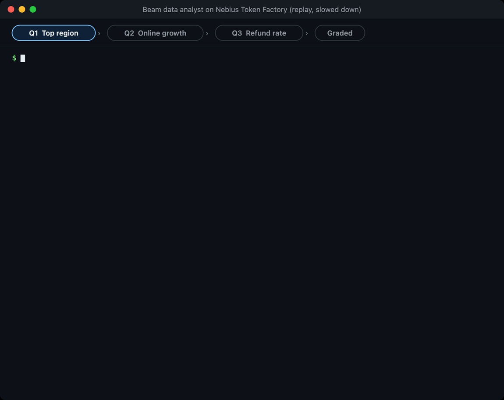
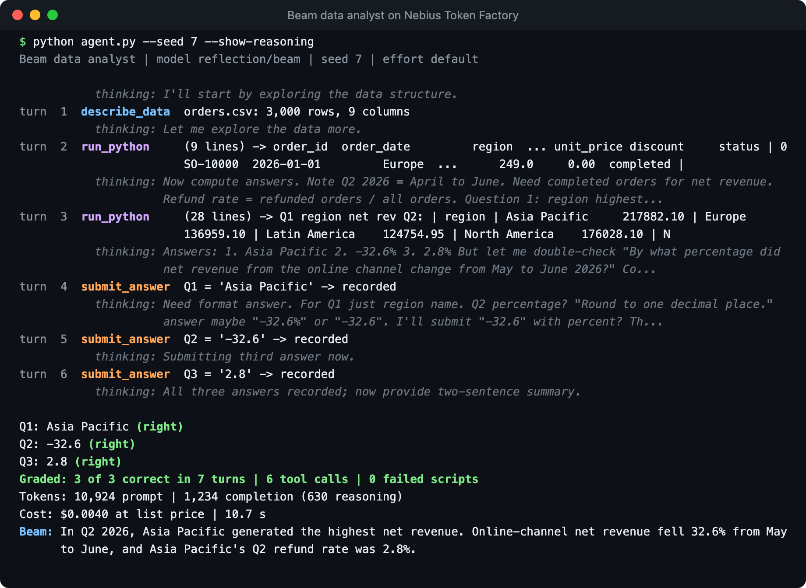
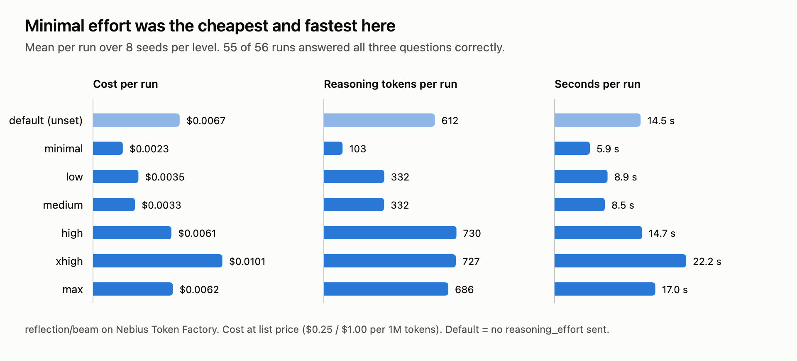

# Build a Python AI agent with Reflection AI's Beam

Beam is Reflection AI's first open-weight model, a 501B-parameter mixture-of-experts with 23B active parameters, built for coding and agentic work and released under Apache 2.0. Nebius Token Factory serves it as `reflection/beam` through the same OpenAI-compatible API as every other model in the catalog.

In this project you build a data analyst agent you can run on a laptop. You give Beam a sales dataset, three business questions, and three tools. Beam writes and runs pandas code to answer each question, and you measure what each run costs.

Here are the data and the questions:


And here is Beam working through them on Token Factory, replayed from a real run and slowed down so you can read along. The strip at the top shows which answers are in:



New to Beam? [Build with Beam on Token Factory](https://dev.nebius.com/cookbook/beam-reflection-token-factory) covers your first request and wiring Beam into a coding agent.

## What you will build

A command-line agent that:

- builds a seeded sales dataset and computes the right answers itself, so every run can be graded without a judge;
- gives Beam three tools: `describe_data` to read the schema, `run_python` to run pandas code next to the data in a child process, and `submit_answer` to record an answer;
- runs the full tool-call loop, sending Beam's `reasoning_content` back on every turn;
- reads the live list price from the Token Factory catalog and prints what each run cost;
- sweeps every reasoning-effort level across several seeds so you can choose one with data, not guesswork.

## What's in this folder

| File | What it does |
|---|---|
| [`workspace.py`](workspace.py) | The seeded dataset, the questions and their answers, the three tool definitions, and the `run_python` sandbox |
| [`agent.py`](agent.py) | The tool-call loop against Token Factory, plus the command-line runner |
| [`sweep.py`](sweep.py) | Runs the task across effort levels and seeds, then prints a comparison table |
| [`tests/`](tests/) | Offline tests with a fake client: no key, no network |
| [`images/`](images/) | The illustrations and run snapshots in this README |

## How the loop works


Every run asks the same three questions about a dataset built from the seed:

1. **Top region.** Which region had the highest net revenue in Q2 2026?
2. **Online growth.** By what percentage did online net revenue change from May to June 2026?
3. **Refund rate.** What was the Q2 refund rate for the region from question 1? Beam has to carry its first answer into the third question.

Net revenue is quantity × unit price × (1 − discount) on completed orders. The workspace computes every answer from the same data, and a numeric answer counts as right when it matches to one decimal place. The workspace, not the model, decides how many answers are right.

## Prerequisites

- Python 3.10 or newer and [uv](https://docs.astral.sh/uv/).
- A Token Factory API key with access to `reflection/beam`. See the [setup guide](../../start-here/setup.md) if you don't have one yet.
- About $0.007 per run, or about $0.30 for the full effort sweep.

Beam on Token Factory:

| Field | Value |
|---|---|
| Model ID | `reflection/beam` |
| Parameters | 501.3B total, 23.4B active |
| Context length | 1,048,576 tokens |
| Quantization | FP8 |
| Features | Tool calls, reasoning |
| Price | $0.25 per 1M input tokens, $1.00 per 1M output tokens |

`agent.py` reads the price from the catalog on every run, so its cost line stays correct if the price changes.

## Set up and test offline

```bash
git clone https://github.com/nebius/token-factory-cookbook.git
cd token-factory-cookbook/agents/beam-python-ai-agent
uv sync
uv run python -m pytest -q -p no:cacheprovider
```

The tests use a fake client, so they pass without a key and make no network calls. They check that every answer matches an independent pandas calculation, that grading accepts answers like `-32.6%`, that the sandbox can read `orders.csv` but not `NEBIUS_API_KEY`, and that the loop sends `reasoning_content` and the matching `tool_call_id` back to the model.

```text
........                                                                 [100%]
8 passed
```

## Run your first analysis

Put your key in `.env`, then run seed 7 with Beam's reasoning shown:

```bash
cp env.example .env   # then put your key after NEBIUS_API_KEY=
set -a; source .env; set +a
uv run python agent.py --seed 7 --show-reasoning
```

`NEBIUS_BASE_URL` defaults to `https://api.tokenfactory.nebius.com/v1` and `NEBIUS_MODEL` to `reflection/beam`. Override either if you need to. Never commit `.env`; it is already in `.gitignore`.

The output looks like this:



In this run, Beam read the schema, ran one script to look at the data and a second to compute all three answers, then submitted them one at a time. All three were right: 7 turns, 10,924 prompt tokens, 1,234 completion tokens (630 of them reasoning), $0.0040, and 10.7 seconds. The italic `thinking:` lines are the start of each turn's `reasoning_content`, and the last line is Beam's summary for a business reader.

Change `--seed` for a different dataset, add `--effort minimal` (or any level up to `max`) to set the reasoning effort, and add `--save run.json` to keep the run record.

## Walk through the code

### The sandbox

`run_python` starts a fresh interpreter for every script, in a temporary folder that holds a copy of `orders.csv`. The child gets an empty environment and a 20-second timeout:

```python
def run_python(self, code: str, timeout: float = 20.0) -> dict:
    with tempfile.TemporaryDirectory() as workdir:
        Path(workdir, DATA_FILE).write_text(self.csv_text)
        try:
            done = subprocess.run(
                [sys.executable, "-I", "-"],
                input=code,
                cwd=workdir,
                env={},
                capture_output=True,
                text=True,
                timeout=timeout,
            )
        except subprocess.TimeoutExpired:
            return {"exit_code": None, "stdout": "", "stderr": f"Timed out after {timeout:g} seconds."}
    return {"exit_code": done.returncode, "stdout": done.stdout[-OUTPUT_LIMIT:], "stderr": done.stderr[-OUTPUT_LIMIT:]}
```

The empty environment keeps your API key out of the child's reach, and the timeout stops runaway loops. The child uses the same Python as the agent, so pandas is available. This is not a security boundary: the child can still reach the network and read your files. Before you point model-written code at anything you care about, run it in a container with networking off or in a disposable VM.

Errors come back as data, not exceptions, so Beam can read a traceback in `stderr` and fix its script on the next turn.

### The loop

Every turn sends the full history with the three tools, records token usage, and appends Beam's answer, reasoning included:

```python
choice = response.choices[0]
message = choice.message
reasoning = getattr(message, "reasoning_content", None)

# Beam needs its earlier reasoning back on later turns, so keep it in the history.
assistant = {"role": "assistant", "content": message.content or ""}
if reasoning:
    assistant["reasoning_content"] = reasoning
if message.tool_calls:
    assistant["tool_calls"] = [
        {"id": call.id, "type": "function", "function": {"name": call.function.name, "arguments": call.function.arguments}}
        for call in message.tool_calls
    ]
messages.append(assistant)

if not message.tool_calls:
    final = (message.content or "").strip()
    finish = "answered" if final else choice.finish_reason
    break

for call in message.tool_calls:
    result = call_tool(workspace, call.function.name, call.function.arguments)
    messages.append({"role": "tool", "tool_call_id": call.id, "content": result})
```

The loop builds the assistant message by hand, so the history carries exactly `content`, `tool_calls`, and `reasoning_content`. `call_tool` turns a tool name Beam was never given, or arguments that are not valid JSON, into an error result instead of an exception, so a stray call costs a turn instead of crashing the run.

`play()` stops after 16 turns (`--max-turns`), which bounds what a single run can cost, and it grades the run from the workspace rather than from Beam's final summary.

The reasoning effort goes in `extra_body`, which sends the field exactly as written whatever your installed `openai` version's type hints list. When you omit `--effort`, the request leaves the field out and Beam uses its default.

### The price

The Token Factory models endpoint returns per-token pricing when you ask for the verbose listing:

```python
def list_prices(client: OpenAI, model: str) -> tuple[float, float] | None:
    for entry in client.models.list(extra_query={"verbose": "true"}):
        pricing = (entry.model_extra or {}).get("pricing")
        if entry.id == model and pricing:
            return float(pricing["prompt"]), float(pricing["completion"])
    return None
```

Cost is then prompt tokens times the input price plus completion tokens times the output price. Reasoning tokens are billed as output and are already inside `completion_tokens`.

## Choose a reasoning effort with data

Beam accepts `reasoning_effort` set to `minimal`, `low`, `medium`, `high`, `xhigh`, or `max`. `sweep.py` runs the same seeds at every level you list, four runs at a time:

```bash
uv run python sweep.py --efforts default minimal low medium high xhigh max --seeds 1 2 3 4 5 6 7 8
```

`default` means the request carries no `reasoning_effort`. Across those 56 runs:



| Effort | All 3 correct | Turns | Completion tokens | Reasoning tokens | Seconds | Cost per run |
|---|---:|---:|---:|---:|---:|---:|
| default | 8/8 | 9.4 | 1,858 | 612 | 14.5 | $0.0067 |
| minimal | 8/8 | 5.0 | 885 | 103 | 5.9 | $0.0023 |
| low | 8/8 | 6.2 | 1,229 | 332 | 8.9 | $0.0035 |
| medium | 8/8 | 6.5 | 1,078 | 332 | 8.5 | $0.0033 |
| high | 8/8 | 9.0 | 1,827 | 730 | 14.7 | $0.0061 |
| xhigh | 7/8 | 8.4 | 3,110 | 727 | 22.2 | $0.0101 |
| max | 8/8 | 8.5 | 1,928 | 686 | 17.0 | $0.0062 |

Values are means per run. What the numbers say:

- **`minimal` did this job for the least.** It got all three answers right on every seed in 5 turns on average, at about a third of the default's cost and well under half its time. The analysis happens in pandas, so Beam's job is to write the right few lines, not to reason at length.
- **More effort bought more turns, not more accuracy.** From `high` up, Beam spent about 700 reasoning tokens and made about 8 tool calls a run, for roughly three times the cost of `minimal`, and more at `xhigh`.
- **Input dominates the bill.** A run averaged about 15,000 prompt tokens against 1,700 completion tokens. Because the loop resends the growing history every turn, input is about two thirds of the cost even at a quarter of the output price. Fewer turns save more than lower effort does.

For questions where the hard part happens inside the model, such as choosing which analysis to run or explaining an anomaly, the higher levels have more to do. Point `sweep.py` at questions that look like your workload before you pick a default.

## Verify the result

You have a working setup when:

1. `uv run python -m pytest -q` reports `8 passed` without `NEBIUS_API_KEY` set.
2. `uv run python agent.py --seed 7` prints `Q1`, `Q2`, and `Q3` lines marked `(right)`, then `Graded: 3 of 3 correct`, a token count, and a cost line in dollars.
3. Running it with `--save run.json` writes a record whose `correct` field is `3` and whose `model` field is `reflection/beam`.
4. The requests show up under your project's usage in the Token Factory console.

## Troubleshooting

- **`401`.** The key is missing or wrong. Check that `.env` holds your key and that you ran `set -a; source .env; set +a` in the same shell.
- **`404` or model not found.** Check that `NEBIUS_MODEL` is unset or exactly `reflection/beam`, and that your key's project has access to it.
- **`ModuleNotFoundError: pandas` in a `run_python` result.** The sandbox uses the same Python as `agent.py`. Run `uv sync` in this folder and start the agent with `uv run`.
- **A question is marked wrong.** The line shows the expected value next to Beam's answer. Rerun with `--show-reasoning` to see how Beam computed it.
- **`Graded: ... in 16 turns`.** The run hit the turn cap before Beam finished. Raise `--max-turns`, or set `--effort minimal` for a shorter run.

## Clean up

Nothing runs on Nebius after the script exits. Remove the local environment, the key file, and the variables from your shell:

```bash
rm -rf .venv .env
unset NEBIUS_API_KEY NEBIUS_BASE_URL NEBIUS_MODEL
```

## Going further

- **Ask your own questions.** Add a question to `QUESTIONS` in `workspace.py`, compute its answer in `expected_answers`, and extend `grade()`. Questions that need judgement, not just arithmetic, are where the effort levels start to separate.
- **Point it at your own data.** Replace `build_orders` with a loader for your CSV and keep the rest of the loop as it is. Without computed answers you lose automatic grading, so keep a few questions whose answers you already know.
- **Swap in a real sandbox.** Replace the body of `run_python` with a call to a container or a hosted sandbox. Nothing else in the loop changes.
- **Try Reflection's harness.** Beam was trained alongside Mirror, Reflection's open-source terminal coding agent. Its [models and providers page](https://developers.reflection.ai/mirror-models) shows how to point it at any Chat Completions endpoint, which includes Token Factory.
- **Run the weights yourself.** The [Beam collection on Hugging Face](https://huggingface.co/collections/reflection/beam-10) has BF16, FP8, and NVFP4 checkpoints and a speculative-decoding drafter, if you want to serve Beam on your own Nebius AI Cloud GPUs.
