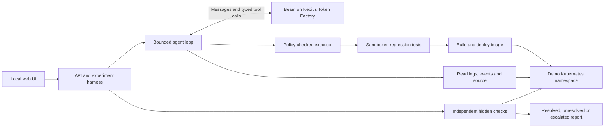

# Investigate and repair Kubernetes incidents with Beam

Use [Reflection Beam](https://reflection.ai/blog/introducing-beam) on [Nebius Token Factory](https://tokenfactory.nebius.com/?modals=endpoint-details&model-id=reflection/beam) to investigate a failing application, edit its source, run regression tests, build an image and deploy a repair. This recipe uses [KubeTrace AI](https://github.com/Studio1-OSS/kubetrace-ai), an open-source application from the [Studio1 team](https://studio1hq.com).

The exercise is a small storefront checkout service on a disposable Kubernetes cluster. An injected pricing bug makes orders of 30 or more items return HTTP 500. The agent gets the incident description and typed tools; independent hidden checks decide whether the repair worked.

The complete application is included in this directory: Python API and agent, React UI, storefront, Kubernetes manifests, Dockerfiles, tests and sample reports. It is copied from upstream revision `6a111412eeaadd831f499aa6c72c55e3a99e7fef` under the [Apache-2.0 license](LICENSE). See [UPSTREAM.md](UPSTREAM.md) for provenance and cookbook-specific changes.

## What you will learn

- Configure an OpenAI-compatible tool-calling agent with `reflection/beam` on Token Factory.
- Follow an investigation from cluster evidence into application code and tests.
- Separate model-proposed changes from deterministic execution policy and human approval.
- Verify a deployed repair independently and inspect failures as well as successes.

## Architecture



The backend uses the official Python `openai` client with `base_url=https://api.tokenfactory.nebius.com/v1`. Pydantic argument models supply the tool schemas. The loop sends conversation history and tools with `tool_choice="auto"`, dispatches validated calls, and returns redacted, size-limited tool results to the model.

There is no agent framework dependency. See the included [model client](services/agent/kubetrace_agent/llm.py), [agent loop](services/agent/kubetrace_agent/loop.py) and [typed tools](services/agent/kubetrace_agent/tools.py).

## Prerequisites

- macOS or Linux with Git, Docker, [kind](https://kind.sigs.k8s.io/) and `kubectl`. Start Docker before creating the cluster.
- Python 3.11+ and [uv](https://docs.astral.sh/uv/).
- Node.js 22 and pnpm to build the web UI.
- A Nebius Token Factory API key with access to `reflection/beam`. Follow the cookbook's [setup guide](../../start-here/setup.md) to create a key.

Use a disposable local cluster for this exercise. Setup and fault injection intentionally change demo workloads. Live inference spends credits on your Token Factory account; fixture mode is available for checking the pipeline without a model.

## 1. Get the cookbook

```bash
git clone https://github.com/nebius/token-factory-cookbook.git
cd token-factory-cookbook/agents/kubetrace-ai
cp .env.example .env
uv sync
```

Run the remaining commands from `agents/kubetrace-ai`. No separate application clone is needed.

## 2. Configure Beam on Token Factory

Edit the copied `.env` file. Fill in `NEBIUS_API_KEY` with your own key, and set these non-secret values:

```dotenv
NEBIUS_MODEL=reflection/beam
NEBIUS_BASE_URL=https://api.tokenfactory.nebius.com/v1
CLUSTER_KIND=kind
POLICY_MODE=review
MODEL_TEMPERATURE=0.2
MODEL_MAX_TOKENS=2048
```

Keep the key in the backend environment; do not paste it into a prompt or commit `.env`. Review mode makes each policy-allowed cluster mutation wait for approval in the UI. The deterministic policy still applies when you approve a change.

Run the provider preflight before setting up the experiment:

```bash
uv run kubetrace preflight
```

It checks configuration, authentication, model access, a tool-calling round trip and usage reporting. Resolve failures before continuing. The model ID is case-sensitive. Check the [Beam endpoint page](https://tokenfactory.nebius.com/?modals=endpoint-details&model-id=reflection/beam) for access through your account; an unavailable model is an error, not a reason to silently substitute a different one.

Leave `MODEL_REASONING_EFFORT` unset initially. Generation settings are passed to the provider, so only set options the selected model accepts.

## 3. Create a local cluster and start the UI

The pinned kind configuration names the cluster `kubetrace`.

```bash
mkdir -p .secrets
kind create cluster --config deploy/kind/kind-config.yaml --kubeconfig .secrets/kind-kubeconfig
echo "KUBECONFIG=$PWD/.secrets/kind-kubeconfig" >> .env

(cd apps/web && pnpm install && pnpm build)
uv run kubetrace serve
```

Open **http://127.0.0.1:8000**. Keep this process running while using the UI. For kind on macOS, run the API on the host: a container cannot reach a kind API server bound to the host's `127.0.0.1`.

## 4. Reproduce the checkout failure

In **Experiments**:

1. Select **application-bug**.
2. Keep **Live model** enabled and **Review each change** enabled.
3. Press **Setup**. The harness deploys the healthy storefront and checks the baseline. It also prepares the test runner image.
4. Press **Inject**. The harness introduces the pricing bug and proves the large order fails.
5. Press **Investigate** to start Beam's tool-calling loop.

The incident concerns a wholesale checkout for 30 mugs. The agent must establish the cause from evidence rather than receiving the expected patch or hidden tests.

For a pipeline-only check, turn off **Live model** before starting investigation. That run is labelled **FIXTURE**: a scripted test double produces the actions and no model is called. Do not use it as evidence of Beam's capability.

## 5. Follow the code repair and deployment

The timeline shows visible decision notes, tool calls, results, patches and test output. A successful investigation can include:

| Stage | Tools or evidence | What to inspect |
| --- | --- | --- |
| Reproduce | `http_check` | A request through the Service reproduces the failing checkout. |
| Diagnose | `get_logs`, `read_file` | The exception and pricing rules support the proposed cause. |
| Repair | `edit_file`, `write_file`, `show_diff` | Source changes fix the cause, and a new regression test covers the failing order. |
| Test | `run_tests` | Tests run in the Docker sandbox without network access or credentials. |
| Deploy | `build_image`, `deploy_image`, `wait_for_rollout` | A newly built image is deployed, and rollout completes. |
| Verify | `http_check`, then harness verification | The application serves correct responses; independent checks determine the final outcome. |

These are available tools and inspection points, not a promised sequence. Beam chooses its calls and may fail, reach a budget limit or need to escalate.

When review mode pauses a cluster mutation, inspect the proposed change and policy result before approving it. Do not approve an unrelated change just to advance the run. A denial or failed check remains part of the report and can become feedback to the agent.

The application bug is a tier lookup that indexes past the end of a discount table. Recovery requires more than catching the exception: the discount and checkout totals must match the documented rules, the original tests must remain, and the agent's regression test must fail against the buggy code.

## 6. Inspect the outcome and export the evidence

Open the run's **Report**. Check:

- **Provenance and settings:** live versus fixture, provider, exact model ID, generation settings and repository commit.
- **Issue and baseline:** healthy baseline and fault proof before investigation.
- **Changes and tests:** diffs, rejected actions, test output and the deployed image.
- **Verification:** hidden checks, first-attempt success and eventual success.
- **Usage:** provider-reported tokens, tool and model calls, timings, and any available cost estimate.

The agent calling `finish` with `outcome="resolved"` does not make the run successful. Hidden verification must pass. For this code-repair scenario it checks the run-built image, ready Pods, checkout totals, preserved tests and the regression test's ability to detect the original bug.

Use **Markdown** or **JSON export** to retain a report, and **Replay** to inspect the recorded timeline. **Presentation mode** hides addresses, contexts, cluster IDs and registry hosts when sharing a report. Review the export before sharing it.

The included [sample reports and result tables](docs/RESULTS.md) describe earlier Muse Spark Open runs and separately labelled fixtures. This recipe configures Beam; inspect your own run's provenance before attributing an outcome to Beam. The scenarios are demo exercises, not a general coding or Kubernetes benchmark.

## 7. Try another incident

| Scenario | Exercise |
| --- | --- |
| `selector-mismatch` | A Service selector matches no Pods; restore endpoints and real checkout traffic. |
| `broken-readiness` | A readiness path returns 404; fix the probe without removing it. |
| `invalid-config` | An invalid tax-rate value crashes startup; repair configuration and restart the workload. |
| `memory-pressure` | Cache size exceeds the memory limit; make a bounded resource or configuration change. |
| `partner-outage` | An external payment service is down; diagnose and escalate without changing another namespace. |

Use **Setup → Inject → Investigate** for the next exercise. The included [scenario cookbook](docs/COOKBOOK.md) explains the faults, checks and recorded outcomes.

For a headless run on this disposable cluster, you can explicitly select automatic execution of policy-allowed changes:

```bash
uv run kubetrace run application-bug --model-mode live --policy auto
```

This command performs setup, injection and investigation without the UI approval workflow. Use the UI with review mode when you want to approve each cluster change.

## Optional: connect an existing Civo cluster

The local recipe needs no Civo account. To use an existing Civo demo cluster instead, follow the included [Civo guide](docs/CIVO.md).

Set `CLUSTER_KIND=civo`, `CIVO_REGION`, `CIVO_CLUSTER_ID` and a `REGISTRY` the nodes can pull from; fill in `CIVO_API_KEY` server-side. The application fetches a kubeconfig but does not create Civo infrastructure. Civo nodes need pullable images; the local kind image-loading path does not apply. Cluster and registry costs are separate from Token Factory inference.

## Execution boundaries

The harness uses admin access for experiment setup, injection, verification and token minting. The agent receives a separate namespace-scoped ServiceAccount, not admin credentials. Its RBAC excludes Secrets, nodes, RBAC changes, deletes and other namespaces.

Cluster mutations pass an API-server dry run, an allowlist policy and a `resourceVersion` staleness check. Review approval does not bypass these controls. Logs, annotations, repository text and tool output are treated as untrusted data. Provider private reasoning fields are not stored.

The Docker test runner has no network or credentials, mounts source read-only and uses resource limits. The subprocess fallback is not isolated; reports identify it if used. See the [security model](docs/SECURITY.md) for exact boundaries.

## Troubleshooting

| Symptom | Next check |
| --- | --- |
| Preflight fails | Verify the backend key, exact model ID, account access and accepted generation settings. |
| UI does not load | Build `apps/web` and confirm `uv run kubetrace serve` is running on port 8000. |
| Setup fails | Check Docker, kind, the kubeconfig path and cluster connectivity. |
| Investigation pauses | Inspect the review-mode approval prompt and policy decision. |
| Agent claims success but run is unresolved | Read the hidden verification results and the applied diff. Retain the failure as evidence. |
| Cost is unavailable | The pinned pricing file may not contain a verified rate for the model. Use provider-reported token counts and current account pricing; do not substitute another model's rate. |
| Civo rollout cannot pull an image | Check the registry configuration, node access and image digest. |

## Cleanup

Stop `kubetrace serve` with Ctrl-C. If you created the disposable kind cluster for this recipe, remove it:

```bash
kind delete cluster --name kubetrace
```

This deletes that cluster and its workloads. It does not delete local reports or Docker build images. For an existing Civo cluster, use the cleanup steps in the Civo guide; do not delete a shared cluster.

## Test the included application

These checks require no cluster or live inference:

```bash
uv run pytest tests/unit
(cd apps/web && pnpm build && pnpm typecheck)
```

Cluster integration and UI tests are opt-in; follow the [testing guide](docs/TESTING.md). Run reports record the cookbook checkout commit. The copied application revision is documented separately in [UPSTREAM.md](UPSTREAM.md).

## Resources

- [KubeTrace AI source and current documentation](https://github.com/Studio1-OSS/kubetrace-ai) — Apache-2.0 licensed application.
- [Introducing Beam](https://reflection.ai/blog/introducing-beam).
- [Beam on Nebius Token Factory](https://tokenfactory.nebius.com/?modals=endpoint-details&model-id=reflection/beam).
- [Token Factory setup](../../start-here/setup.md).
- [Testing guide](docs/TESTING.md).
