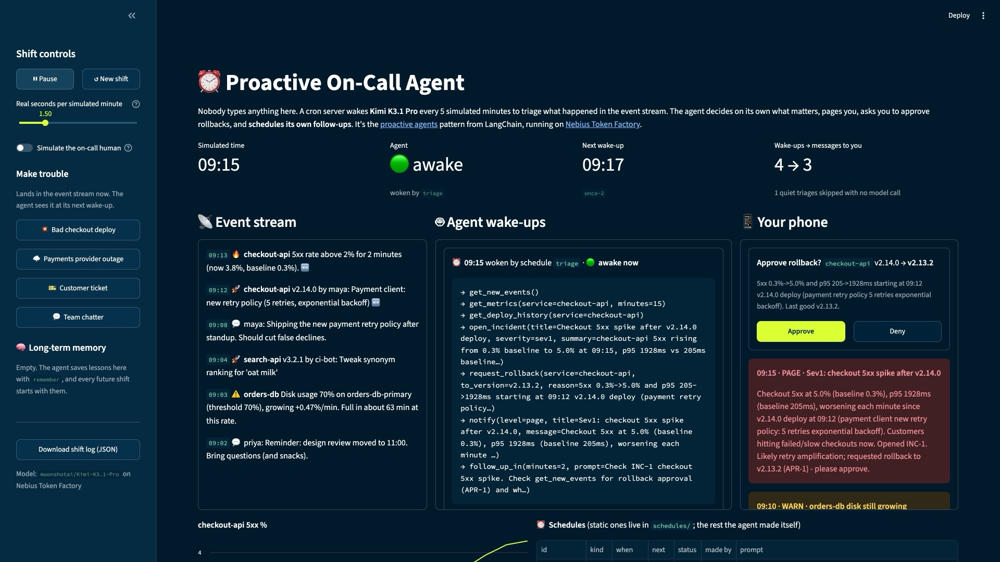
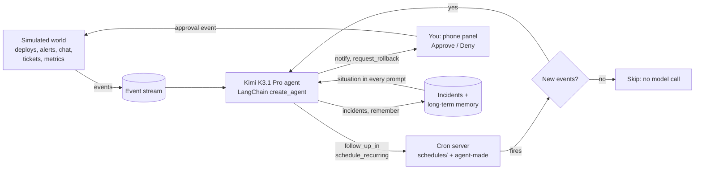

[Cookbook](../../../README.md) / [Agents](../../README.md) / [LangChain](../README.md) / Proactive on-call agent

# Proactive on-call agent with Kimi K3.1 Pro

An agent that acts on events without being asked. A cron server wakes **Kimi K3.1 Pro** on [Nebius Token Factory](https://tokenfactory.nebius.com/) to triage a live event stream. The agent pages a human, asks for a rollback, and schedules its own follow-ups until the incident is closed.



Most agents sit in a chat box and wait. This one has no chat box. It implements LangChain's [proactive agents](https://www.langchain.com/blog/proactive-agents) idea on one concrete use case, an on-call shift for a checkout team: a cron server wakes the agent every 5 minutes to read what happened, and the agent decides for itself what matters, who needs to hear about it, and when it should wake up again.

## What you will build

A scripted on-call morning that you watch in a Streamlit dashboard or a terminal. A bad deploy breaks checkout at 09:12. Three minutes later the agent has paged you with the evidence, asked you to approve a rollback, and set itself a follow-up. It keeps checking back until checkout is healthy, resolves the incident, and saves the lesson. Meanwhile it puts a slowly filling database disk on a recurring watch, cancels that watch when a teammate fixes the cause, and stays quiet about team chatter and healthy deploys.

- **No prompts, only triggers.** Every run starts from a schedule firing. The user message only says which schedule fired and why.
- **Static schedules in `schedules/`.** One file per schedule with `define_schedule(cron=..., prompt=...)`, the same shape as LangSmith's Managed Deep Agents schedules.
- **Schedules the agent makes itself.** `follow_up_in` (one-off, continues the same thread) and `schedule_recurring` (cron, fresh thread each run), plus `list_schedules` and `cancel_schedule`.
- **Quiet triage.** When nothing new arrived, the triage run is skipped without a model call. Noise gets no notification.
- **Human-gated actions.** The agent can't roll back on its own. `request_rollback` puts an Approve/Deny card on your phone panel, and the decision comes back as an event.
- **Incidents as shared working memory.** Separate runs open, update and resolve incidents, so they don't page twice for the same problem.
- **Long-term memory.** `remember` saves durable lessons to `state/memory.md`, which is loaded into every later run. An end-of-shift schedule writes the handoff and consolidates lessons.
- **A world that reacts.** A bad version raises the error rate, an approved rollback brings it back down, and a payments-provider outage hurts checkout whatever version runs. Inject a bad deploy, a provider outage, a customer ticket or chatter from the sidebar and watch the next wake-up handle it.



1. **Tick.** The simulated clock moves one minute and the world produces that minute's events and metrics. The clock stops while the agent works, so a slow model call never makes it miss an event.
2. **Fire.** The cron server runs every schedule that's due: the agent's own follow-ups first, then its recurring watches, then the static ones from `schedules/`.
3. **Wake.** Each due schedule starts an agent run. A `@dynamic_prompt` middleware rebuilds the system prompt before every model call with the current situation: open incidents, pending approvals, active schedules, messages already sent and long-term memory.
4. **Act.** The agent calls tools to look (`get_new_events`, `get_metrics`, `get_deploy_history`), to act (`notify`, `request_rollback`, incidents, `remember`) and to schedule itself (`follow_up_in`, `schedule_recurring`, `cancel_schedule`).
5. **Repeat.** You approve or deny on the phone panel, the world reacts, and the agent finds out at its next wake-up.

### The two building blocks

LangChain's post argues that most proactive agents are "agent runs as cron tasks", and that you need two things to build one:

| Building block | In this recipe |
| --- | --- |
| A cron server that runs a prompt on a schedule | `cron.py`: static schedules from `schedules/*.py`, runtime schedules with `cron` or `at`, 20-schedule limit per owner |
| An interface for the agent to create and manage its own schedules | `agent.py`: `follow_up_in`, `schedule_recurring`, `list_schedules`, `cancel_schedule`, all reaching the cron server through `runtime.context` |

A one-off follow-up continues the thread of the run that set it, so the agent remembers what it was checking. Cron runs start on a fresh thread.

### The scripted morning

| Time | What happens | What a good agent does |
| --- | --- | --- |
| 09:00 | Shift starts, nothing has happened | Nothing. The triage is skipped without a model call |
| 09:03 | orders-db disk crosses 70%, growing about 0.5%/min | Warns, and sets itself a recurring disk watch |
| 09:04, 09:08 | A search-api deploy, team chatter | Nothing |
| 09:12 | checkout-api v2.14.0 ships a new payment retry policy | |
| 09:13 | Checkout 5xx above 2% | |
| 09:15 | Triage wakes the agent | Opens an incident, pages you, requests a rollback to v2.13.2, schedules a follow-up |
| 09:16-09:17 | Provider status page says all clear; a customer reports a double charge | Links the ticket to the incident, rules out the provider |
| After approval | Rollback runs, errors fall back to baseline | Follows up every few minutes, resolves the incident, saves the lesson |
| 09:24 | Disk crosses 80% | Keeps watching without repeating itself |
| 09:30 | A teammate turns off debug logging; disk drops to 58% | Cancels its own disk watch |
| 09:35 | v2.14.1 fixes the retry policy | Checks the new deploy stays healthy |
| 09:47 | End-of-shift schedule | Sends the handoff and saves durable lessons |

### Model and configuration

| Setting | Value |
| --- | --- |
| Endpoint | `https://api.tokenfactory.nebius.com/v1/` (OpenAI-compatible, through `langchain-openai`) |
| Model | `moonshotai/Kimi-K3.1-Pro`, override with `NEBIUS_MODEL` or `--model` |
| Reasoning effort | `medium`, override with `REASONING_EFFORT` |
| Framework | LangChain `create_agent` with `@dynamic_prompt` middleware, `ToolRuntime` context and a LangGraph checkpointer for follow-up threads |
| Scheduling | [croniter](https://github.com/kiorky/croniter) for cron expressions in the in-process cron server |

### Project layout

```text
proactive-oncall-agent/
├── schedules/
│   ├── triage.py          # every 5 min: triage the event stream (skipped when quiet)
│   └── shift_handoff.py   # end of shift: handoff note + long-term memory
├── agent.py               # Kimi K3.1 Pro agent: tools, dynamic situation prompt, run loop
├── cron.py                # in-process cron server and define_schedule()
├── desk.py                # notifications, incidents, long-term memory, Slack delivery
├── world.py               # simulated checkout service, monitoring rules, approvals
├── runtime.py             # clock + world + cron + agent, background loop for the UI
├── app.py                 # Streamlit dashboard
├── main.py                # terminal run of a shift
├── tests/                 # credential-free unit tests
├── assets/                # dashboard screenshot
├── .streamlit/            # theme, binds the server to localhost
├── env.example
├── pyproject.toml
└── uv.lock
```

## Requirements

- Python 3.10 or newer
- [uv](https://docs.astral.sh/uv/) (or pip)
- A Token Factory API key from [tokenfactory.nebius.com](https://tokenfactory.nebius.com/)
- Optional: a Slack incoming webhook URL, to also post the agent's notifications to a channel

**Paid calls.** Each agent wake-up is one LangChain agent run on Kimi K3.1 Pro, which can make several model calls as it uses tools. A full scripted shift wakes the agent about 15 to 20 times, plus a few skipped triages that make no model call. The dashboard pauses its background loop when no browser tab has watched it for 30 seconds, so a forgotten tab doesn't keep spending tokens.

## Setup

From this directory:

```bash
uv sync
cp env.example .env
```

Set `NEBIUS_API_KEY` in `.env`. Optionally set `NEBIUS_MODEL`, `REASONING_EFFORT` or `SLACK_WEBHOOK_URL`.

With pip instead of uv:

```bash
python -m venv .venv && source .venv/bin/activate
pip install -e .
```

## Run

### Dashboard

```bash
uv run streamlit run app.py
```

Open http://localhost:8501 and press **Start shift**. Don't type anything; there is nowhere to type. Watch three columns:

- **Event stream:** what happens in the world, marked new until a triage run reads it.
- **Agent wake-ups:** every run with what woke it (a schedule, its own follow-up or its own recurring watch), each tool call as it happens, and its one-line log. Skipped triages show as a single grey line.
- **Your phone:** the agent's pages, warnings and notes, and Approve/Deny buttons for rollback requests.

Below them are the checkout error rate and database disk charts, the schedule table (the static ones and every one the agent made, with who made it), and incidents.

In the sidebar, set how many real seconds a simulated minute takes, turn on **Simulate the on-call human** to approve rollbacks automatically after 2 minutes, and use **Make trouble** to inject events. The sidebar also shows long-term memory as the agent writes it. After the scripted morning ends at 09:48, try a bad deploy, then a payments-provider outage: the agent should roll back the first and refuse to roll back the second. **Download shift log (JSON)** at the bottom of the page saves everything that happened.

### Terminal

```bash
uv run python main.py                   # 09:00-09:48 shift, rollbacks approved after 2 min
uv run python main.py --approve ask     # you approve or deny each rollback
uv run python main.py --approve never   # nobody answers: watch the agent escalate
uv run python main.py --fresh-memory    # forget lessons from earlier shifts
```

A full shift takes a few minutes. It ends with a summary of events, wake-ups, messages sent, incidents, approvals and long-term memory.

### Make it yours

- **Real events.** `World` is the only simulated part. Replace `get_new_events`, `get_metrics` and `get_deploy_history` with calls to your alerting, metrics and CI systems, and `request_rollback` with your deploy tool's approval flow.
- **Wall-clock time.** The cron server takes `now` as an argument. Call `cron.due(datetime.now())` once a minute instead of advancing the simulated clock, and set `schedules/shift_handoff.py` to something like `cron="0 17 * * 1-5"`.
- **Managed Deep Agents.** The schedule files and tools are shaped like LangSmith's [Managed Deep Agents schedules](https://docs.langchain.com/langsmith/python/managed-deep-agents-schedules). To deploy there, import `define_schedule` from `managed_deepagents`, and call `runtime.schedules.create(owner={"type": "user"}, cron=... or at=..., prompt=...)` inside the schedule tools.

## Validate

Credential-free tests cover the cron server (static schedules, one-off follow-ups that keep their thread, recurring schedules and cancellation), schedule validation, the simulated world (bad deploy, rollback, disk story, provider outage), the one-open-incident-per-service rule, and the runtime's skip-when-quiet rule, with a stub in place of the model. They make no network or Token Factory calls:

```bash
uv sync --frozen
uv run python -m unittest discover -s tests
```

What was verified for this recipe:

- The 7 offline tests pass with Python 3.12 on macOS, using the committed `uv.lock`.
- Live Token Factory calls were not re-run for this cookbook copy. Run a shift yourself to confirm your key's model access and cost.

## Limitations and cleanup

- **Simulated environment.** The event stream, metrics, deploys and rollbacks come from `world.py`. Nothing touches real infrastructure until you replace those tools.
- **In-process scheduler.** Schedules live in memory and are lost when the process stops. Use a durable scheduler for production.
- **Localhost only.** `.streamlit/config.toml` binds the server to `localhost`, and the dashboard has no authentication.
- **Slack is optional and outbound only.** With `SLACK_WEBHOOK_URL` set, every notification is also posted to that channel.

The recipe creates no cloud resources. Long-term memory is written to `state/`, which is git-ignored. To clean up:

```bash
rm -rf .venv .env state
```

## Source and license

Built by [Arindam Majumder](https://github.com/Arindam200). Based on LangChain's [Why aren't you building proactive agents yet?](https://www.langchain.com/blog/proactive-agents). Kimi K3.1 Pro is by [Moonshot AI](https://www.kimi.ai/blog/kimi-k3-1-pro).

Released under this repository's [MIT license](../../../LICENSE).
