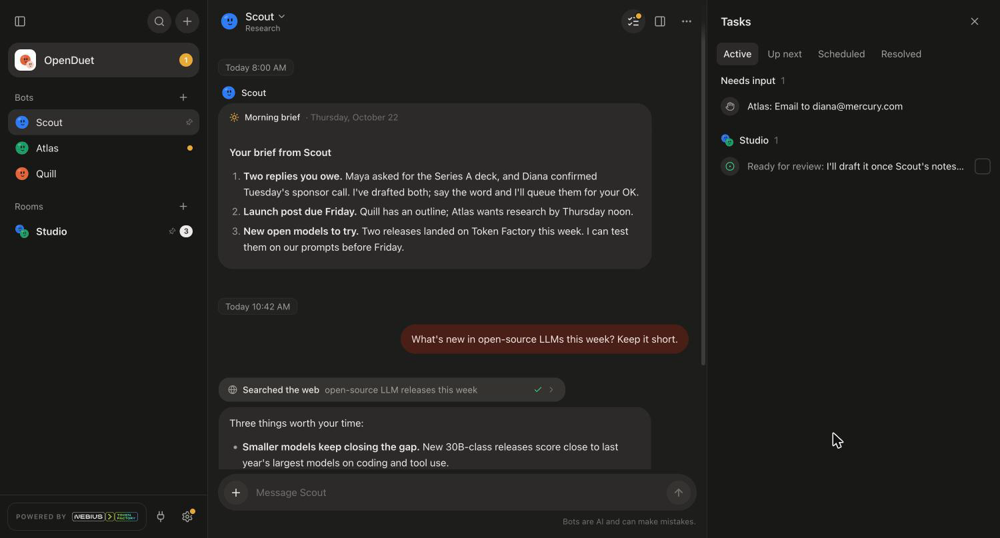
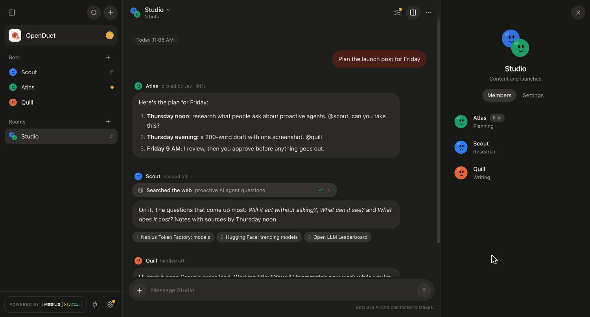
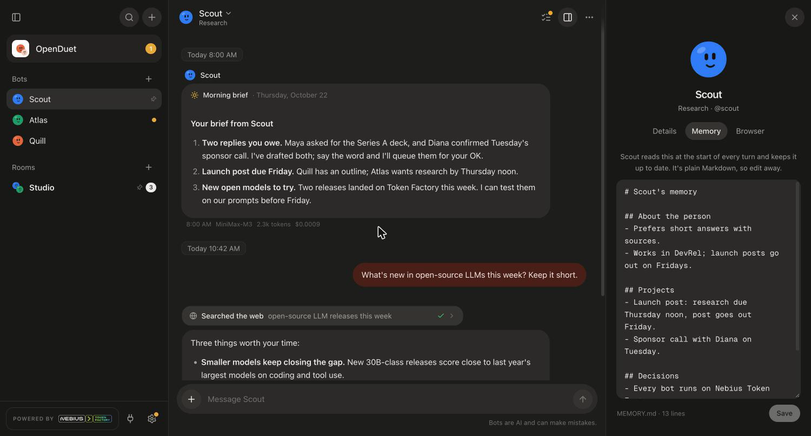
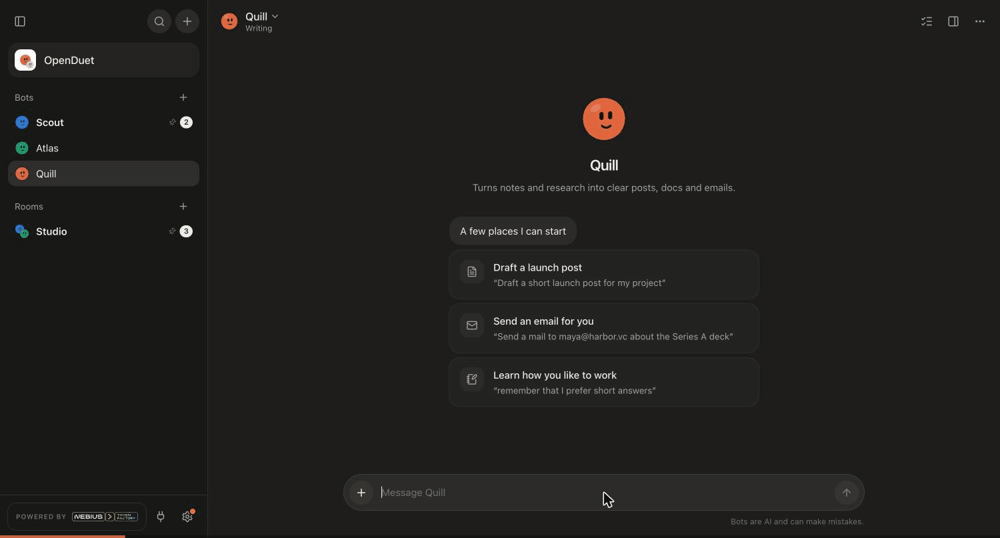
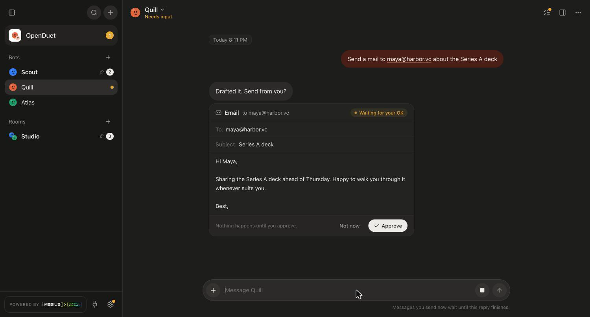
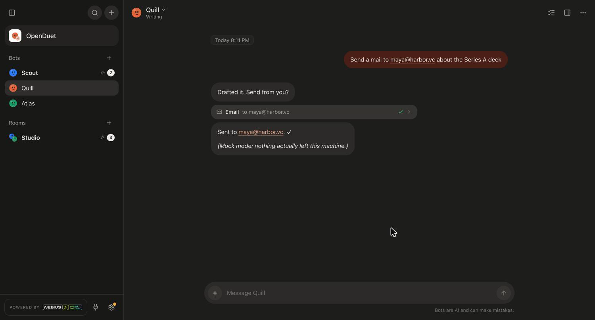
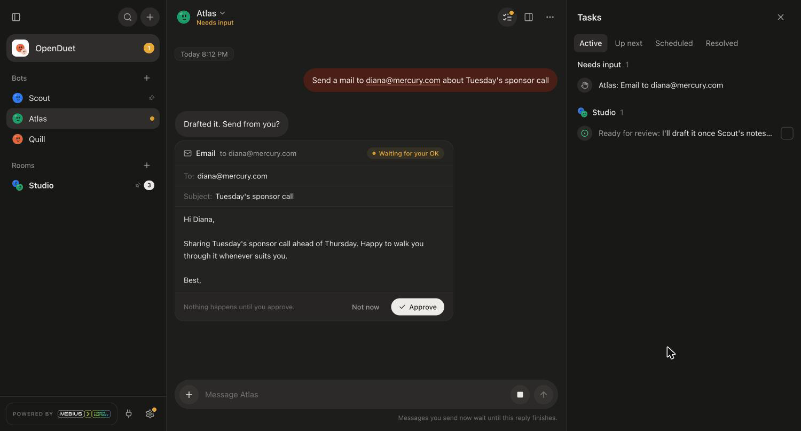
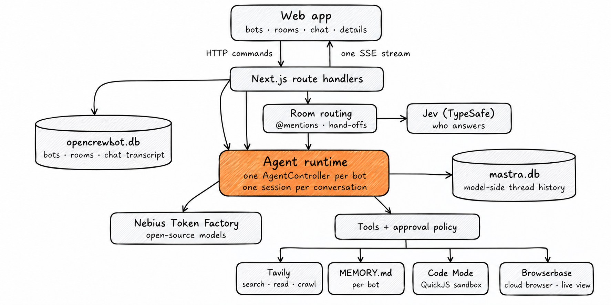

<div align="center">


# OpenDuet

### AI teammates that work while you're away, and ask before they act.

**An open-source, Duet-style proactive agent on open models. Your bots brief you every morning, check your apps, flag what needs you, and wait for your OK before they send, post or pay.**

Built with [Mastra](https://mastra.ai) and [Nebius Token Factory](https://tokenfactory.nebius.com) · [Get started](#get-started) · [Overview](#overview) · [Architecture](#architecture) · [Features](#features) · [Data and privacy](#data-and-privacy)


[](./LICENSE)
[](https://studio1hq.com)

Run OpenDuet on your own machine. Bring a Nebius Token Factory key for the models, and optionally Tavily, Browserbase and Jev keys for search, browsing and room routing. With no keys at all, it runs in mock mode so you can try the whole interface first.

</div>

---

<div align="center">

<table><tr><td>



</td></tr></table>

</div>

_A morning brief, a sourced answer and a memory save, with everything waiting on you in the Tasks pane. Staged example content; the interface is real._

## Overview

OpenDuet is inspired by [Claude Duet](https://claude.com/resources/articles/claude-duet), Anthropic's proactive agent, rebuilt in the open on open-source models. It isn't affiliated with or endorsed by Anthropic.

Every contact in the sidebar is a bot with its own persona, its own open-source model, its own tools and its own memory. Talk to one bot directly, or put several in a room and let them split the work. Turn on **While you're away** and a bot sends you a morning brief and checks your connected apps every few hours, speaking up only when something needs you. Anything that sends, posts, pays or deletes shows you the exact draft and waits for **Approve**.

**A starting point, not a hosted product.** You run the app and bring your own keys. It's early: the [Features](#features) section says what's included and what has been verified so far.

### Bots

Give each bot a name, a role, instructions, a model and a set of tools. Each reply shows its tokens and cost.

**Choose the model from the bot's Details.** **Change** opens a model sheet with three suggested picks (fastest, best all-rounder, strongest) and every model in Nebius Token Factory's live catalog, with search, context size, tool support and price. A new model applies from the bot's next reply, with no restart. Automatic routing, where Jev picks a model for each message, is coming soon.

The details panel keeps a short summary of the bot, with the full editor one click away. Changes apply from the bot's next reply.

### Rooms

Put bots in a room and talk to all of them at once. @mention a bot to choose who answers, or `@everyone`. With no mention, an **Auto** room asks [Jev](https://typesafe.ai), TypeSafe's decision model, to pick the best bot in a few hundred milliseconds. If Jev isn't sure, the room's lead answers. A bot can @mention a teammate to hand work on, up to two hops.

<div align="center">

<table><tr><td>



</td></tr></table>

</div>

_One message, three bots. Jev picks Atlas to answer, Atlas hands research to Scout and drafting to Quill. Staged example content._

### Memory

Each bot keeps its notes in one plain Markdown file, `data/workspaces/<botId>/MEMORY.md`. The first 200 lines load into the bot's prompt every turn. The bot adds and fixes lines with two small tools, `memory_add` and `memory_edit`, and you can read or edit the same file in the Memory tab, or in any editor. Anything that looks like a password, token or key is redacted before it's written.

<div align="center">

<table><tr><td>



</td></tr></table>

</div>

_The Memory tab is the file itself. The panel refreshes live when the bot writes to it._

### Ask before acting

On **Ask first**, a bot stops before it sends, posts or changes anything and shows you the draft in chat, marked **Waiting for your OK**, with every field it's about to send. **Approve** sends it; **Not now** skips it and the bot carries on. Bots can also pause to ask you a question, with suggested answers as buttons, and resume when you reply. **Full access** acts without asking.

<div align="center">

<table><tr><td>



</td></tr></table>

</div>

_Ask for an email, check the draft, approve, sent. Recorded in mock mode, where the email tool sends nothing: try `send a mail to maya@harbor.vc about the Series A deck` in any bot._

<div align="center">

<table><tr><td>

 

</td></tr></table>

</div>

### Tasks

The **Tasks** pane opens on the right, from the checklist button in a chat's header or the app's row at the top of the sidebar. It collects what needs you across every bot and room:

- **Active**: what **Needs input** (approvals and questions) first, then each chat's replies **Ready for review** (tick one off once you've read it) and anything still **Working**.
- **Up next**: the next brief or check-in each bot will run, and when.
- **Scheduled**: each bot's repeating routines.
- **Resolved**: approvals you gave or turned down, and questions you answered.

<div align="center">

<table><tr><td>



</td></tr></table>

</div>

_Staged example content._

### While you're away

A bot can work while you're away, like [Claude Duet](https://claude.com/resources/articles/claude-duet), and post what it finds in its own chat. Turn this on in the **While you're away** card in the bot's Details:

- **Morning brief.** At the time you pick, the bot goes through its connected apps and memory and writes up the few things that need you today, each with a next step. If your machine was asleep at that time, the brief still goes out within the next four hours.
- **How often to check.** Every 1 to 24 hours, the bot looks for anything new. It posts only when something needs you, as a card marked **Needs your attention**, so a check-in that finds nothing leaves no message. Check-ins pause from 10pm to 7am.
- **What you want to hear about.** Tell it in your own words.
- **Brief me now** and **Check now** run either one straight away.

Briefs and check-ins run on the server, so they keep going with the browser closed. Each bot does this work in its own thread, so quiet check-ins never crowd out your chat history, and its latest updates come along, quoted, with your next message, so you can reply "draft that answer". **Work a bot starts on its own always asks before it sends, posts, pays, signs or deletes, even with Full access.** With **Desktop notifications** on (in Settings), you hear about a brief, a check-in that found something, or a request for your OK while you're in another tab.

**Off limits, even with your approval.** In connected apps, bots can't trade securities or crypto, can't move money between accounts, and can't send card numbers or government ID numbers to any app. These calls are blocked in `src/lib/server/guardrails.ts` when they run. Composio's remote workbench is off too, since code it runs can't be checked. The rules match on action names (for example `STRIPE_CREATE_PAYOUT` or `ALPACA_CREATE_ORDER`), so read them before relying on them.

### Tools

| Tool | What it does | Powered by |
| --- | --- | --- |
| Web search | Search, read pages and crawl sites, with sources shown under the answer | [Tavily](https://tavily.com) via `@mastra/tavily` |
| Memory | Read and update the bot's own `MEMORY.md` | Local files |
| Code mode | The model writes one TypeScript function that calls several tools at once, so multi-step questions take one round trip | Mastra Code Mode, in a QuickJS (WebAssembly) sandbox |
| Browser | A real cloud browser for pages that need clicks, forms or JavaScript. Watch it live from the chat and click in to take over | [Browserbase](https://www.browserbase.com) via Mastra `AgentBrowser` |
| Ask me | Pause and ask you a question with a card in chat | Mastra `ask_user` |

### Connections

Give bots access to Slack, GitHub, Gmail, Notion and the rest of your tools. Open **Connections** from the plug icon in the sidebar:

- **Apps via [Composio](https://composio.dev).** Click **Connect**, sign in on the app's own page, and come back. Composio handles each app's sign-in and tokens, with 1,000+ apps available through search.
- **Your own MCP servers.** Add any remote MCP server by URL and token. There's a preset for GitHub's official server (`https://api.githubcopilot.com/mcp/`, with a personal access token). **Add and test** connects straight away and reports how many tools it offers.

Then switch each connection on for the bots that should have it, in the bot's Details. Lookups run on their own; anything that changes something (sending a message, opening an issue) shows an approval card first, unless the bot has full access. Tokens stay on the server.

## Architecture

### Mastra runs the bots

OpenDuet doesn't build its own agent loop. Each bot gets a Mastra [`AgentController`](https://mastra.ai/docs/harness/agent-controller), and each conversation gets its own session. Mastra handles the model calls, thread history, tool approvals and question pauses. OpenDuet folds the controller's events into chat messages and streams them to the browser over one SSE connection.



All keys stay on the server. Without a Nebius key, bots run on a scripted mock model that streams replies and calls the real tools, so every part of the interface can be tried before you connect anything.

## Get started

Use **Node.js 22.13 or newer** (developed on 24) and **pnpm**:

```sh
git clone https://github.com/nebius/token-factory-cookbook.git
cd token-factory-cookbook/agents/mastra/openduet
pnpm install
cp .env.example .env
pnpm dev
```

Open **http://localhost:3000**. On first run OpenDuet creates three bots (Scout for research, Quill for writing, Atlas for planning) and a room called Studio.

Add your keys to `.env`, then restart `pnpm dev`. Every key is optional:

| Variable | What it turns on |
| --- | --- |
| `NEBIUS_API_KEY` | Real models from [Nebius Token Factory](https://tokenfactory.nebius.com). Without it, bots use the mock model. |
| `TAVILY_API_KEY` | Web search, page reading and site crawls. |
| `BROWSERBASE_API_KEY` | Cloud browsers for bots with the Browser tool. |
| `BROWSERBASE_PROJECT_ID` | Optional. Inferred from the key when empty. |
| `BROWSERBASE_SESSION_MINUTES` | Optional cap on one browser session (default 15). |
| `COMPOSIO_API_KEY` | Connected apps (Slack, GitHub, Gmail, Notion and more) through [Composio](https://platform.composio.dev). |
| `TYPESAFE_API_KEY` | Jev routing in Auto rooms. Without it, the room's lead answers. |
| `JEV_MODEL` | Jev model id (default `jev-latest`). |
| `OPENDUET_DATA_DIR` | Where data lives (default `./data`). |
| `OPENDUET_ALLOWED_HOSTS` | Extra host names the API answers to, comma-separated. Only for deliberate setups behind your own sign-in. |

**No keys yet?** Try these in a bot's chat in mock mode:

- `remember that I like short answers` calls the memory tool and writes to `MEMORY.md`.
- `ask me something` shows a question card and resumes when you answer.
- `open https://example.com` shows an approval card first, in a bot with the Browser tool on.
- `send a mail to maya@harbor.vc about the Series A deck` drafts an email and waits for **Approve**. In mock mode the email tool sends nothing.
- **Brief me now** in a bot's Details posts a scripted brief.
- `search for Nebius Token Factory` runs a real Tavily search once `TAVILY_API_KEY` is set.

## Data and privacy

Bots, rooms and the chat transcript are stored in SQLite at `data/openduet.db`. Mastra keeps each bot's model-side thread history in `data/mastra.db`. Each bot's memory is `data/workspaces/<botId>/MEMORY.md`. Nothing leaves your machine except calls to the services you configure:

- **Nebius Token Factory** receives each bot's system prompt (including its `MEMORY.md`), the conversation, and tool results.
- **Tavily** receives search queries and the URLs a bot reads or crawls.
- **Browserbase** runs the cloud browser, so it sees the pages a bot visits and anything typed into them. Sessions are released when a bot is reset or deleted, and expire after `BROWSERBASE_SESSION_MINUTES`.
- **Briefs and check-ins** send the same things to Nebius Token Factory and your connected apps as a chat turn does, on the schedule you set, whether or not the app is open.
- **Jev** receives the room name, member names and descriptions, the last few room messages and the new message, when an Auto room has no @mention.
- **Composio** holds the sign-ins for apps you connect, and receives the actions a bot runs in them.
- **Your MCP servers** receive the tool calls a bot makes to them. Their URLs and tokens are stored in `data/openduet.db`.

OpenDuet sends no telemetry of its own. Review the privacy policy and retention settings of each service you connect.

It assumes one local owner and has no sign-in. To keep it that way, `pnpm dev` and `pnpm start` listen on `127.0.0.1` only, and the API refuses requests from other websites and requests addressed to any host but `localhost`. Don't expose it to the internet as-is.

## Features

| Area | Included |
| --- | --- |
| Bots | Name, role, instructions, color, model, tools and approval level per bot; pin, search, unread counts, live typing status |
| Models | Model sheet with suggested picks, search and the live Token Factory catalog; switch without a restart; tokens and cost on every reply |
| Connections | Composio apps with one-click sign-in, your own MCP servers (GitHub preset), per-bot access, approval for actions |
| Chat | Streaming Markdown, reasoning, tool steps with sources, Stop, and messages queued while a bot is busy |
| Rooms | @mentions, `@everyone`, Auto routing with Jev, Lead and Everyone modes, bot-to-bot hand-offs |
| Memory | One `MEMORY.md` per bot, loaded every turn, editable in the app, with secret redaction |
| Approvals | Draft cards marked Waiting for your OK that show every field an action will send, and ask-you question cards that resume the run |
| Tasks | Needs input, Ready for review and Working across every chat, plus Up next for scheduled briefs and check-ins |
| Appearance | Follows the system by default, with a warm light and a warm dark theme; pick one in Settings |
| While you're away | Morning brief and quiet check-ins per bot, scheduled on the server, run-now buttons, desktop notifications, actions that stay blocked even with approval |
| Browser | Browserbase session per bot, embedded live view with takeover, release on reset |
| Code mode | Multi-tool TypeScript in a QuickJS sandbox with no filesystem or network access |
| Mock mode | A scripted model that exercises the real tools, approvals and streaming without any keys |

**What's been verified.** On October 13 and 14, 2026, these were tested locally with the mock model: streaming, tool calls, memory writes, approvals (Allow, Deny, and Stop while waiting), question cards, room @mentions and hand-offs, restart recovery, and the production build. The Browserbase path was tested by driving a local Chrome over the same CDP connection. MCP servers were tested against DeepWiki's public server (add, test, and loading its tools into a bot). The live model list comes from Token Factory, and Mastra's router was checked to accept every model on it. **Still to verify with live services:** Composio sign-in and app actions, Browserbase sessions, Jev routing, and how reliably each open model calls tools.

### Extending it

- Let bots delegate to each other in direct chats with Mastra subagents.
- Let Jev pick the model for each message (fast for simple asks, strong for hard ones). It's shown as "coming soon" in the model sheet.
- Let you talk to bots from Slack or Discord with Mastra Channels.
- Add sign-in and multiple users before deploying it anywhere shared.
- Add voice: speak to a bot and have it read replies aloud.

## Project layout

- `src/lib/server/runtime.ts`: the harness glue. One `AgentController` per bot, one session per conversation, events folded into chat messages.
- `src/lib/server/tools.ts`: which tools a bot gets, their approval categories, and how each looks in chat.
- `src/lib/server/rooms.ts` and `jev.ts`: room routing, catch-up context and hand-offs.
- `src/lib/server/memory-files.ts`: `MEMORY.md` reads, writes, edits and redaction.
- `src/lib/server/browserbase.ts`: creates, announces and releases each bot's Browserbase session.
- `src/lib/server/proactive.ts` and `src/instrumentation.ts`: the brief and check-in schedule, started once when the server starts.
- `src/lib/server/guardrails.ts`: app actions that stay blocked even with approval.
- `src/lib/server/mock-model.ts`: the scripted model used without a Nebius key.
- `src/components/`: the chat interface. `src/lib/client/store.ts` folds server events into state.

## Cookbook maintenance

The cookbook copy updates affected transitive dependencies, uses the standard Tailwind PostCSS integration, and adds credential-free dependency compatibility checks:

```sh
pnpm test
pnpm typecheck
pnpm lint
pnpm build
pnpm audit --prod
```

The pinned `agent-browser` patch adapts its protocol validation to Zod 4 and keeps the browser-manager exports used by Mastra. OpenDuet connects to Browserbase over CDP; unused iOS simulator and standalone CLI exports and their mobile-driver dependencies are excluded from this application's dependency tree. The patch and overrides are recorded in `pnpm-workspace.yaml`, matching [OpenCrewBot](../opencrewbot/). Refresh them together when updating the browser adapter.

## Contributing

This is a copy of [Studio1-OSS/OpenDuet](https://github.com/Studio1-OSS/OpenDuet) for the Token Factory cookbook. Development happens there; issues and pull requests are welcome in that repo. Describe the workflow a change enables, run `pnpm exec tsc --noEmit` and `pnpm lint`, and say whether you tested it against live services or the mock model.

## License

[MIT](LICENSE) © 2026 Studio1HQ
