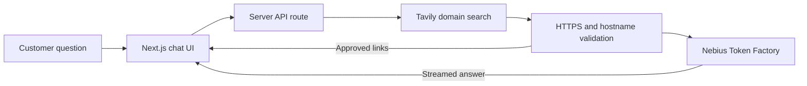

[Cookbook](../README.md) / Applications and demos

# Applications and demos

Explore complete applications built with Nebius Token Factory. Follow the linked project for its runtime, required keys, and deployment instructions.

| Application | Workflow | Source |
| --- | --- | --- |
| [Splitter Lite](splitter-lite/) | Read receipts and split bills with vision and calculator tools | Included in this repository |
| [Cutaway](cutaway/) | Explore any machine as a 3D teardown with diagrams, steps and a quiz | Included in this repository |
| [WhatLLM](https://www.whatllm.org/) | Compare model responses | Hosted application |
| [Allycat](https://github.com/The-AI-Alliance/allycat) | Search and chat over website content | External repository |
| [Customer Support AI](https://github.com/amrrs/customer-support-ai) | Answer support questions with domain-restricted web retrieval | External repository |
| [Codetrail](codetrail/) | Architecture maps, code tours and checked answers for any GitHub repo | Included in this repository |

For agent applications, see [OpenCrewBot](../agents/mastra/opencrewbot/) and [KubeTrace AI](../agents/kubetrace-ai/). For environment help, see [setup](../start-here/setup.md).

## WhatLLM

A model comparison tool.

[whatllm.org](https://www.whatllm.org/)

Built by Dylan Bristot: [demianarc](https://github.com/demianarc)  · [demian_ai](https://twitter.com/demian_ai)

| 
|-

---

## Allycat

[Allycat](https://github.com/The-AI-Alliance/allycat) can scrape a website, index its contents and allow chatting with the website content using LLMs running on Nebius Token Factory or locally.

Author: [sujee](https://github.com/sujee) | [sujee.dev](https://sujee.dev/) 

| 
|-

---

## Customer Support AI

[Customer Support AI](https://github.com/amrrs/customer-support-ai) is an
enterprise-style Next.js demo for building a conversational support assistant
with Nebius Token Factory and Tavily. It streams Markdown responses, supports
same-session follow-up questions, and restricts retrieval to a domain selected
by the user.

The server validates every retrieved URL before its excerpt can enter model
context, and the interface hyperlinks answers only to those approved sources.
The demo can be run locally or deployed to Vercel or Render.

Built by [Amrrs](https://github.com/amrrs).

---

## Codetrail

[Codetrail](codetrail/) is a Next.js app for reading code. Paste a GitHub link,
and Moonshot AI's Kimi K3.1 Pro on Nebius Token Factory reads the whole repo in
one prompt with its 1M-token context window. It returns an architecture map,
code tours and answers, and the app checks every quoted line against the code.
Follow-up calls reuse the same repo prefix, so it can be billed as cached input.

| 
|-

Built by [Amitesh Anand](https://github.com/Astrodevil).

---

## Splitter Lite

[Splitter Lite](splitter-lite/) is a Next.js bill-splitting app. Upload one
or two bills, say who had what in plain English, and NVIDIA Nemotron 3.5 Super
VL on Nebius Token Factory reads every line into structured JSON, then works
out each share by calling calculator tools. The app re-checks the model's
shares and flags any split that doesn't add up.

| 
|-

Built by [Amitesh Anand](https://github.com/Astrodevil).

---

## Cutaway

[Cutaway](cutaway/) is a Next.js app for seeing inside machines. Show it a
photo or type a name, and Moonshot AI's Kimi K3.1 Pro on Nebius Token Factory
designs every part inside as three.js code, with flows, SVG diagrams, a guided
teardown and a quiz. The app builds each part in a sandbox and lets Kimi review
renders of its own model.

| 
|-

Built by [Amitesh Anand](https://github.com/Astrodevil).

---
