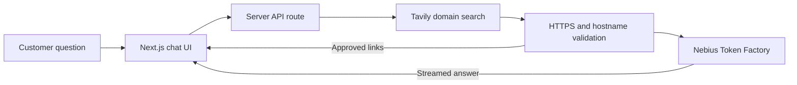

[Cookbook](../README.md) / Applications and demos

# Applications and demos

Explore complete applications built with Nebius Token Factory. Follow the linked project for its runtime, required keys, and deployment instructions.

| Application | Workflow | Source |
| --- | --- | --- |
| [Splitter Lite](splitter-lite/) | Read receipts and split bills with vision and calculator tools | Included in this repository |
| [Paper to interactive explainer](paper-to-interactive-explainer/) | Turn a research paper into a self-tested, interactive HTML explainer | Included in this repository |
| [Napkin to 3D print](napkin-to-3d-print/) | Turn a hand-drawn sketch into a parametric CadQuery model and a printable STL | Included in this repository |
| [WhatLLM](https://www.whatllm.org/) | Compare model responses | Hosted application |
| [Allycat](https://github.com/The-AI-Alliance/allycat) | Search and chat over website content | External repository |
| [Customer Support AI](https://github.com/amrrs/customer-support-ai) | Answer support questions with domain-restricted web retrieval | External repository |

For agent applications, see [OpenCrewBot](../agents/mastra/opencrewbot/) and [KubeTrace AI](../agents/kubetrace-ai/). For environment help, see [setup](../start-here/setup.md).

## WhatLLM

A model comparison tool.

[whatllm.org](https://www.whatllm.org/)

Built by Dylan Bristot: [demianarc](https://github.com/demianarc)  · [demian_ai](https://twitter.com/demian_ai)

| 
|-

---

## Allycat

[Allycat](https://github.com/The-AI-Alliance/allycat) can scrape a website, index its contents and allow chatting with the website content using LLMs running on Nebius Token Factory or locally.

Author: [sujee](https://github.com/sujee) | [sujee.dev](https://sujee.dev/) 

| 
|-

---

## Customer Support AI

[Customer Support AI](https://github.com/amrrs/customer-support-ai) is an
enterprise-style Next.js demo for building a conversational support assistant
with Nebius Token Factory and Tavily. It streams Markdown responses, supports
same-session follow-up questions, and restricts retrieval to a domain selected
by the user.

The server validates every retrieved URL before its excerpt can enter model
context, and the interface hyperlinks answers only to those approved sources.
The demo can be run locally or deployed to Vercel or Render.

Built by [Amrrs](https://github.com/amrrs).

---

## Splitter Lite

[Splitter Lite](splitter-lite/) is a Next.js bill-splitting app. Upload one
or two bills, say who had what in plain English, and NVIDIA Nemotron 3.5 Super
VL on Nebius Token Factory reads every line into structured JSON, then works
out each share by calling calculator tools. The app re-checks the model's
shares and flags any split that doesn't add up.

| 
|-

Built by [Amitesh Anand](https://github.com/Astrodevil).

---

## Paper to interactive explainer

[Paper to interactive explainer](paper-to-interactive-explainer/) is a
Streamlit app. Paste an arXiv link or upload a PDF, and Kimi K3.1 Pro on
Nebius Token Factory reads the whole paper, figure pages included, plans a
lesson, and writes a single-file HTML explainer with one interactive widget per
idea. A headless Chrome self-test feeds JavaScript errors back to Kimi, which
fixes them with SEARCH/REPLACE patches.

| 
|-

Built by [Arindam Majumder](https://github.com/Arindam200).

---

## Napkin to 3D print

[Napkin to 3D print](napkin-to-3d-print/) is a Streamlit app. Upload a photo
of a hand-drawn part, and Kimi K3.1 Pro on Nebius Token Factory writes a
parametric CadQuery model, builds it in a guarded subprocess, compares a
four-view render with your sketch, and revises it. You get sliders for every
dimension and STL, STEP and Python downloads.

| 
|-

Built by [Arindam Majumder](https://github.com/Arindam200).

---
