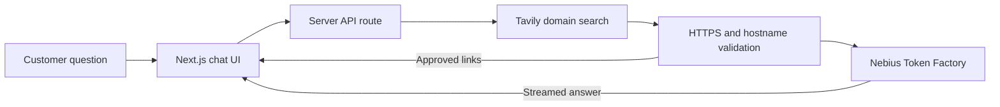
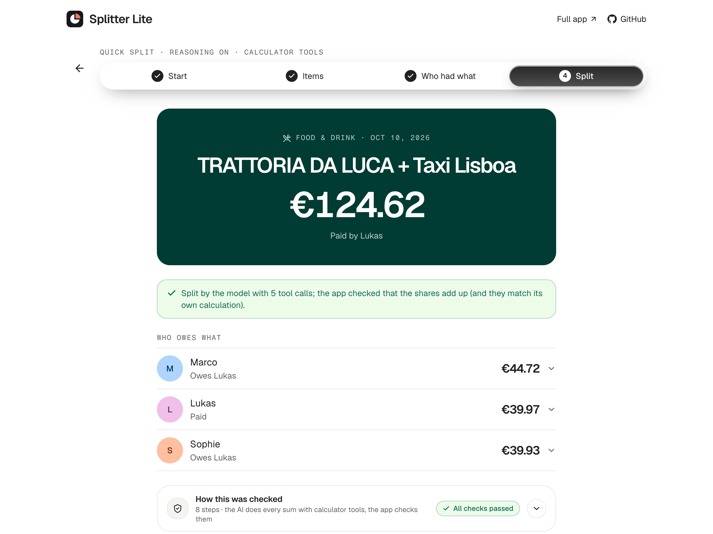
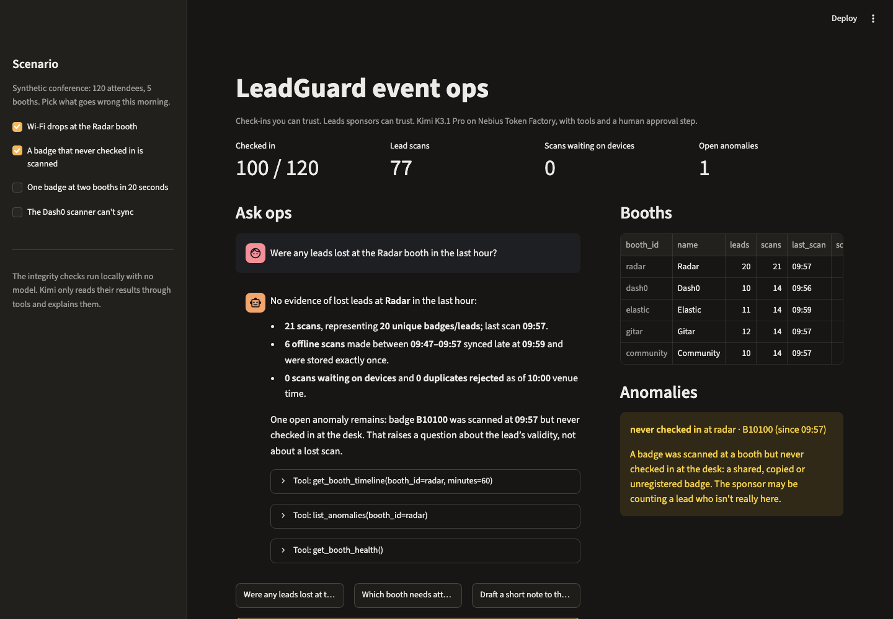
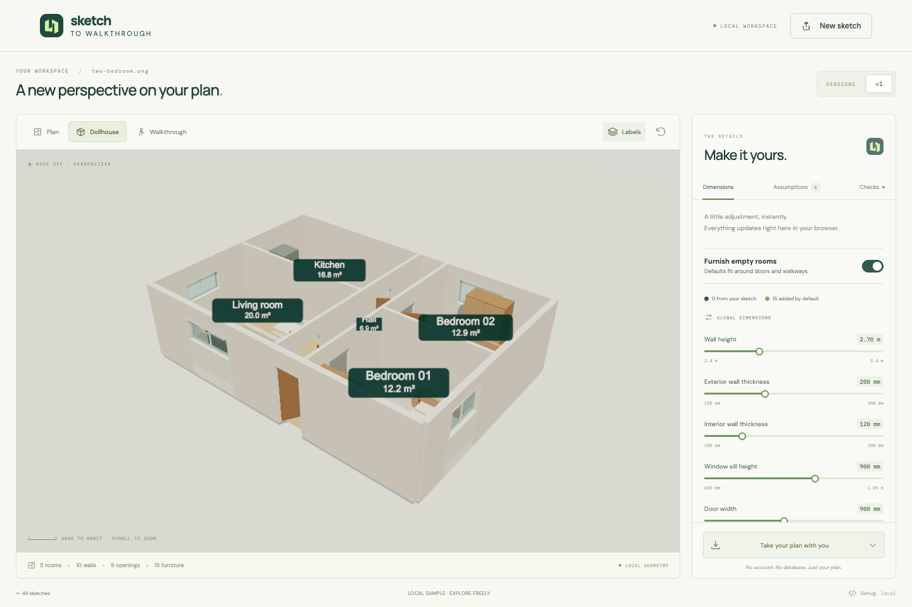
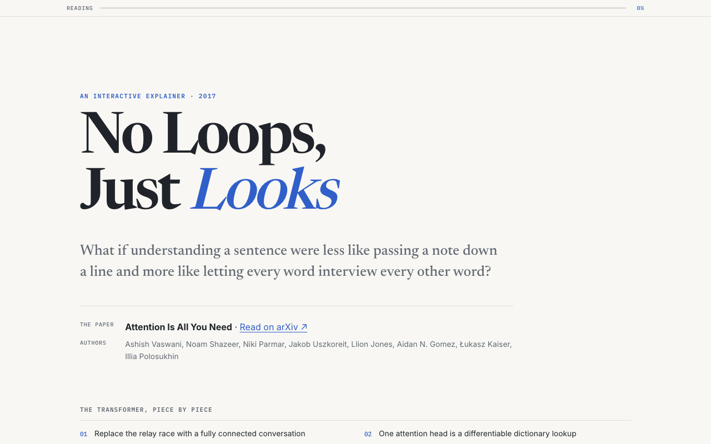
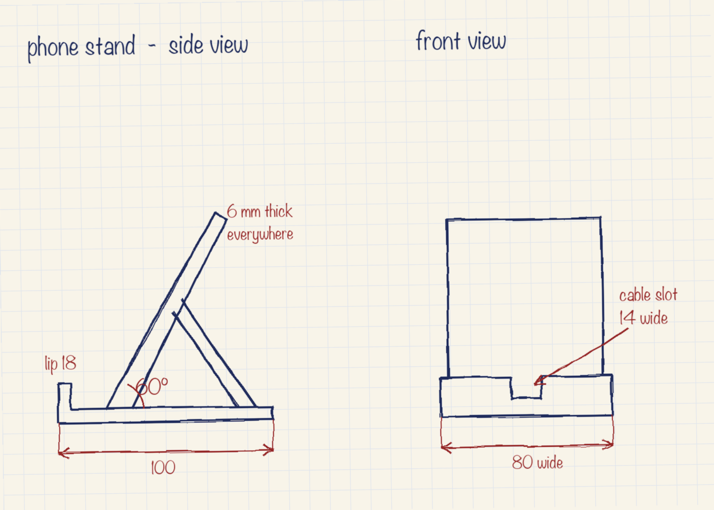
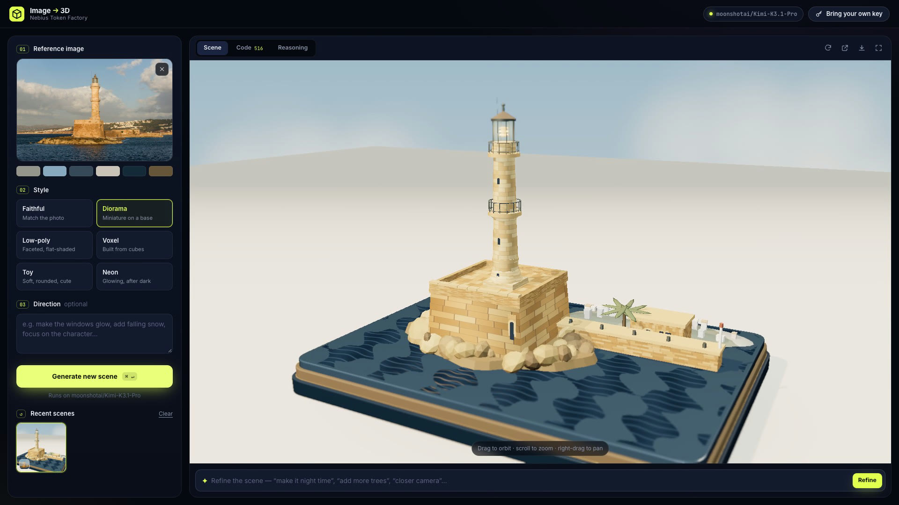
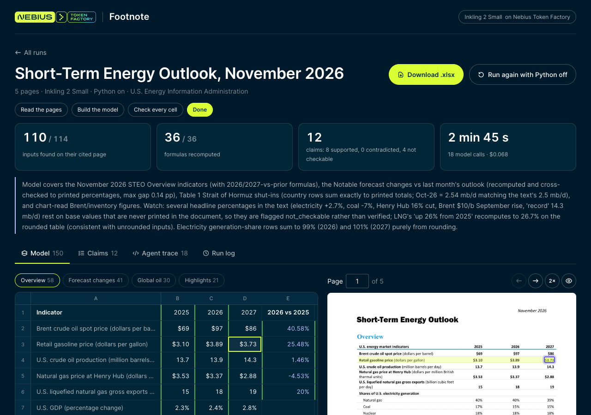

[Cookbook](../README.md) / Applications and demos

# Applications and demos

Explore complete applications and interactive coding examples for Nebius Token Factory. Each recipe states whether it makes runtime model calls. Follow the linked project for its runtime, required keys, and deployment instructions.

| Application | Workflow | Source |
| --- | --- | --- |
| [Codetrail](codetrail/) | Repository architecture, source-checked code tours and Q&A; includes a curated preview | Included in this repository |
| [Cutaway](cutaway/) | Generate and explore machine internals with Kimi; includes a static showcase | Included in this repository |
| [Explode Anything](explode-anything/) | Inspect a procedural camera assembly; no runtime inference | Included with adaptation permission |
| [Splitter Lite](splitter-lite/) | Read receipts and split bills with vision and calculator tools | Included in this repository |
| [Sketch to Walkthrough](sketch-to-walkthrough/) | Turn a hand-drawn floor plan into a checked, walkable 3D model | Included in this repository |
| [Paper to interactive explainer](paper-to-interactive-explainer/) | Turn a research paper into a self-tested, interactive HTML explainer | Included in this repository |
| [Napkin to 3D print](napkin-to-3d-print/) | Turn a hand-drawn sketch into a parametric CadQuery model and a printable STL | Included in this repository |
| [LeadGuard event ops](leadguard-event-ops/) | Ask Kimi what happened at conference booths; tool calls over check-in and lead-scan evidence, with approval for sponsor messages | Included in this repository |
| [Image to 3D](image-to-3d/) | Turn a photo into an interactive Three.js scene with Kimi, then refine it in plain language | Included in this repository |
| [Footnote](footnote/) | Turn a report PDF into a spreadsheet model where every number links to its page, then check the report's claims | Included in this repository |
| [WhatLLM](https://www.whatllm.org/) | Compare model responses | Hosted application |
| [Allycat](https://github.com/The-AI-Alliance/allycat) | Search and chat over website content | External repository |
| [Customer Support AI](https://github.com/amrrs/customer-support-ai) | Answer support questions with domain-restricted web retrieval | External repository |

For agent applications, see [OpenCrewBot](../agents/mastra/opencrewbot/) and [KubeTrace AI](../agents/kubetrace-ai/). For environment help, see [setup](../start-here/setup.md).

## WhatLLM

A model comparison tool.

[whatllm.org](https://www.whatllm.org/)

Built by Dylan Bristot: [demianarc](https://github.com/demianarc)  · [demian_ai](https://twitter.com/demian_ai)

| 
|-

---

## Allycat

[Allycat](https://github.com/The-AI-Alliance/allycat) can scrape a website, index its contents and allow chatting with the website content using LLMs running on Nebius Token Factory or locally.

Author: [sujee](https://github.com/sujee) | [sujee.dev](https://sujee.dev/) 

| 
|-

---

## Customer Support AI

[Customer Support AI](https://github.com/amrrs/customer-support-ai) is an
enterprise-style Next.js demo for building a conversational support assistant
with Nebius Token Factory and Tavily. It streams Markdown responses, supports
same-session follow-up questions, and restricts retrieval to a domain selected
by the user.

The server validates every retrieved URL before its excerpt can enter model
context, and the interface hyperlinks answers only to those approved sources.
The demo can be run locally or deployed to Vercel or Render.

Built by [Amrrs](https://github.com/amrrs).

---

## Splitter Lite

[Splitter Lite](splitter-lite/) is a Next.js bill-splitting app. Upload one
or two bills, say who had what in plain English, and NVIDIA Nemotron 3.5 Super
VL on Nebius Token Factory reads every line into structured JSON, then works
out each share by calling calculator tools. The app re-checks the model's
shares and flags any split that doesn't add up.

| 
|-

Built by [Amitesh Anand](https://github.com/Astrodevil).

---

## LeadGuard event ops

[LeadGuard event ops](leadguard-event-ops/) answers an organizer's questions about a
conference, such as "Were any leads lost at the Radar booth?". Kimi K3.1 Pro on Token Factory
gathers evidence through five tools: check-in stats, booth health, a booth's timeline including
scans made offline, and integrity anomalies. It answers with counts, times and badge ids. It can
also draft a message to a sponsor, which waits for an organizer to approve it. The integrity checks
run without a model, and the tools never return names or emails.

| 
|-

Built by [Shivay Lamba](https://github.com/shivaylamba).

---

## Sketch to Walkthrough

[Sketch to Walkthrough](sketch-to-walkthrough/) is a Vite, React and Three.js
app. Upload a photo of a hand-drawn floor plan, and Kimi K3.1 Pro on Nebius
Token Factory reads every written dimension and writes a layout generator. The
app runs it in a sandbox, checks it with deterministic engineering checks,
shows Kimi its own render to review, and opens a plan, dollhouse and
first-person walkthrough with a slider for every dimension.

| 
|-

Built by [Shivay Lamba](https://github.com/shivaylamba).

---

## Paper to interactive explainer

[Paper to interactive explainer](paper-to-interactive-explainer/) is a
Streamlit app. Paste an arXiv link or upload a PDF, and Kimi K3.1 Pro on
Nebius Token Factory reads the whole paper, figure pages included, plans a
lesson, and writes a single-file HTML explainer with one interactive widget per
idea. A headless Chrome self-test feeds JavaScript errors back to Kimi, which
fixes them with SEARCH/REPLACE patches.

| 
|-

Built by [Arindam Majumder](https://github.com/Arindam200).

---

## Napkin to 3D print

[Napkin to 3D print](napkin-to-3d-print/) is a Streamlit app. Upload a photo
of a hand-drawn part, and Kimi K3.1 Pro on Nebius Token Factory writes a
parametric CadQuery model, builds it in a guarded subprocess, compares a
four-view render with your sketch, and revises it. You get sliders for every
dimension and STL, STEP and Python downloads.

| 
|-

Built by [Arindam Majumder](https://github.com/Arindam200).

---

## Image to 3D

[Image to 3D](image-to-3d/) is a zero-dependency Node.js app. Drop in a photo,
pick a style, and Kimi K3.1 Pro on Nebius Token Factory writes a real-time
Three.js scene you can orbit, refine with plain-language instructions and
download as a single HTML file. Generated scenes run in a sandboxed iframe, and
users can bring their own key.

| 
|-

Built by [Amrrs](https://github.com/amrrs).

---

## Footnote

[Footnote](footnote/) is a Next.js app. Drop in a report PDF, a scanned
document or two reports to compare, and Inkling 2 Small on Nebius Token Factory
reads the pages, writes a spreadsheet model with live formulas and a source for
every number, and checks the report's own claims with sandboxed Python. The app
then verifies every number against the PDF text and recomputes every formula
without the model, and stores runs in a local SQLite file you can search.

| 
|-

Built by [Amitesh Anand](https://github.com/Astrodevil).

---
