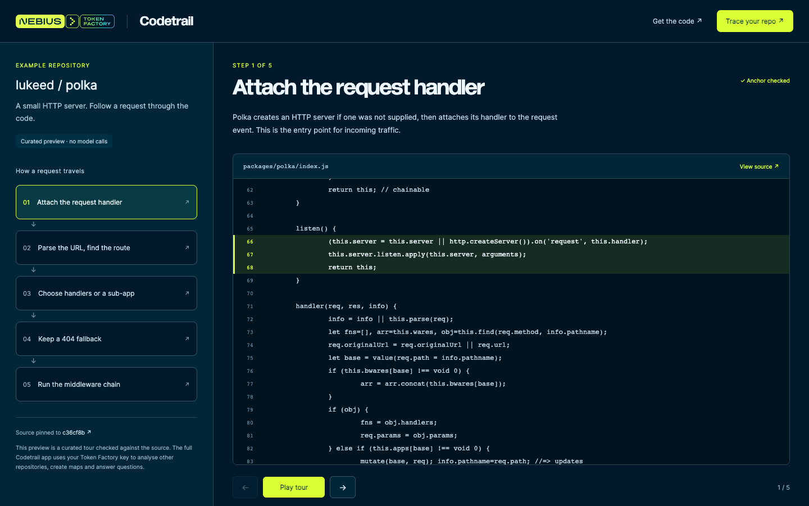

[Cookbook](../../README.md) / [Applications](../README.md) / Codetrail

# Turn a repository into a code tour

Codetrail reads repository source with an open model on Nebius Token Factory and produces architecture maps, documentation, guided tours and answers with references checked against the code. This recipe includes the full application and a key-free, curated sample tour.



## What you will build

The full Next.js application supports GitHub repositories, pull requests and local folders. A server stores source snapshots and generated artifacts in SQLite. The static companion lets visitors follow five stages of Polka's HTTP request lifecycle, with anchors checked against a pinned source revision.

The static sample is curated; it does not run a model, analyse new repositories or represent a fresh Kimi output.

## Requirements

- Node.js 22.15+ and pnpm 11 for the full app.
- A Token Factory project, API key, model access and billing for new analysis. These requests spend your project's balance and send the selected code to the configured model endpoint.
- Python 3 only if using the simple static preview command below.
- Optional GitHub token for higher API limits or access to selected private repositories. Keep it server-side.

## Setup

From this directory:

```bash
pnpm install --frozen-lockfile
```

To explore the sample without credentials:

```bash
pnpm showcase:build
python3 -m http.server 5177 --bind 127.0.0.1 --directory showcase-dist
# Open http://127.0.0.1:5177
```

To run model-backed analysis:

```bash
cp .env.example .env
# Set NEBIUS_API_KEY in .env.
# For Kimi, also set NEBIUS_MODEL=moonshotai/Kimi-K3.1-Pro.
pnpm dev
# Open http://localhost:3000
```

The upstream default model is `deepseek-ai/DeepSeek-V4.1-Flash-1017`. Choose the exact model available in your Token Factory project. The default API endpoint is `https://api.tokenfactory.us-north1.nebius.com/v1/`; `NEBIUS_BASE_URL` can override it. See the [Kimi quickstart](../../models/kimi-k3.1-pro.md).

## Run

In the static sample, select a flow step or use the previous/next buttons. The source panel highlights the matching lines. **Play tour** advances the five steps. **View source** opens the exact upstream commit and line.

In the full app, paste a public repository URL such as `https://github.com/lukeed/polka`, review the source scope and estimated cost, then start the read. New model-backed analysis requires the configured key. See the [application guide](UPSTREAM.md) for Q&A, docs, PR tours, exports and MCP integration.

## Validate

```bash
pnpm typecheck
pnpm test
pnpm lint:dead
pnpm build
pnpm showcase:build
pnpm audit --prod
# Optional browser checks, with a Chromium installation:
pnpm exec playwright-core install chromium
pnpm showcase:test
```

The browser check defaults to `http://127.0.0.1:5177`; `BASE_URL` and `CHROME_PATH` can override the URL and browser binary.

On 5 November 2026, 135 unit tests, TypeScript, dead-code checks, the full Webpack production build and static build passed. Browser checks exercised all five source anchors, navigation, playback, credits, the 390px mobile layout and zero external requests. No new live inference was run. The production audit reports one moderate transitive esbuild development-server advisory; the static preview has no esbuild server.

## Deployment and cleanup

Serve `showcase-dist/` on a static host for the sample. The full application needs a Node server and persistent SQLite storage. Its default `AUTH_MODE=none` is intended for self-hosting: configure authentication and spend limits before exposing model-backed actions publicly.

Code-reference checks establish that the quoted source exists; they do not prove that an explanation is correct. Review generated documentation. Recorded upstream costs are examples, not current prices or guarantees.

Stop the local server with Ctrl+C. Local state is stored in `codetrail.db` and related SQLite files unless `DATABASE_URL` is overridden. Remove those only when you no longer need the stored source and results; keep private repository snapshots out of published artifacts.

## Source and license

Original build: [Studio1HQ](https://studio1hq.com), [Codetrail](https://github.com/Studio1-OSS/Codetrail), revision `6ee13736c7e6636e65d9ef2a4741c0323965af5a`.

[TF edition](https://github.com/demianarc/token-factory-codetrail), revision `b7bcdcb`, adds official branding, self-hosted fonts, visible attribution, a patched Next.js version and the curated sample. The original [MIT license](LICENSE) is retained. The Polka source is pinned to `c36cf8b5d1a57164e64fdd7d4e0d0f80ab262dc0` and retains [Luke Edwards' MIT notice](showcase/POLKA-LICENSE.txt). Nebius brand assets are not covered by a general grant to reuse the brand.
