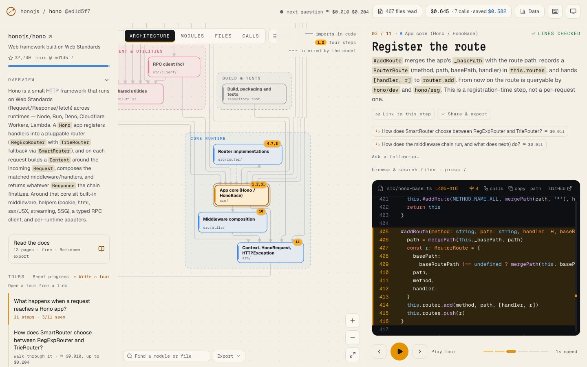
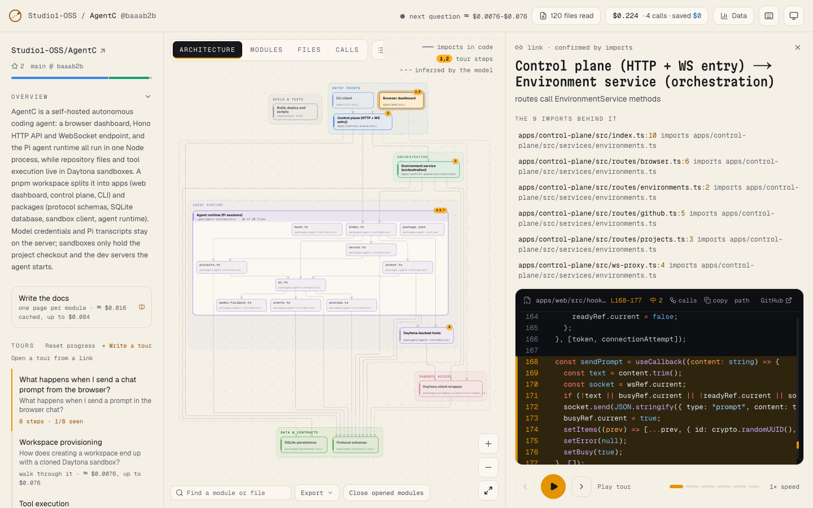
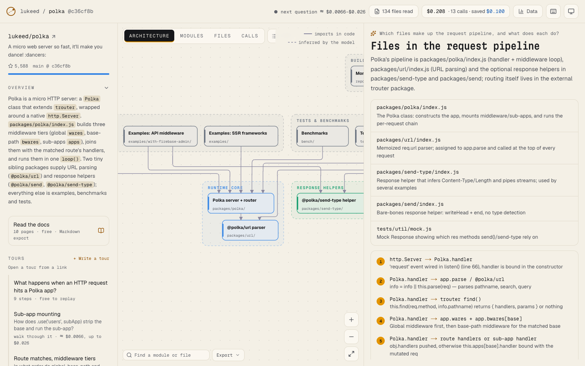
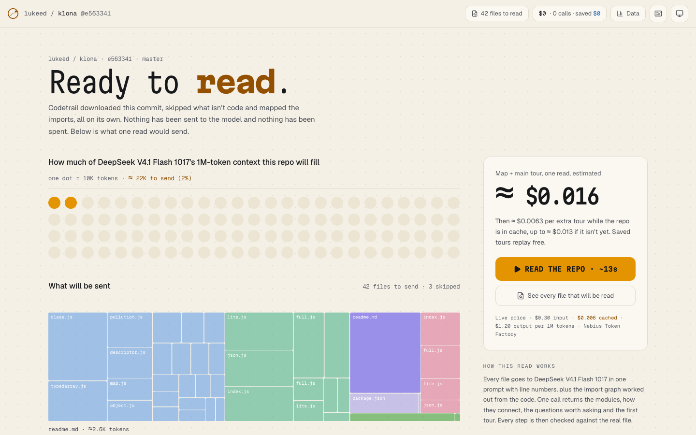
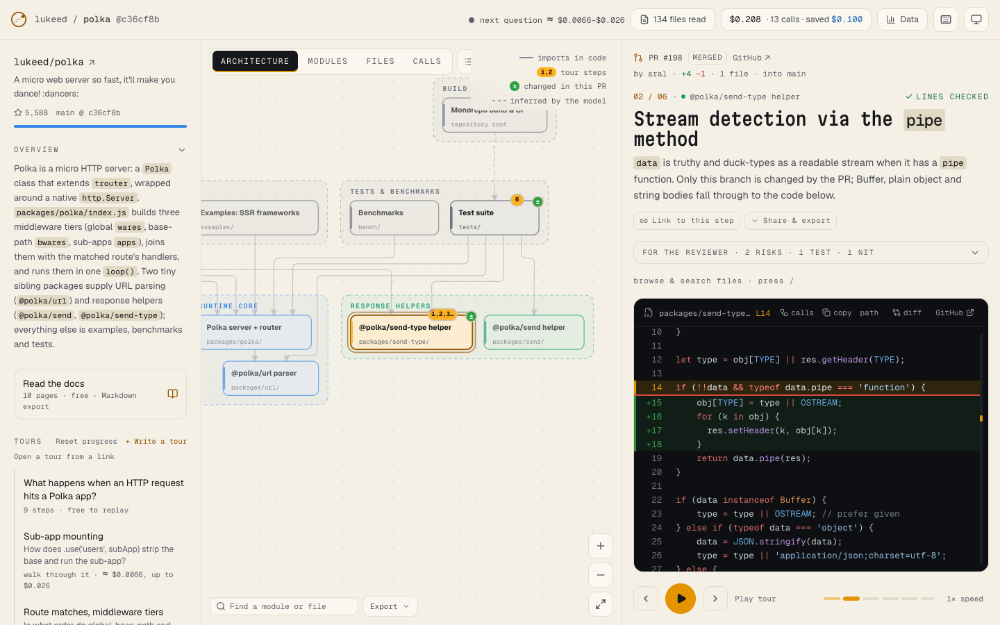
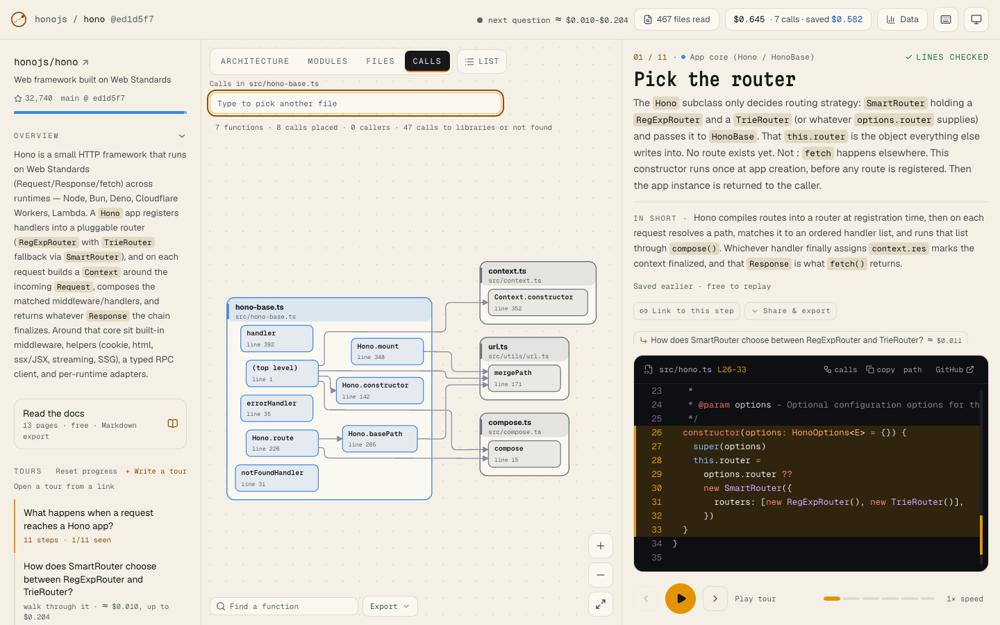
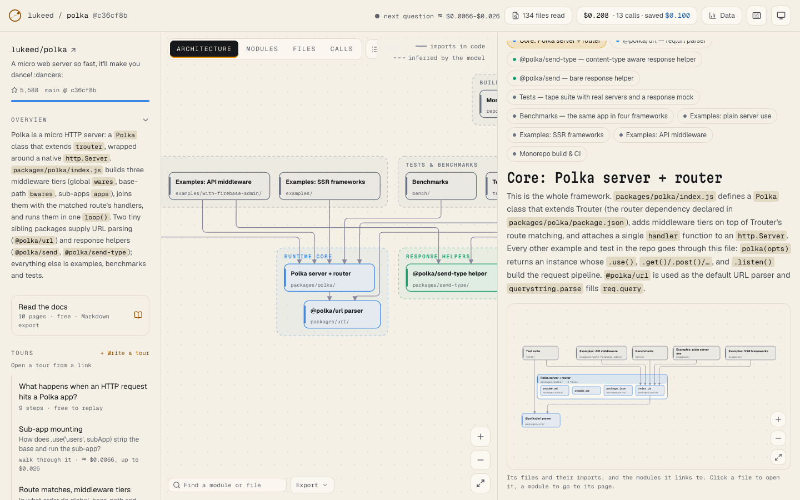
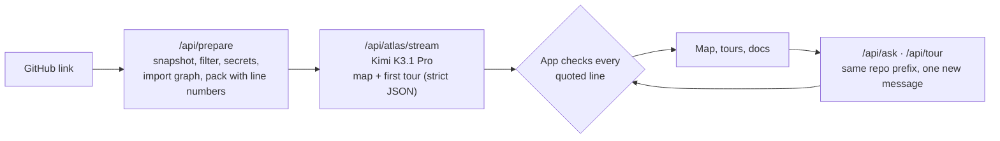

# Codetrail: read a whole GitHub repo in one prompt with Kimi K3.1 Pro

Paste a GitHub link and get an architecture diagram, code tours, docs for every module, and answers to your questions, with every quoted line checked against the code.

**Moonshot AI's Kimi K3.1 Pro** on [Nebius Token Factory](https://tokenfactory.nebius.com) has a **1M-token context window**, so Codetrail sends the whole repo in one prompt instead of searching it in pieces: every file, whole, with line numbers. There's no vector database, embeddings or indexing step. Every later call reuses the same repo prefix, so Token Factory can bill it as cached input.



## What you'll build

A Next.js app that reads a repo once and keeps everything in a local SQLite file:

1. **Prepare.** The app downloads one snapshot of the repo, drops vendored and generated files, scans for secrets, builds the import graph, and packs every file with line numbers into one prompt. You see how much of the context the repo fills, and what the read will cost, before anything is sent.
2. **Read.** One streamed call returns the architecture map (modules, layers and how they connect) and a first code tour. Each tour step quotes a real line, and the app finds that line in the file at that commit before showing the step.
3. **Ask and explore.** More tours, questions with follow-ups, pull-request tours and module docs all send the same repo prefix plus one new message, and every answer's code references are checked the same way.

- **An architecture diagram** in layers: open a module into its files, see the imports behind a link, export it as Mermaid, SVG, PNG or draw.io.
- **Code tours,** generated or written by you, and **pull-request tours** that walk through a change in the order it runs.
- **Docs for every module,** with a diagram per page, as Markdown or as slides.
- **Function calls** for JS/TS, Python and Go, worked out from the code.
- **A receipt for every call,** with the price shown before you click.
- **Your own code:** private repos with a GitHub token, and local folders when self-hosted.
- **An MCP server** at `/api/mcp`, so a coding agent can use the same reads.

| A module opened into its files | An answer with checked references | What a read will send and cost |
| --- | --- | --- |
|  |  |  |

| A pull-request tour | Function calls | Docs with a diagram on every page |
| --- | --- | --- |
|  |  |  |

## How it works



The model writes the map, tours and answers. Code does the rest: downloading and filtering, secret scanning, the import graph, line numbers, token estimates, checking every step against the real file, pricing and storage. Generated maps, tours and answers are stored, so opening a repo again makes no new calls.

## Setup

Requirements: Node.js 22.13 or newer, pnpm, and a [Nebius Token Factory](https://tokenfactory.nebius.com) API key.

```bash
cd apps/codetrail
pnpm install
cp env.example .env          # add NEBIUS_API_KEY (and GITHUB_TOKEN for more GitHub requests)
pnpm dev                     # http://localhost:3000
```

Paste a public repo link to read it. Reading a repo, starting a tour and asking a question are paid model calls; the price is shown before each one. Opening something already read is free.

With Docker instead:

```bash
cd apps/codetrail
docker build -t codetrail .
docker run -p 3000:3000 -e NEBIUS_API_KEY=your-key -e NEBIUS_MODEL=moonshotai/Kimi-K3.1-Pro -v codetrail-data:/data codetrail
```

To use it from a coding agent, start the app and point an MCP client at `http://localhost:3000/api/mcp`, or run the stdio server with `pnpm mcp`. Local folders, private repos and the other settings are in [self-hosting](docs/self-hosting.md) and the [user guide](docs/user-guide.md).

## Exact model and configuration

| Setting | Value |
| --- | --- |
| Model | `moonshotai/Kimi-K3.1-Pro` ([model page](https://tokenfactory.nebius.com/?modals=endpoint-details&model-id=moonshotai/Kimi-K3.1-Pro)), set with `NEBIUS_MODEL` in `env.example`. Any Token Factory model ID works there; every call records the model that made it. |
| Context | 1,048,576 tokens. The app reads repos up to `MAX_REPO_TOKENS` (700,000 by default) and compresses files to their signatures when a repo is larger. |
| Endpoint | `https://api.tokenfactory.us-north1.nebius.com/v1/`, through the OpenAI-compatible `openai` SDK, streamed |
| Reasoning | JSON calls send `reasoning_effort: "medium"`, plain-text calls `"low"`. |
| Output | `response_format: json_schema` (strict), falling back to `json_object`; validated with zod and the app's own checks, with up to two repair turns when an answer fails them |
| Caching | Every call on a repo sends the same prefix (system prompt plus the packed repo) with a `prompt_cache_key`; only the last message changes. Cached input comes back in `prompt_tokens_details.cached_tokens`. |
| Streaming usage | K3.1 Pro sends a running usage total on every chunk, so the app keeps only the latest one per stream ([`src/server/ai/nebius.ts`](src/server/ai/nebius.ts)) |
| Price | read live from `GET /v1/models?verbose=true`. At the time of writing: $2.00 per 1M input tokens, $0.20 per 1M cached input tokens and $10.00 per 1M output tokens. |

## Project layout

| Path | What's in it |
| --- | --- |
| [`src/server/ai/nebius.ts`](src/server/ai/nebius.ts) | The Token Factory client: strict JSON with repair turns, streaming, cached-token and usage handling |
| [`src/server/ai/pricing.ts`](src/server/ai/pricing.ts) | Prices from `/v1/models?verbose=true` and the cost of each call |
| [`src/server/repo/`](src/server/repo/) | Snapshot download, filtering, secret scanning, the import graph and packing |
| [`src/server/trail/prompts.ts`](src/server/trail/prompts.ts) | The shared repo prefix and the prompts |
| [`src/server/trail/service.ts`](src/server/trail/service.ts) | Prepare, read, tours and the stored results |
| [`src/server/trail/ground.ts`](src/server/trail/ground.ts) | Checks every quoted line against the file at that commit |
| [`src/server/store.ts`](src/server/store.ts) | SQLite storage (libsql and drizzle) for files, maps, tours, answers and the cost ledger |
| [`mcp/`](mcp/) | The stdio MCP server |

## A real run

[koajs/koa](https://github.com/koajs/koa), about 110K tokens, read with Kimi K3.1 Pro in November 2026. Costs are from the app's call receipts:

| Call | Result | Time | Cost |
| --- | --- | --- | --- |
| Map and first tour, one call | 8 modules in 6 layers and a 9-step tour; 99.8% of the input from the cache | 159 s | $0.083 |
| A question with a structured answer | 3 of 3 code references checked; the cache missed | 39 s | $0.236 |

At full price, the first call's 109,692 input and 6,042 output tokens would cost $0.28; the cached repo prefix brought it to $0.083. The prompt cache is best-effort ([Token Factory's caching docs](https://docs.tokenfactory.nebius.com/cached-tokens)), so a call can miss it, as the question did. More measurements are in [how it works](docs/how-it-works.md).

## Validate

These checks make no API calls:

```bash
pnpm test
pnpm typecheck
pnpm build
```

## Limitations

- **Speed.** Reading a repo of about 110K tokens took 159 s.
- **Size.** Repos above `MAX_REPO_TOKENS` are read with large files compressed to signatures, so some code is not quoted in full.
- **Cache.** Cached input is best-effort; each receipt shows the real cached share.
- **Scope.** The default `AUTH_MODE=none` is for local use: anyone who can reach the app can spend your API key. Everything is stored in `codetrail.db`; delete it to start over.
- **More features.** Hosted mode with GitHub sign-in and daily quotas, and the Claude Code plugin, are in [Codetrail](https://github.com/Studio1-OSS/Codetrail).

## Credits

Built by [Amitesh Anand](https://github.com/Astrodevil), based on [Codetrail](https://github.com/Studio1-OSS/Codetrail).

## License

MIT, © 2026 Studio1HQ. See [LICENSE](LICENSE).

This copy is based on [Studio1-OSS/Codetrail](https://github.com/Studio1-OSS/Codetrail) at commit `6ee1373` (November 4, 2026). The cookbook changes are the README and docs, `env.example`, and `pnpm-workspace.yaml`. The Claude Code plugin and upstream CI are not included.
