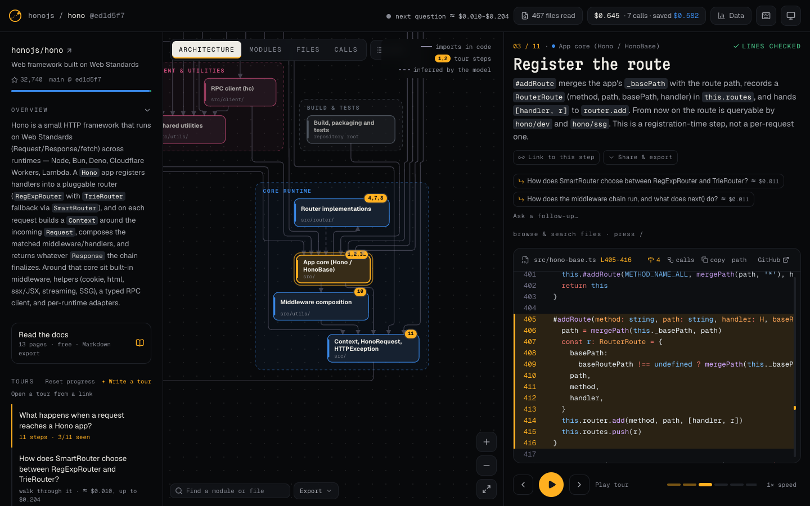
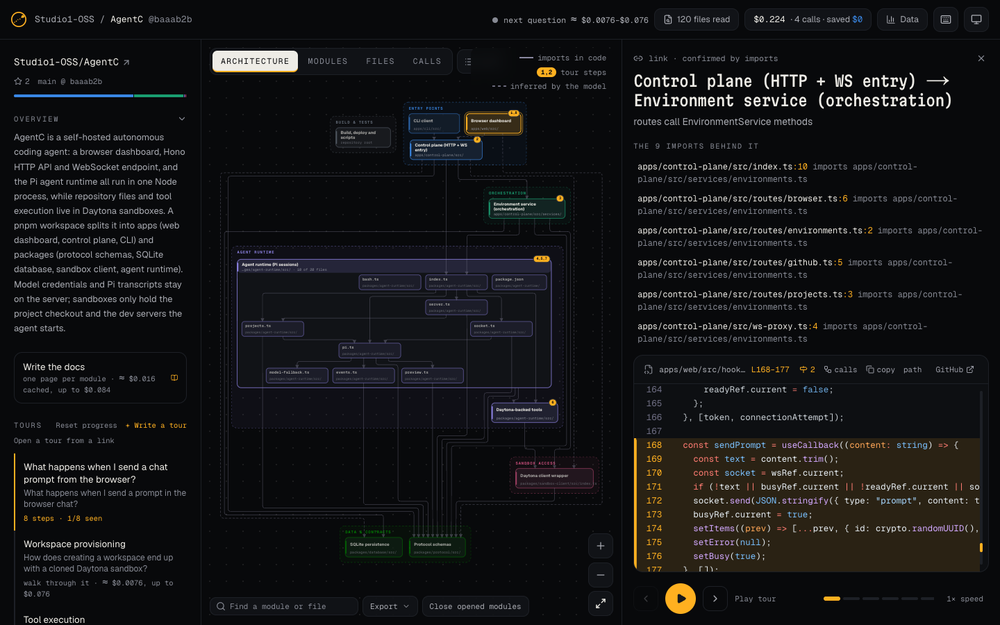
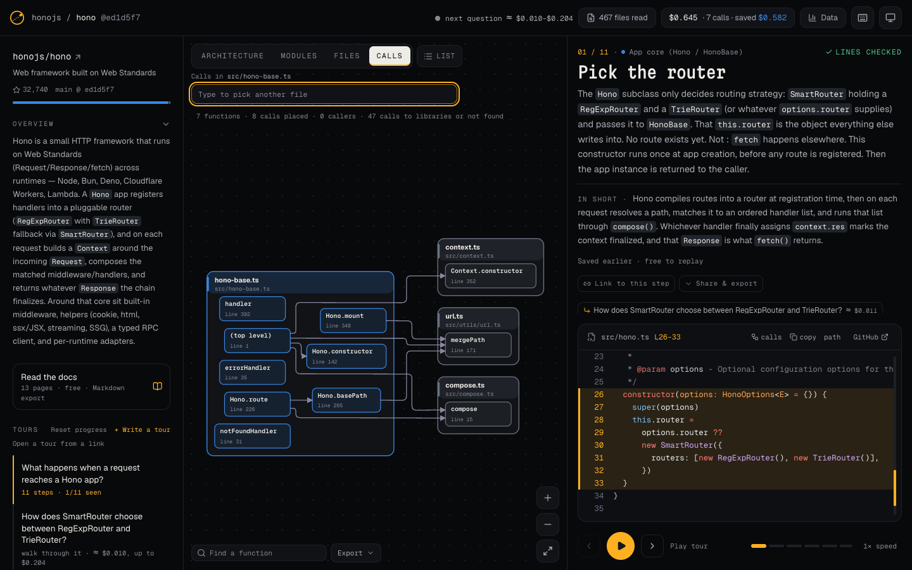
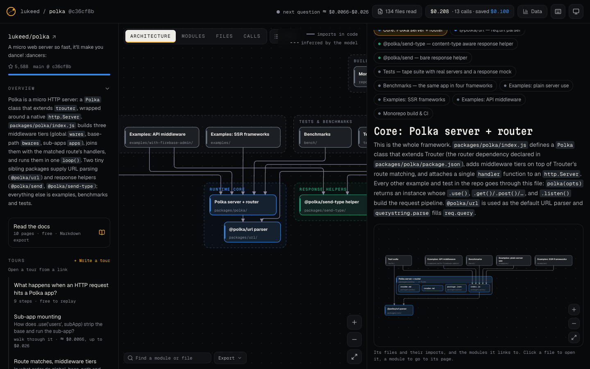
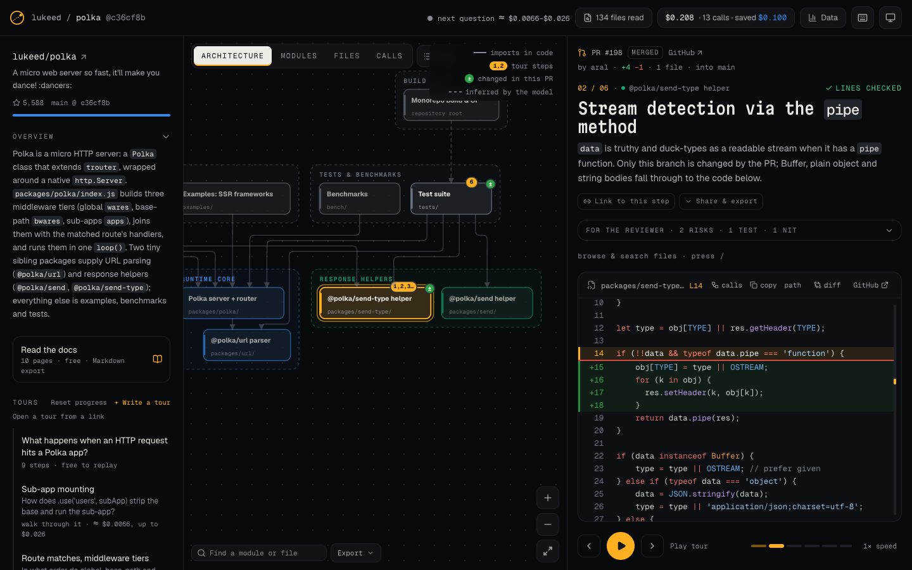
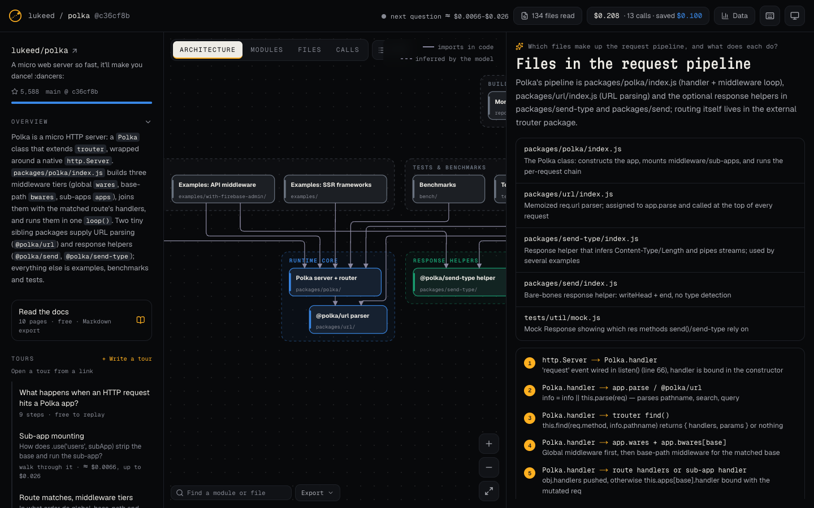
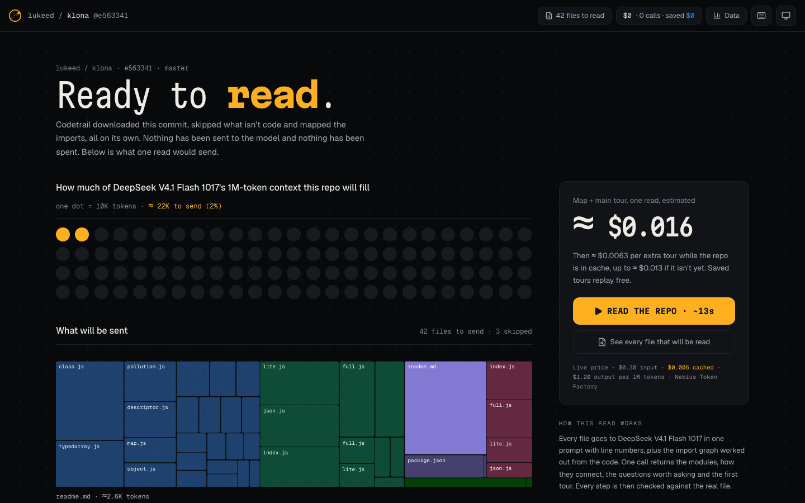

<p align="center"></p>

<h1 align="center">Codetrail</h1>

<p align="center"><b>Architecture diagrams, wiki docs, code tours and Q&amp;A for any GitHub repo, from one link.</b><br>For a repo, a pull request or a folder on your machine. Open source, runs on the open model you pick (DeepSeek V4.1 Flash 1017 or Kimi K3.1 Pro), and every line it points to is checked against the code.</p>

<p align="center">

<a href="https://tokenfactory.nebius.com/?modals=endpoint-details&model-id=deepseek-ai/DeepSeek-V4.1-Flash-1017"></a>
<a href="https://tokenfactory.nebius.com/?modals=endpoint-details&model-id=moonshotai/Kimi-K3.1-Pro"></a>
<a href="https://dub.sh/aistudio"></a>

<a href="./LICENSE"></a>
<a href="https://studio1hq.com"></a>
</p>

> [!NOTE]
> Codetrail is an early version. It works end to end, but there are rough edges. If you hit one, [open an issue](https://github.com/Studio1-OSS/Codetrail/issues) or send a fix: see [Contributing](#contributing).

<p align="center"><a href="#run-it">Run it</a> · <a href="docs/user-guide.md">User guide</a> · <a href="docs/features.md">Features</a> · <a href="#how-it-compares">How it compares</a> · <a href="docs/how-it-works.md">How it works</a> · <a href="docs/self-hosting.md">Self-hosting</a></p>


<picture>
  <source media="(prefers-color-scheme: light)" srcset="docs/screenshots/tour-light.png">
  
</picture>

Getting to know a new codebase usually means hours of clicking through files. Codetrail hands the whole repo to an open model in one prompt: **[DeepSeek V4.1 Flash 1017](https://tokenfactory.nebius.com/?modals=endpoint-details&model-id=deepseek-ai/DeepSeek-V4.1-Flash-1017)** (the default) or **[Kimi K3.1 Pro](https://tokenfactory.nebius.com/?modals=endpoint-details&model-id=moonshotai/Kimi-K3.1-Pro)**. Both have a 1M-token context, so there's no search index guessing which pieces matter: the model sees every file. It draws the map of modules, walks you through how the code actually runs, step by step, and answers your questions. Each step quotes a real line of code, and Codetrail finds that line in the file before showing it.

It's open source and runs on your own [Nebius Token Factory](https://dub.sh/aistudio) key. On DeepSeek V4.1 Flash 1017 a small repo costs 1–3 cents to read; Kimi K3.1 Pro, a much larger model, costs about 7× as much per token. Everything it writes is saved, so the next visit is free.

## Token Factory edition

Original build by [Studio1HQ](https://studio1hq.com), from [Codetrail](https://github.com/Studio1-OSS/Codetrail). This edition adds the official Token Factory design, self-hosted fonts and visible builder credits. See [edition provenance](BRAND-EDITION.md).

### Explore the key-free sample

```bash
pnpm showcase:build
python3 -m http.server 5177 --bind 127.0.0.1 --directory showcase-dist
```

Open http://127.0.0.1:5177. The five-step Polka tour is curated and checked against the pinned source revision. It makes no inference requests and cannot analyse another repository. The full application below provides that workflow with your Token Factory key. The included Polka source retains Luke Edwards' MIT notice.

### Edition validation

On 5 November 2026, all 135 unit tests, TypeScript, dead-code checks and the full production build passed. The build uses Next.js's supported Webpack path to work in environments that restrict Turbopack worker ports. No new live inference was run. Recorded upstream prices and cost comparisons below are historical examples, not current quotes. The dependency audit reports one moderate transitive esbuild development-server advisory; the static preview contains no esbuild server.

## What you get

- **The whole repo, one prompt.** Files go in whole with line numbers, so a flow that crosses ten files stays whole.
- **Every step is checked.** Each step quotes a real line, found in the file at that commit before it's shown.
- **An architecture diagram** in layers. Open a module into its files, see the imports behind a link, export it as Mermaid, SVG, PNG or draw.io, or embed it in a README.
- **Ask anything,** with follow-ups, a Thorough mode and Research, which plans and looks in rounds before it answers.
- **Docs for every module,** with a diagram per page, as Markdown or as slides.
- **Code tours,** generated or written by you, with markers in the code, progress, and steps that follow the code to newer commits.
- **Pull-request tours** that walk through the change in the order it runs, with review notes.
- **Function calls** for JS/TS, Python and Go, worked out from the code.
- **A receipt for every call,** with the price shown before you click, and a Stop button.
- **Your own code:** private repos with a GitHub token, and local folders, in one Docker container.
- **Inside your coding agent** as an MCP server and a Claude Code plugin.

All of it in detail: **[features](docs/features.md)**.

<table>
<tr>
<td width="33%"><picture><source media="(prefers-color-scheme: light)" srcset="docs/screenshots/architecture-open-light.png"></picture></td>
<td width="33%"><picture><source media="(prefers-color-scheme: light)" srcset="docs/screenshots/calls-light.png"></picture></td>
<td width="33%"><picture><source media="(prefers-color-scheme: light)" srcset="docs/screenshots/docs-light.png"></picture></td>
</tr>
<tr>
<td align="center"><sub>A module opened into its files, and the imports behind a link</sub></td>
<td align="center"><sub>Function calls, worked out from the code</sub></td>
<td align="center"><sub>Docs with a diagram on every page</sub></td>
</tr>
<tr>
<td width="33%"><picture><source media="(prefers-color-scheme: light)" srcset="docs/screenshots/pr-tour-light.png"></picture></td>
<td width="33%"><picture><source media="(prefers-color-scheme: light)" srcset="docs/screenshots/answer-light.png"></picture></td>
<td width="33%"><picture><source media="(prefers-color-scheme: light)" srcset="docs/screenshots/before-reading-light.png"></picture></td>
</tr>
<tr>
<td align="center"><sub>A pull request, changes marked</sub></td>
<td align="center"><sub>An answer with checked references</sub></td>
<td align="center"><sub>What a read will send and cost, before anything is spent</sub></td>
</tr>
</table>

## How it compares

Codetrail does the jobs of four tools people use to understand a codebase. GitDiagram draws a repo's architecture, DeepWiki writes a wiki and answers questions, CodeTour plays hand-written walkthroughs in VS Code, and CodeViz draws architecture and call graphs in VS Code.

| | Codetrail | GitDiagram | DeepWiki | CodeTour | CodeViz |
|---|---|---|---|---|---|
| What the model sees | Every file, one prompt | Tree, README, source excerpts | An index of the repo, searched per page and question | No model | AI agents search the code |
| Architecture diagram | Layers, colours, routed links; open a module into its files | Layers, colours, links | Mermaid diagrams in wiki pages | — | C4 and UML, editable |
| Written docs for every module | Yes, references checked, a diagram per page | A short overview | Yes, a wiki | — | Diagram-led docs |
| Ask questions about the code | Yes, with follow-ups, Thorough and Research modes | — | Yes, with Deep Research | — | Yes |
| Step-by-step walkthroughs with file + line | Generated or written by you, every line checked | — | Codemaps (code in execution order) | Hand-written | Walkthroughs in search results |
| Tour markers in the code, progress | Yes | — | — | Yes | — |
| Pull requests | A tour of the change, with review notes | — | — | Tours pinned to a branch or commit | PR diagrams (paid plan) |
| Checked against the code | Every quoted line, and again on each newer commit | Every linked path | — | Drift warnings in CI | — |
| Export the diagram | Mermaid (with GitHub links), SVG, PNG, draw.io | Mermaid, PNG | — | `.tour` files | Mermaid, draw.io, PNG, SVG |
| A live diagram image for a README | SVG or PNG, with a badge; also the link preview | Yes, with a badge | A badge | — | Embeds (Teams plan) |
| Markdown page for AI tools | `/owner/repo.md`, `llms.txt` | `/owner/repo.md`, `llms.txt` | — | — | — |
| Read only some folders | Choose folders or globs | — | A page list in `.devin/wiki.json` | — | — |
| What it costs you | Your Nebius key; the price shown before and after every call | Free quota, cost after a run | Free for public repos | Free | Free tier, Pro $19/month |
| Works from a URL in the browser | Yes | Yes | Yes | VS Code (desktop and web) | VS Code |
| MCP server for coding agents | Yes, also a Claude Code plugin | Yes | Yes | — | — |
| Open source | Yes, MIT | Yes, MIT | No | Yes, MIT | No |
| Private code | Private repos with a GitHub token, and local folders; the code goes only to the model you pick, on your Nebius key | With a GitHub token | With a Devin account | Local files | Local folders; code goes to cloud models |
| Function-level call graph | JS/TS, Python, Go, from the code | — | — | — | Yes, from the language server |
| Explainer video of a repo | — | Yes | — | — | — |

Checked in October 2026 against each tool's own docs and code. Where the others are ahead: CodeViz draws editable C4 and UML diagrams and covers more languages in its call graph; GitDiagram makes narrated explainer videos; DeepWiki already has wikis for many public repos, so there's nothing to wait for; CodeTour plays tours inside VS Code itself.

## How it works

Every call sends the same prefix, the whole repo with numbered lines, so after the first read the repo can be billed as cached input: $0.006 per 1M tokens instead of $0.30 on DeepSeek V4.1 Flash 1017, $0.20 instead of $2.00 on Kimi K3.1 Pro. Code, not the model, checks every step, builds the import graph and does the pricing. On DeepSeek, polka's map and main tour cost $0.028, and an extra tour on zustand with the repo cached cost $0.005. On Kimi, koa's 110K-token read costs $0.28 at full price. **[How it works, measured costs and the tech stack](docs/how-it-works.md)**.

## Run it

All it needs is a [Nebius Token Factory](https://dub.sh/aistudio) API key. With [Docker](https://www.docker.com/products/docker-desktop):

```bash
git clone https://github.com/demianarc/token-factory-codetrail.git
cd token-factory-codetrail
docker build -t codetrail .
docker run --name codetrail -p 3000:3000 -e NEBIUS_API_KEY=your-key -v codetrail-data:/data -v ~/code:/repos:ro codetrail
```

Or from source, with Node.js 22.13+ and pnpm:

```bash
pnpm install
cp .env.example .env      # add NEBIUS_API_KEY
pnpm dev
```

Then open **http://localhost:3000**. To run on Kimi K3.1 Pro instead of DeepSeek V4.1 Flash 1017, set `NEBIUS_MODEL=moonshotai/Kimi-K3.1-Pro` (in `.env`, or `-e` with Docker). Every call records its model, so receipts and the data page stay right after a switch.

Local folders, private repos, hosted mode and scripts: **[self-hosting](docs/self-hosting.md)**. A walk through every part of the app: the **[user guide](docs/user-guide.md)**.

## Use it from your coding agent

<a href="https://insiders.vscode.dev/redirect/mcp/install?name=codetrail&config=%7B%22type%22%3A%22http%22%2C%22url%22%3A%22http%3A%2F%2Flocalhost%3A3000%2Fapi%2Fmcp%22%7D"></a>
<a href="https://cursor.com/install-mcp?name=codetrail&config=eyJ1cmwiOiJodHRwOi8vbG9jYWxob3N0OjMwMDAvYXBpL21jcCJ9"></a>

Both point at `http://localhost:3000/api/mcp`, so start the app first. In Claude Code, the plugin adds the server and a skill that says when to use each tool:

```bash
claude plugin marketplace add Studio1-OSS/Codetrail
claude plugin install codetrail@codetrail
```

Other setups and the six tools are in the [user guide](docs/user-guide.md#13-coding-agents-mcp).

## Accessibility

Built to WCAG 2.2 AA: full keyboard use, a text version of every diagram, screen-reader landmarks and announcements, both themes contrast-checked, and an axe-core scan with no issues. **[Details](docs/accessibility.md)**.

## Contributing

This is an early version, so there's plenty to improve, and contributions of any size help: a bug report with the repo and steps, a fix, better docs, or support for another language in the call graph. Issues and pull requests are welcome. Run `pnpm test && pnpm typecheck && pnpm lint:dead` before sending one; CI runs the same, plus a production build. For UI changes, `pnpm a11y` against a running app keeps the accessibility scan at zero issues. Changes to prompts or checks should come with a `pnpm eval owner/repo` run on a small repo (it calls the model, so it costs a few cents).

## License

[MIT](LICENSE) © 2026 Studio1HQ
