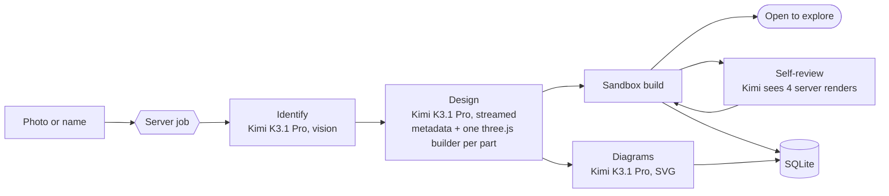

# Cutaway: see inside any machine with Kimi K3.1 Pro

Show it a photo of a machine, or type its name, and get a 3D model of every part inside that you can pull apart, slice open and learn from.

**Moonshot AI's Kimi K3.1 Pro** on [Nebius Token Factory](https://tokenfactory.nebius.com) designs the whole teardown: every part as three.js code with real sizes in millimetres, how the parts come apart, how electricity, air, heat and motion move through them, three SVG diagrams, a guided teardown, and study notes with a quiz. The app runs the model's code in a sandbox, renders the result, and lets Kimi review four pictures of its own model and rewrite what looks wrong.


## What you'll build

A Next.js app that turns one input into a full teardown, saved in a local SQLite file so the model runs once per machine:

1. **Identify.** Kimi looks at the photo (or reads the name) and says what the machine is. If it isn't sure, it asks you a question.
2. **Design.** One streamed call returns the machine's metadata and one three.js builder per part. Parts are saved as they arrive.
3. **Build.** Every builder runs in a locked-down sandbox, and the app checks each part for errors, empty or invalid geometry, and sizes outside the machine. Once every part is built, you can start exploring while the next step runs.
4. **Diagrams and self-review, in parallel.** Kimi draws a cross-section, a flow map and a numbered parts sheet as SVG. Separately, the server renders four views of the model (front, three-quarter, pulled apart and sliced), and Kimi rewrites the parts that look wrong.

| Kimi K3.1 Pro designs | The app runs, checks and shows |
| --- | --- |
| What the machine is, from your photo | The photo, and a cache so the same photo is not identified twice |
| Every part as three.js code, with real sizes | Each part's code in a sandbox, plus checks for broken shapes |
| Where each part sits and in what order it comes apart | The exploded view, slicing, see-through mode and the step-by-step teardown |
| How electricity, air, heat or motion flows through it | Animated flows along the parts Kimi named |
| Plain explanations, expert details, a glossary and quiz questions | The study pages, quiz scoring, notes and a printable study sheet |
| A review of its own work from four rendered views | The renders, and rebuilding the parts it fixes |

| Start from a photo or a name | A guided teardown, one step at a time |
| --- | --- |
|  |  |


## How it works



Kimi answers in a tagged format, so code and SVG never need escaping:

```text
<meta>{ device, parts[], systems[], steps[], study }</meta>
<part id="stator-core"> ...three.js builder that returns an Object3D... </part>
<diagram kind="section" title="..."> <svg>...</svg> </diagram>
```

Model-written code never runs in the web server process. On the server, builders run in a separate Node process started with Node's permission model (no file writes, child processes or native addons, all imports blocked, 6 seconds per part). In the browser, the same code runs in a Web Worker with network, timers and globals removed. Generation is a background job, so you can close the tab and come back.

## Setup

Requirements: Node.js 22.15 or newer, pnpm, and a [Nebius Token Factory](https://tokenfactory.nebius.com) API key.

```bash
cd apps/cutaway
pnpm install
cp env.example .env          # add NEBIUS_API_KEY
pnpm dev                     # http://localhost:3000
```

A new copy starts with two machines Kimi K3.1 Pro made, a sonic toothbrush and a jet engine (from [`seed/`](seed/)). Opening and exploring them makes no model calls. Starting a new machine makes three to five calls to Kimi K3.1 Pro: identify (photos only), design, diagrams, and one or two review rounds. See [A real run](#a-real-run) for time and cost.

To work on the app without a key, `KIMI_PROVIDER=replay pnpm dev` streams a stored sample answer from [`fixtures/kimi/`](fixtures/kimi/) through the real pipeline.

## Exact model and configuration

| Setting | Value |
| --- | --- |
| Model | `moonshotai/Kimi-K3.1-Pro` ([model page](https://tokenfactory.nebius.com/?modals=endpoint-details&model-id=moonshotai/Kimi-K3.1-Pro)) |
| Endpoint | `https://api.tokenfactory.us-north1.nebius.com/v1/`, through the OpenAI-compatible `openai` SDK, streamed with `stream_options.include_usage` |
| Reasoning | No reasoning setting is sent, so every call uses Token Factory's default, which has reasoning on |
| Sampling | No temperature or other sampling settings are sent |
| `max_tokens` | 64,000 for the design and diagram calls (reasoning tokens count toward this) |
| Answer format | Tagged blocks (above); the metadata is validated with zod, small slips fall back to defaults, and real schema errors get one repair call |
| Self-review | Up to two rounds, each with four renders from the server's software renderer |
| Price | read live from `GET /v1/models?verbose=true` and applied to each call's real token counts, cached input at the cached rate. At the time of writing: $2.00 per 1M input tokens, $0.20 cached and $10.00 output. |

## Project layout

| Path | What's in it |
| --- | --- |
| [`lib/kimi/client.ts`](lib/kimi/client.ts) | The Token Factory client: streaming, usage and the run log |
| [`lib/kimi/pricing.ts`](lib/kimi/pricing.ts) | Prices from `/v1/models?verbose=true` and per-call cost |
| [`lib/kimi/prompts.ts`](lib/kimi/prompts.ts), [`lib/kimi/pipeline.ts`](lib/kimi/pipeline.ts) | The prompts and the identify, design, diagrams and review steps |
| [`lib/jobs/runner.ts`](lib/jobs/runner.ts) | The background job that runs the steps and saves each one |
| [`lib/sandbox/`](lib/sandbox/) | The part kit, checks, the browser Web Worker and the server child-process sandbox |
| [`lib/render/raster.ts`](lib/render/raster.ts) | The software renderer for review pictures and thumbnails |
| [`lib/viewer/`](lib/viewer/) | The three.js scene: explode, slice, see-through, labels, flows and the free camera |
| [`seed/`](seed/) | The two machines a new copy starts with |

## A real run

A two-spool high-bypass turbofan, generated from its name on November 4, 2026. Times and costs are from the app's run log:

| Step | Time | Output tokens | Cost |
| --- | --- | --- | --- |
| Design: 47 parts, 5 flows, 10 steps, a quiz | 23 min | 38,477 | $0.39 |
| Self-review from four rendered views, 12 parts rewritten | 11.5 min | 28,501 | $0.32 |
| Diagrams, alongside the review | 12 min | 40,000 | $0.41 |
| **Whole machine** | **35 min** | | **$1.12** |

Two of the three diagrams fit in the 40,000-token output limit used for that run; the limit for diagrams is now 64,000. This machine is included in [`seed/`](seed/).

## Validate

These checks make no API calls:

```bash
pnpm test        # parser, schema, checks, both sandboxes, renderer, framing, pricing, database, pipeline and background job
pnpm typecheck
pnpm build
```

## Limitations

- **Speed.** K3.1 Pro reasons by default and the answer is long (every part is code), so a new machine took about 35 minutes in the run above. You can start exploring once its parts are built.
- **Accuracy.** Kimi designs representative internals for that kind of machine, not an exact copy of one product. Each part shows how sure Kimi is.
- **Scope.** This is a local app with no accounts. Everything is stored in `data/cutaway.db`; delete that folder to start over. Don't expose it publicly with your own API key.

## Credits

Built by [Amitesh Anand](https://github.com/Astrodevil), based on [Cutaway](https://github.com/Studio1-OSS/Cutaway).

## License

MIT, under this cookbook's [LICENSE](../../LICENSE).
