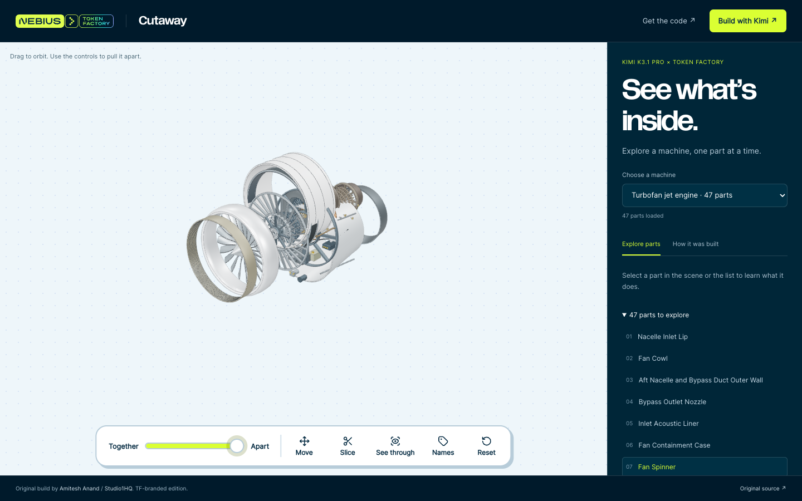

[Cookbook](../../README.md) / [Applications](../README.md) / Cutaway

# Explore a machine in 3D with Cutaway

Cutaway sends a machine name or image to Kimi K3.1 Pro on Nebius Token Factory, builds the returned Three.js geometry in a sandbox, and asks the model to review four rendered views. This recipe includes the runnable generator and a key-free showcase of two saved examples.

## What you will build

A machine explorer with part selection, reversible disassembly, slicing and see-through controls. The included turbofan engine has 47 parts; the electric toothbrush has 34. The full application also includes a guided teardown, diagrams and study questions.



## Requirements

- Node.js 22.15 or later and pnpm 11.
- WebGL-capable browser.
- For **new generation**, a Token Factory project with model access, billing and an API key. API calls spend your project balance. Exploring saved examples makes no inference requests.

## Setup

From this directory:

```bash
pnpm install --frozen-lockfile
```

The workspace file permits build scripts only for the named SQLite, bundler and image dependencies. Keep secrets in the full application's `.env`; never put a key in the static showcase.

## Run

To explore the stored examples:

```bash
pnpm showcase:dev
# Open http://127.0.0.1:5174
```

Select a machine, drag to orbit, move **Together → Apart**, or select a part to read its explanation. **How it was built** explains the generation workflow.

To generate a new machine:

```bash
cp .env.example .env
# Set NEBIUS_API_KEY in .env; leave the real key out of source control.
pnpm dev
# Open http://localhost:3000 and enter: oscillating desk fan
```

The configured model is `moonshotai/Kimi-K3.1-Pro`. The fork defaults to `https://api.tokenfactory.us-north1.nebius.com/v1/`; set `KIMI_BASE_URL` if your project requires a different Token Factory endpoint. See the [model quickstart](../../models/kimi-k3.1-pro.md) and check current availability in your project.

## Validate

```bash
pnpm test
pnpm typecheck
pnpm build
pnpm showcase:build
pnpm audit --prod
# With the showcase running:
pnpm exec playwright install chromium
pnpm showcase:test
```

On 5 November 2026, the TF edition passed 48 unit tests, TypeScript, the full production build and the static build. Production-showcase browser checks built all 81 saved parts successfully, exercised selection, disassembly/reassembly, slice/reset, X-ray and machine switching, and checked the 390px mobile layout. No runtime errors or external requests were observed in that pass. No fresh live Kimi generation was run.

## Deployment and cleanup

`pnpm showcase:build` produces `showcase-dist/`, which can be served on a static host without a backend or API key. It explores saved output; it cannot generate new machines.

The full application needs a Node server and persistent SQLite storage. It has no user accounts: run locally or behind an access boundary. Do not expose an uncapped, shared inference key through a public generator. Stop the local server with Ctrl+C. The full app stores photos, generated code and notes in `data/`; remove that directory only when you no longer need those local records.

The geometry is an educational interpretation, not manufacturer-accurate CAD. The upstream time/cost table is one recorded example, not a current quote or performance guarantee.

## Source and license

Original build: [Amitesh Anand](https://github.com/Astrodevil) / [Studio1HQ](https://studio1hq.com), [Cutaway](https://github.com/Studio1-OSS/Cutaway), revision `5e8763d30e03e08606de81b031596c3625bbd3a4`.

[TF edition](https://github.com/demianarc/token-factory-cutaway), revision `41da4b0`, adds the official design, self-hosted fonts, visible credits, dependency fixes and the static showcase. The original [MIT license](LICENSE) is retained. Nebius brand assets are not covered by a general grant to reuse the brand. The [upstream application guide](UPSTREAM.md) documents the full architecture.
