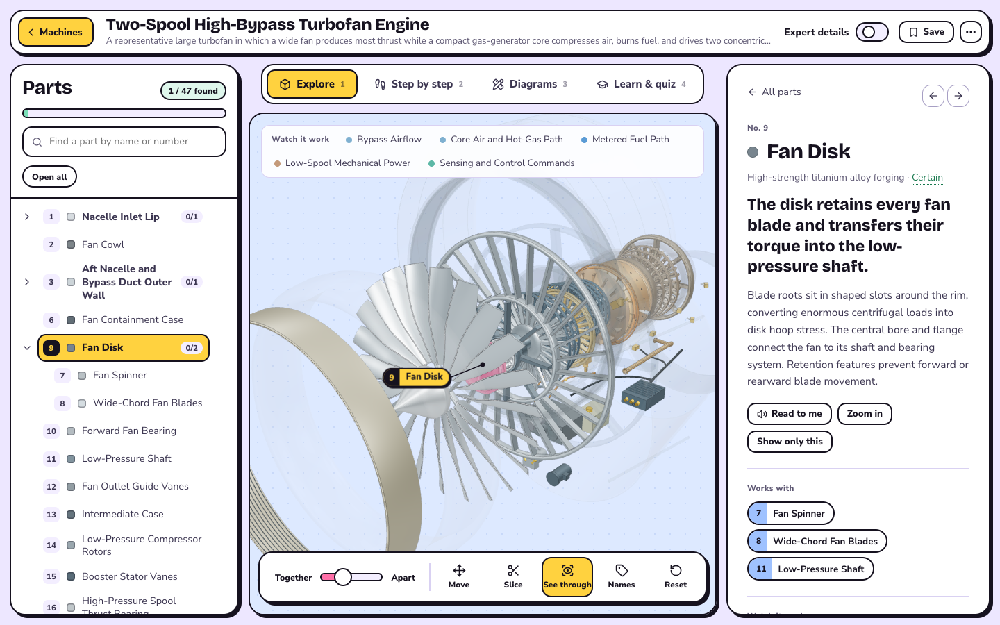
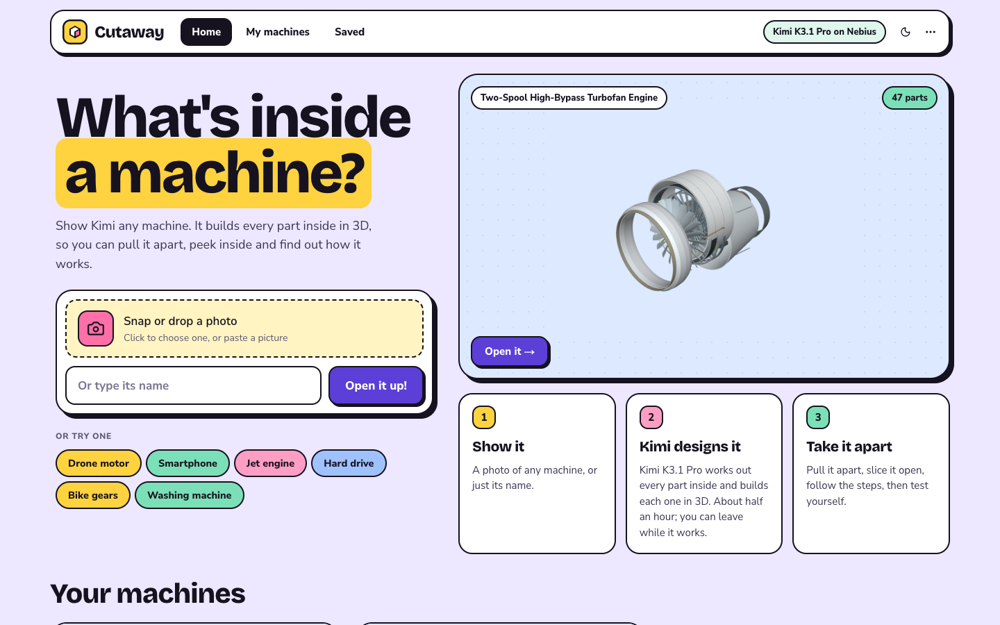
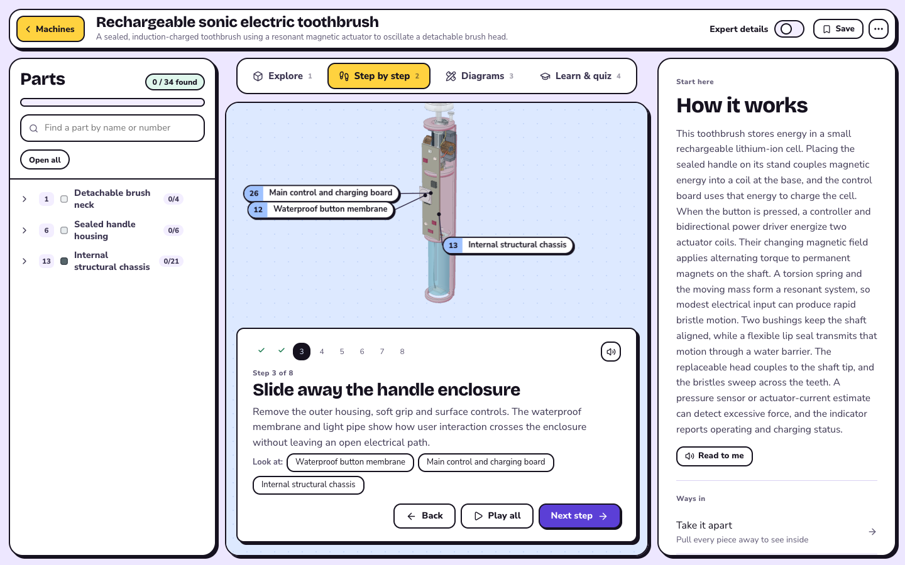
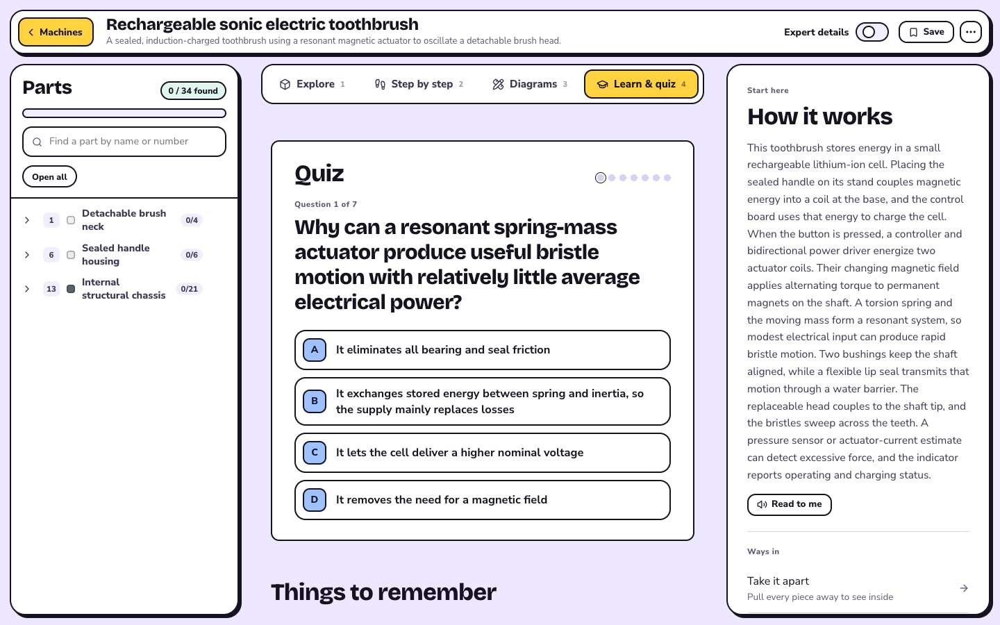
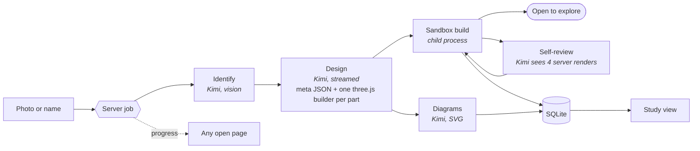

<div align="center">


# Cutaway · Nebius Token Factory edition

### What's inside a machine?

**Show it a photo of a fan, a toothbrush or a jet engine. Kimi K3.1 Pro designs every part inside as a 3D model you can pull apart, slice open and explore, with each part numbered and explained, diagrams, a guided teardown and a quiz.**

Built on **Kimi K3.1 Pro** by Moonshot AI, served by **Nebius Token Factory** · [Get started](#get-started) · [Features](#features) · [How it works](#how-it-works) · [Time and cost](#time-and-cost)


[](./LICENSE)
[](https://studio1hq.com)

Runs on your own machine with one API key and no sign-up. Everything is saved in a local SQLite file, so Kimi runs once per machine; exploring, studying and quizzes never cost anything.

</div>

---

<div align="center">



</div>

_A two-spool high-bypass turbofan, designed by Kimi K3.1 Pro from its name: 47 parts, five flows, a 10-step teardown and a quiz. Part 9, the fan disk, is picked; "See through" turns the casings to glass._

## Why Kimi K3.1 Pro

Kimi K3.1 Pro can design in 3D, and Cutaway lets it do the whole job:

| Kimi designs | The app runs, checks and shows |
| --- | --- |
| What the machine is, from your photo | The photo, cached so the same picture is never sent twice |
| Every part inside, written as three.js code with real sizes in millimetres | Each part's code in a locked-down sandbox, then checks for broken or impossible shapes |
| Where each part sits, how it comes apart and in what order | The exploded view, slicing, see-through mode and the step-by-step teardown |
| How electricity, air, heat or motion flows through it | Animated flows along the parts Kimi named |
| Plain explanations, expert details, a glossary and quiz questions | The study pages, quiz scoring and progress |
| Three 2D diagrams as SVG: a cross-section, a flow map and numbered parts | The diagrams, cleaned in the browser and linked to the 3D parts |
| A review of its own work from four renders of the model | The renders it looks at, and rebuilding the parts it fixes |

## Features

**For learners**

- **Explore:** pull it apart with one slider, **slice** it open, turn the covers **see-through**, tap any part.
- **Move it freely:** grab the machine to slide it, drag the background to turn it any way (it never gets stuck at the top), scroll to zoom where you point, double-click to look closer.
- **Numbered parts:** every part has one number, shown in the list, on its 3D name tag and on its page, so words and picture always match.
- **A tidy parts list:** big machines start folded into groups with "found" counts. Search by name or number, and hide any part (and what's inside it) to see behind it.
- **Every part explained:** what it does in one sentence, how it works, what it works with, and a **Read to me** button.
- **Watch it work:** animated electricity, air, heat and motion moving through the parts.
- **Step by step:** a guided teardown from the outside in, with narration; the parts each step mentions are tagged on the model.
- **Diagrams:** a cross-section, a "how it works" map and a numbered parts sheet. Point at a name to light up the part.
- **Learn & quiz:** one question at a time with big answer buttons, things to remember and a word bank.
- **Expert details:** one switch adds the engineering: equations, typical specs, how parts fail.
- A first-visit tour, notes per part, saved machines, a printable study sheet, light and dark themes, and layouts that work on a phone.

**For builders**

- **Runs in the background.** Generation is a server job. Close the tab or browse other machines; a small indicator follows you and a notification says when it's ready.
- **Explore early.** As soon as every part is built, the machine opens while Kimi still draws the diagrams and checks its work; the page updates itself when that's done.
- **Resumes.** Every step is saved to SQLite as it finishes, so a stopped or interrupted run continues from where it was.
- **Kimi checks its own work.** The server renders the model from four angles and Kimi rewrites what looks wrong.
- **Run log with real cost.** Every call is listed with tokens, cached tokens, thinking tokens, time and cost, priced from the rate Nebius publishes for the model.

<table>
<tr>
<td></td>
<td></td>
</tr>
<tr>
<td align="center"><sub>Start from a photo or a name</sub></td>
<td align="center"><sub>A guided teardown, one step at a time</sub></td>
</tr>
<tr>
<td colspan="2"></td>
</tr>
</table>

## Token Factory edition

Original build by [Amitesh Anand](https://github.com/Astrodevil) / [Studio1HQ](https://studio1hq.com). This fork keeps the full generator and adds the official Token Factory visual design plus a static, interactive showcase of the two saved machines. See [edition provenance](BRAND-EDITION.md).

### Host the saved examples without a key

```bash
git clone https://github.com/demianarc/token-factory-cutaway.git
cd token-factory-cutaway
pnpm install --frozen-lockfile
pnpm showcase:dev            # http://127.0.0.1:5174
pnpm showcase:build          # output: showcase-dist/
```

Serve `showcase-dist/` on a static host. It uses the original interactive viewer and stored geometry: orbit, disassembly, selection, X-ray and slicing work locally in the browser. Exploring it makes no inference requests and cannot generate new machines. The full application below provides generation. Never put an API key in the static bundle.

## Get started

Requires Node.js 22.15 or newer and pnpm.

```bash
git clone https://github.com/demianarc/token-factory-cutaway.git
cd token-factory-cutaway
pnpm install --frozen-lockfile
cp .env.example .env        # paste your Nebius key
pnpm dev                    # http://localhost:3000
```

`.env`:

```bash
NEBIUS_API_KEY=...
```

Create a key in [Nebius Token Factory](https://tokenfactory.nebius.com/project/api-keys). A fresh copy already includes two machines Kimi made (the toothbrush and the jet engine), so you can explore before spending anything.

<details>
<summary>All settings</summary>

| Variable | Default | What it does |
| --- | --- | --- |
| `NEBIUS_API_KEY` | | Your Nebius Token Factory key |
| `KIMI_MODEL` | `moonshotai/Kimi-K3.1-Pro` | Model id on Nebius |
| `KIMI_BASE_URL` | `https://api.tokenfactory.us-north1.nebius.com/v1/` | Nebius API address |
| `KIMI_MAX_TOKENS` | `64000` | Output cap for the design call |
| `KIMI_EFFORT_DESIGN`, `_REVIEW`, `_DIAGRAMS`, `_REPAIR`, `_IDENTIFY` | design: max; others: low | How hard Kimi thinks on each step (`low`, `high` or `max`) |
| `KIMI_PRICE_INPUT`, `KIMI_PRICE_OUTPUT` | | Dollars per million tokens, only used if Nebius's price list can't be read |
| `CUTAWAY_DB` | `data/cutaway.db` | Where the database lives |
| `KIMI_PROVIDER=replay` | | Development only: streams a stored sample answer through the real pipeline with no model call |

</details>

## Recorded upstream time and cost

The figures below are the original builder’s recorded example, not a new run of this TF edition or a current price quote. Use the live Token Factory console for current pricing.

Kimi K3.1 Pro always thinks before it answers, and it writes a lot: every part is real three.js code. The jet engine above, a full run on Nebius with Kimi thinking at its maximum on every step:

| Step | Time | Output tokens (of which thinking) | Cost |
| --- | --- | --- | --- |
| Design: 47 parts, flows, steps, quiz | 23 min | 38,477 (12,979) | $0.39 |
| Self-review from four renders, 12 parts rewritten | 11.5 min | 28,501 (25,212) | $0.32 |
| Diagrams, alongside the review (2 of 3 fit in the token cap, which is now higher) | 12 min | 40,000 (20,572) | $0.41 |
| **Whole machine** | **35 min** | | **$1.12** |

Nebius prices Kimi K3.1 Pro at $2 per million input tokens, $0.20 cached and $10 output. You don't wait on the page: the machine opens as soon as its parts are built (about 23 minutes here), and the rest finishes in the background. Opening a saved machine is free.

Most of the review and diagram time was thinking, so Cutaway asks for less thinking (`low`) on those steps and keeps the design at full effort, where the quality comes from. Each step can be changed with the `KIMI_EFFORT_*` settings.

## How it works



Kimi answers in a tagged format, so code and SVG never need escaping:

```text
<meta>{ device, parts[], systems[], steps[], study }</meta>
<part id="stator-core"> ...three.js builder that returns an Object3D... </part>
<diagram kind="section" title="..."> <svg>...</svg> </diagram>
```

Each builder gets `THREE` and a small `kit` of helpers (lathe, extrude, gear, helix, twisted blade, radial copies, circuit boards, material presets). Parts are saved as the answer streams, so anyone watching sees them appear. Small slips, like an unknown camera view name, fall back to a default instead of failing the whole answer; real schema errors get one repair call. A part that still fails shows as a labelled dashed box, never silently missing.

**The sandbox.** Model-written code never runs inside the web server process:

- **On the server:** builders run in a separate Node process started with Node's permission model, so it can't write files, start processes or workers, or load native addons. All imports are blocked by a module hook, and each part has a 6-second time limit (endless loops are killed).
- **In the browser:** the 3D view runs the same code in a Web Worker with network, timers and globals removed.
- **Self-review images:** a small software renderer on the server draws the four views Kimi checks, so the review needs no browser.

## Data and privacy

- No accounts. The database is `data/cutaway.db` on your machine. It holds machines and versions, your photos, part code, diagrams, thumbnails, notes, progress and the run log.
- Your photo is sent to Nebius only when Kimi identifies or designs a new machine. A photo it has seen before is answered from the cache.
- Diagrams written by the model are sanitised before they are shown.
- `pnpm seed:export <slug>` writes machines to `seed/`; a new database imports `seed/*.json` automatically.
- `pnpm thumbnails` redraws the library pictures locally, without calling the model.

## Project layout

```
app/(dashboard)/      home, my machines, saved, run log
app/new/              building screen (watches the server job)
app/t/[slug]/         study view and printable study sheet
app/api/              teardowns, jobs (start / progress / answer / stop), study, thumbnails
lib/jobs/runner.ts    the background job: identify → design → build → diagrams ∥ review → save
lib/kimi/             Nebius client, pricing, prompts, kit docs, tagged-answer parser, pipeline steps
lib/sandbox/          kit helpers, part checks, browser Web Worker, server child-process sandbox
lib/render/raster.ts  software renderer for review images and thumbnails
lib/viewer/           three.js scene (explode, slice, see-through, labels, flows, free camera) and framing
lib/db/               SQLite access, migrations in db/migrations, seed import
components/           study view, viewer, dashboard and building-screen UI
seed/                 the machines a fresh copy starts with
fixtures/kimi/        stored answers used by tests and replay mode
```

Built with Next.js 16, React 19, three.js, better-sqlite3, zod, esbuild, jpeg-js, Radix UI, Motion, sonner, driver.js and canvas-confetti. The look is described in [DESIGN.md](./DESIGN.md).

## Tests

```bash
pnpm test        # parser, schema, checks, kit, both sandboxes, renderer, framing, pricing, database, pipeline and background job (model mocked)
pnpm typecheck
pnpm build
pnpm showcase:build
# With the showcase served locally:
pnpm exec playwright install chromium
pnpm showcase:test
```

## TF edition verification

On 5 November 2026: 48 unit tests, TypeScript, the Next.js production build and the static showcase build passed. The static production bundle built all 47 engine parts and 34 toothbrush parts with no failed geometry, runtime errors or external requests. Browser checks covered selection, disassembly/reassembly, slice/reset, X-ray, the walkthrough, machine switching and the 390px mobile layout. No fresh live model generation was run.

## License

[MIT](./LICENSE) © 2026 Studio1HQ
