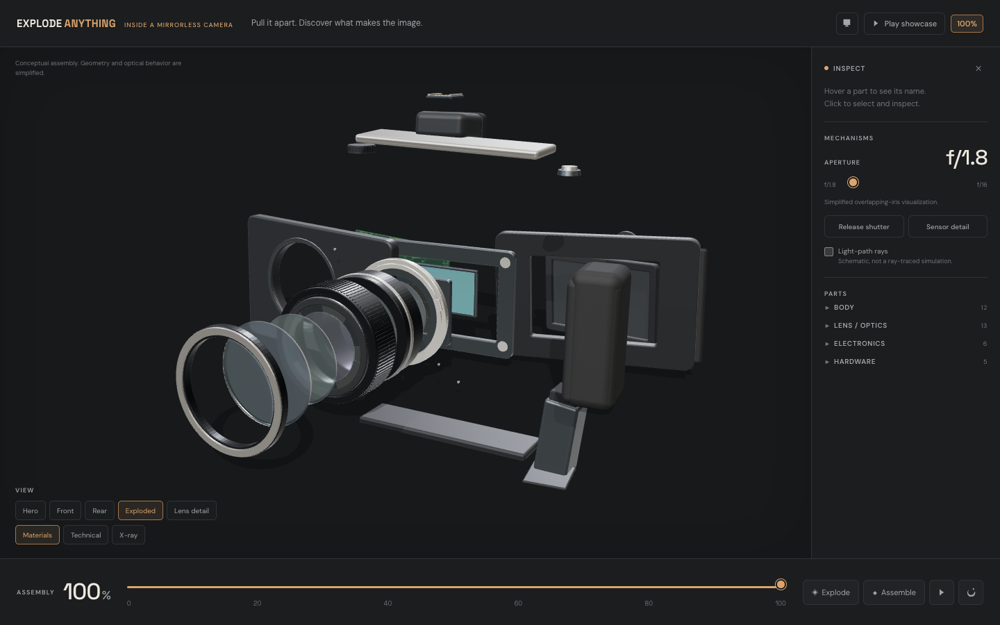
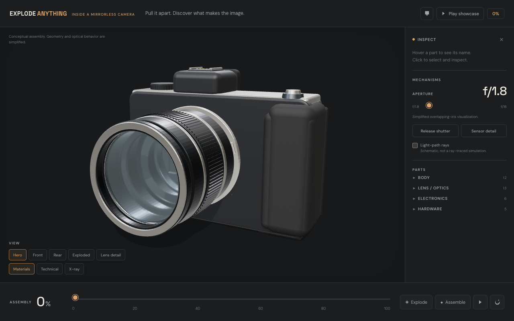
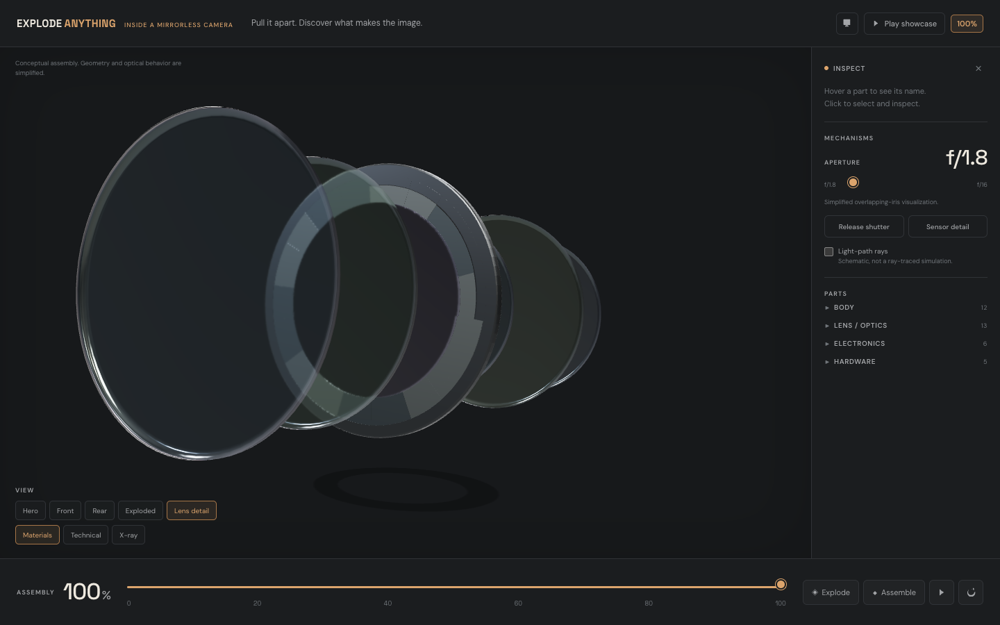

[Cookbook](../../README.md) / [Applications and demos](../README.md) / Explode Anything

# Explode Anything: a 3D camera teardown built with Kimi K3.1 Pro

Pull a mirrorless camera apart in your browser and see what makes the image.

This app was written by **Kimi K3.1 Pro** on [Nebius Token Factory](https://tokenfactory.nebius.com/), working as a coding agent. Kimi built the camera itself in code: 36 parts made from Three.js geometry, with no downloaded model, image or video.



## What you will build

A Vite + TypeScript + Three.js page that shows an unbranded mirrorless camera with a detachable 50 mm lens:

- **Explode and reassemble** the camera with a slider. Each part has its own stage, direction and rotation, so the teardown happens in a sensible order and reverses exactly.
- **Inspect parts.** Hover to name a part, click to select it, and isolate it. Parts are grouped as body, lens and optics, electronics and hardware.
- **Operate it.** Open and close a nine-blade aperture from f/1.8 to f/16, release the shutter, and show schematic light-path rays.
- **Change the look.** Switch between materials, technical edges and X-ray, jump to preset views (hero, front, rear, exploded, lens detail, sensor detail), or play a 20-second showcase.

| Hero view | Lens detail, exploded |
| --- | --- |
|  |  |

The app makes no model calls at runtime.

### How it was built

Kimi K3.1 Pro ran as the model inside [Claude Code](https://docs.claude.com/en/docs/claude-code/overview), routed to Token Factory through [nconnect](https://github.com/Studio1-OSS/nconnect), a local proxy that points coding agents at Token Factory models:

```bash
nconnect --model moonshotai/Kimi-K3.1-Pro claude
```

Kimi was given a brief describing the camera, the interactions and the views, and wrote the procedural geometry, the explode logic, the UI and a Playwright browser check.

### Project layout

```text
explode-anything/
├── index.html
├── src/
│   ├── main.ts        # UI, renderer, orbit controls, selection, showcase, WebGL fallback
│   ├── model.ts       # Part registry, procedural camera, explode transforms, materials
│   ├── geometry.ts    # Shells, rings, curved optical surfaces, dials, screw heads
│   ├── iris.ts        # Nine-blade aperture and f-stop interpolation
│   ├── framing.ts     # Fits the camera to each preset view
│   ├── explosion.ts   # The 20-second showcase sequence
│   ├── types.ts
│   └── styles.css
├── scripts/browser-check.mjs   # Playwright interaction checks with screenshots
├── screenshots/        # Images used in this README
├── package.json
└── package-lock.json
```

## Requirements

- Node.js 20.19+ or 22.12+ (required by Vite 7)
- A browser with WebGL
- No API key is needed to run the app. To build something similar with Kimi, you need a Token Factory API key from [tokenfactory.nebius.com](https://tokenfactory.nebius.com/), Claude Code and nconnect.

## Setup

From this directory:

```bash
npm ci
```

## Run

```bash
npm run dev
```

Open http://127.0.0.1:5173. Drag to orbit, scroll to zoom, and move the **Assembly** slider to explode the camera. Click **Play showcase** for a guided tour.

To serve a production build:

```bash
npm run build
npm run preview
```

## Validate

These checks need no credentials:

```bash
npm run build                 # TypeScript check and production build
npx playwright install chromium
npm run dev &                 # the browser check needs the dev server on port 5173
npm run test:browser          # interaction checks; writes screenshots/ and results.json
```

The browser check needs a Chromium that renders WebGL headless. If the canvas is black, set `CHROME_PATH` to a full Chromium or Chrome for Testing binary.

What was verified for this recipe:

- `npm ci`, `npm run build` and `npm audit --omit=dev --audit-level=high` pass on Node.js 24.
- All 45 browser checks passed in full headless Chromium on macOS, with no page or console errors. They cover every preset view, explode and exact reassembly, selection and isolation, aperture f/1.8 to f/16, the shutter, display modes, the showcase, presentation mode, a simulated WebGL failure, and mobile at 390 × 844.

## Limitations and cleanup

- **It's an educational model, not a teardown of a real camera.** Optics, glass coatings, the shutter and circuit boards are visual approximations. Light rays are schematic, not ray-traced.
- **WebGL is required.** Without it the page shows an error message instead of a 2D fallback.
- The page loads Google Fonts and falls back to system fonts when offline.
- Vite warns that the main JavaScript chunk is over 500 kB, mostly Three.js. The warning is harmless.

The app creates no cloud resources. To clean up:

```bash
rm -rf node_modules dist screenshots/results.json
```

## Source and license

Built by [Shivay Lamba](https://github.com/shivaylamba) with Kimi K3.1 Pro by [Moonshot AI](https://www.kimi.ai/blog/kimi-k3-1-pro). Upstream: [shivaylamba/explode-anything](https://github.com/shivaylamba/explode-anything). Uses [three.js](https://threejs.org/) and [Vite](https://vite.dev/).

Cookbook-specific changes: the README follows the recipe template, and three screenshots were added.

Released under this repository's [MIT license](../../LICENSE).
