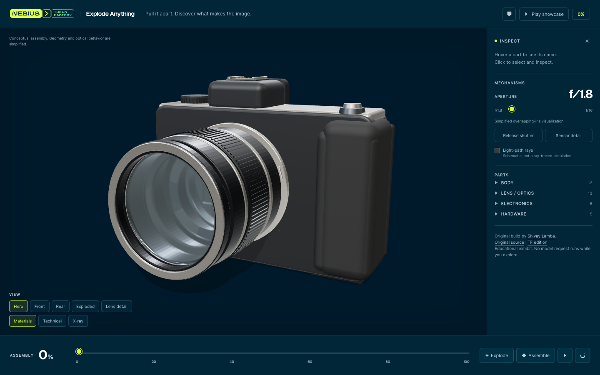

[Cookbook](../../README.md) / [Applications](../README.md) / Explode Anything

# Explore an interactive camera assembly

A runnable Three.js camera exhibit adapted for Nebius Token Factory. Inspect 36 procedural components, reverse a staged disassembly, and operate a schematic aperture and shutter. The finished exhibit uses no API key or model calls.



## What you will build

A static Vite/TypeScript application with an interactive camera, selectable parts, view presets, material/technical/X-ray modes and a 20-second showcase. This is an application source example: its repository does not establish which model produced the original build.

To use it as a coding task with Token Factory, connect a coding agent using the [OpenCode guide](../../coding/opencode.md#kimi-k31-pro), then review the included [original build brief](PROMPT.md). Treat another generation as a separate experiment with its own outputs and inference cost.

## Requirements

- Node.js 20.19+ or 22.12+ and npm.
- WebGL-capable browser.
- No backend, account, model download or API key to run the exhibit.

## Setup and run

From this directory:

```bash
npm ci
npm run dev
# Open the URL printed by Vite, usually http://localhost:5173
```

Drag to orbit. Use **Explode**, **Assemble**, the **Assembly** slider or **Play showcase**. Select a part to inspect it. **Sensor detail** and **Release shutter** demonstrate the simplified mechanism.

## Validate

```bash
npm run build
npm audit
npx playwright install chromium
# With the dev server on port 5173:
npm run test:browser
```

The TF edition passed all 45 browser checks on 5 November 2026, including a rerun against the production bundle after the Vite update. Checks covered all 36 parts, zero measured reassembly transform error, selection, presets, aperture/shutter, showcase completion/cancellation, WebGL fallback and 390px mobile layout. No page or browser-console errors were reported. The build and dependency audit passed. This was a correctness check in software-rendered Chromium, not a hardware FPS benchmark.

## Deployment and cleanup

Build with `npm run build` and serve `dist/` on a static host. No server secrets are required. Stop the local server with Ctrl+C; generated captures are in the ignored `screenshots/` directory.

The assembly and optical behaviour are educational approximations. They are not a manufacturer-specific teardown, validated optical design or CAD model. See the [application guide](UPSTREAM.md) for architecture, controls and limitations.

## Source and permissions

Original build: [Shivay Lamba](https://github.com/shivaylamba), [Explode Anything](https://github.com/shivaylamba/explode-anything), revision `8ba1dbe4ded1e413760839cfdf204c945a973eb9`.

[TF edition](.), imported adaptation revision `336732b`, adds official branding, self-hosted typography, visible credits and a patched Vite dependency. The original repository lists no general open-source license. This Nebius adaptation and publication are made with permission confirmed by Dylan Bristot on 5 November 2026. No blanket MIT license is added to the original work, and the cookbook repository license does not replace the original work's permissions. See [edition provenance](BRAND-EDITION.md).
