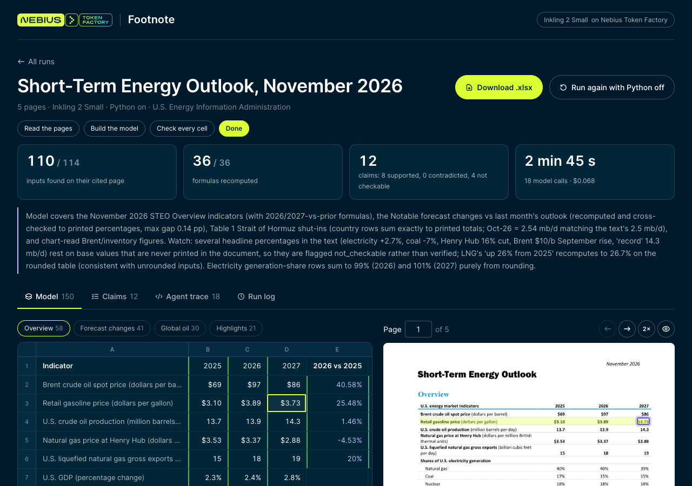
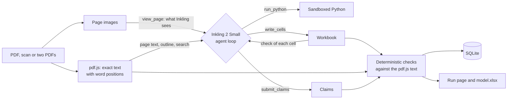

# Footnote: sourced spreadsheet models from reports with Inkling 2 Small

Upload a report PDF and get a spreadsheet model in which every number cites the page and line it came from, plus a check of the report's own claims.

**Thinking Machines' Inkling 2 Small** on [Nebius Token Factory](https://tokenfactory.nebius.com) reads the pages, decides what to model, writes the cells and formulas with a source for each one, runs Python for the arithmetic, and judges each claim. Footnote then checks the work without the model: every number is looked up in the PDF's text, every formula is recomputed, and anything without a source is flagged.



## What you'll build

A Next.js app with four ways in: one PDF, a scanned PDF, two PDFs to compare, or the bundled public report.

Footnote reads a report two ways at once, and each has its own job:

1. **Inkling 2 Small reads the pages with vision.** When it opens a page, it gets the page image together with that page's text. It reads tables, layout and charts from the image, and can zoom into a chart. A scanned page has no text, so Inkling reads it from the image alone.
2. **pdf.js extracts the exact printed text** of every page, with the position of each word, without a model call.
3. **The code verifies Inkling's work against that text.** Every number Inkling writes into the sheet must appear on the page it cites, every quote must be real, and every formula is recomputed. A value Inkling read off a chart has no printed text to check, so it is marked as a chart reading rather than verified.

In the bundled EIA run, Inkling viewed all 5 page images and zoomed into the Brent price chart four times before it wrote a cell; the agent trace shows each image it was sent.

| Inkling 2 Small does | Footnote's code does, with no model call |
| --- | --- |
| Finds its way with `list_pages` and `search_pages`, and reads pages with `view_page`: the page image plus its text, with zoom | Extracts each page's text with positions (pdf.js), renders the page images Inkling sees, builds the outline and runs the search |
| Decides what to model and writes cells with `write_cells`: a value or formula, a label, and a source (document, page, quote) | Checks every number is on its cited page and every quote is real, and answers at once so the model can fix a citation on its next step |
| Writes Python with `run_python` for arithmetic and chart reading | Runs it in a sandbox with no network, no access to your files and a 20 second limit (macOS; see below) |
| Judges the report's claims with `submit_claims`: supported, contradicted or not checkable | Recomputes every formula, adds up totals, flags unsourced cells, marks chart readings as such |
| Reads scanned pages from their images before the analysis starts | Labels those matches "the model's reading", never "PDF text" |

On the run page, click any number to see its source highlighted on the page, edit a cell and recheck it without the model, read the claims and the Python behind them, step through the agent trace, and download an `.xlsx` with live formulas, a Sources sheet and a Claims sheet. The start page searches every number from every run.

## Why Inkling 2 Small

Thinking Machines [describe it](https://thinkingmachines.ai/model-card/inkling-2-small/) as "especially strong in finance and quantitative reasoning over spreadsheets, filings and documents": a 594B-parameter (17B active) open-weight model with image input and up to 1M tokens of context.

## Use cases

| Who | What they give Footnote | What they get |
| --- | --- | --- |
| Equity and credit analysts | A quarterly or annual report | A starter model where every input links to its page, ready to extend |
| Finance and FP&A teams | Board packs and monthly reviews | A workbook that recalculates, and the stated variances that don't add up |
| Audit and review | A report before it is published | Each number in the text tied back to the tables, with the arithmetic shown |
| Energy and macro analysts | EIA, Fed or central bank outlooks, including old scanned releases | Forecast tables in a sheet, and what changed between two issues |

## How it works



The loop runs for up to 30 model calls, or 45 for documents over 20 pages. Every page the model opens stays in the conversation, and Token Factory's prompt caching serves most of that repeated input at the cached rate.

Run data lives in one SQLite file, `data/footnote.db`, through Node's built-in `node:sqlite`. Each run is stored as a JSON document, and its cells, claims, model calls and edits are copied into their own tables in the same transaction, so the start page can search them and total the spend. PDFs, page images and the `.xlsx` stay on disk in `data/runs/<id>/`.

## Setup

Requirements: Node.js 22.13 or newer (it includes SQLite, so there is nothing else to install for storage), pnpm, Python 3 for `run_python`, and a [Nebius Token Factory](https://tokenfactory.nebius.com) API key.

```bash
cd apps/footnote
pnpm install
cp env.example .env.local    # add NEBIUS_API_KEY
pnpm dev                     # http://localhost:3000
```

To try it without a key, `INKLING_PROVIDER=replay pnpm dev` replays the recorded run of the bundled EIA report through the real tools and checks.

Each live run makes paid Inkling 2 Small calls on your Token Factory project. The runs in [A real run](#a-real-run) cost $0.04 to $0.22 each; replay mode makes no calls.

`run_python` runs model-written code, so it only runs inside a sandbox. On macOS that is `sandbox-exec`: no network, writes only to its temp folder, and no reading files in your home folder apart from Python's own install, so a PDF with hidden instructions can't make it read `.env` or `~/.ssh`. On Linux and Windows the app has no comparable sandbox, so the tool is off and the start page says so. To turn it on there, run Footnote in a container and set `FOOTNOTE_PYTHON=unsandboxed`.

## Exact model and configuration

| Setting | Value |
| --- | --- |
| Model | `thinkingmachines/Inkling-2-Small` ([model page](https://tokenfactory.nebius.com/?modals=endpoint-details&model-id=thinkingmachines/Inkling-2-Small)) |
| Endpoint | `https://api.tokenfactory.eu-west2.nebius.com/v1/`, through the OpenAI-compatible `openai` SDK, streamed with `stream_options.include_usage` |
| Reasoning and sampling | Not set, so Token Factory's defaults apply |
| `max_tokens` | 32,000 per call; a reply cut off at the limit is dropped and the model is asked to continue more briefly |
| Tools | `list_pages`, `search_pages`, `view_page`, `run_python`, `write_cells`, `submit_claims` |
| Price | $0.30 per 1M input tokens, $0.06 cached and $1.00 output (Token Factory list price, 13 November 2026), applied to each call's token counts |

## Project layout

| Path | What's in it |
| --- | --- |
| [`src/lib/agent/`](src/lib/agent/) | The system prompt, tool schemas and the agent loop |
| [`src/lib/model/client.ts`](src/lib/model/client.ts) | The Token Factory client: streaming, usage, cost and replay |
| [`src/lib/pdf.ts`](src/lib/pdf.ts), [`src/lib/outline.ts`](src/lib/outline.ts), [`src/lib/transcribe.ts`](src/lib/transcribe.ts) | Text with positions, page images, the outline and search, and reading scanned pages |
| [`src/lib/book.ts`](src/lib/book.ts), [`src/lib/formula.ts`](src/lib/formula.ts), [`src/lib/numbers.ts`](src/lib/numbers.ts) | The workbook, the formula evaluator and every deterministic check |
| [`src/lib/edits.ts`](src/lib/edits.ts), [`src/lib/xlsx.ts`](src/lib/xlsx.ts), [`src/lib/python.ts`](src/lib/python.ts) | Your edits, the `.xlsx` output and the Python sandbox |
| [`src/lib/db.ts`](src/lib/db.ts) | The SQLite store: schema, migrations, search and spend totals |
| [`fixtures/filings/`](fixtures/filings/) | A 5-page excerpt of a public EIA report, with its source in `ATTRIBUTION.md` |
| [`fixtures/replays/`](fixtures/replays/) | The recorded model replies of the EIA run, for replay mode |

## A real run

Four runs on 13 November 2026 on public U.S. government reports, with Python on: the [EIA Short-Term Energy Outlook](https://www.eia.gov/outlooks/steo/archives/nov26.pdf) (pages 2 to 6, bundled as the example), the [Federal Reserve Monetary Policy Report](https://www.federalreserve.gov/monetarypolicy/files/20260710_mprfullreport.pdf) (the 18-page Summary of Economic Projections) and the [March 2026 projections](https://www.federalreserve.gov/monetarypolicy/files/fomcprojtabl20260318.pdf), and a [scanned 1975 BLS release](https://fraser.stlouisfed.org/files/docs/releases/bls/bls_employnews_197511.pdf) from FRASER. Times, tokens and costs are from the app's run log, which multiplies the token counts Token Factory returns by the list price.

| Document | Steps | Numbers found on their cited page | Formulas recomputed | Claims | Time | Cost |
| --- | --- | --- | --- | --- | --- | --- |
| EIA Short-Term Energy Outlook, Nov 2026 (5 pages) | 18 | 110 of 114, the other 4 marked as chart readings | 36 of 36 | 8 supported, 4 not checkable | 2 min 45 s | $0.068 |
| Fed economic projections, Jun 2026 (18 pages) | 16 | 62 of 62 | 51 of 51 | 9 supported, 2 not checkable | 3 min 27 s | $0.059 |
| BLS Employment Situation, Nov 1975 (18 scanned pages) | 9, after reading 18 scans | 64 of 64, in the model's reading of the scans | 65 of 65 | 10 supported, 2 not checkable | 4 min 31 s | $0.224 |
| Fed projections, Mar vs Jun 2026 (17 + 18 pages) | 12 | 57 of 57, each in the document it cites | 57 of 57 | 8 supported, 1 not checkable | 1 min 6 s | $0.038 |

All four ended with no problems or warnings from the checks. Together they made 73 model calls for **$0.39**; prompt caching covered 88% of the 1.37M input tokens.

- **It searched instead of reading everything.** In the 18-page Fed report it opened 6 pages and used `search_pages` to look for the text's account of the revisions.
- **It used Python for the arithmetic.** In the EIA run one call recomputed every row of the forecast-changes table; the results match the printed percentages to within 0.14 points.
- **It read the scans accurately.** On image-only copies of the two born-digital excerpts, its reading recovered 1,546 of 1,562 printed numbers (99%) and misread none; the misses were mostly footnote marks. Reading the 18 scanned BLS pages was $0.17 of that run's $0.22.

## Validate

These checks make no API calls:

```bash
pnpm test        # formulas, number and quote matching, checks, outline and search, scans, edits, xlsx, the database, and the EIA run replayed end to end
pnpm typecheck
pnpm build
```

## Limitations

- **Verdicts are the model's.** Footnote proves each number is on its cited page and each formula computes, but not that a number came from the right row, and it does not re-run the claim checks.
- **Scanned pages.** Their numbers are checked against the model's own reading of the page, and highlights on dense scanned tables can be a few rows off.
- **Scope.** A local app with no accounts, tested on documents of 5 to 18 pages (the limit is 120 pages). Storage is one SQLite file for a single server process; for several instances or serverless hosting, swap `src/lib/db.ts` for Postgres and the run folders for object storage. Don't expose it publicly with your own API key.
- **Cleanup.** Everything Footnote stores is in `data/` (the SQLite file and one folder per run); delete it to start over. The app creates no cloud resources. Remove your key from `.env.local` when you are done.

## Credits

Built by [Amitesh Anand](https://github.com/Astrodevil). The bundled example is an excerpt of a public U.S. government report from the Energy Information Administration; see [`fixtures/filings/ATTRIBUTION.md`](fixtures/filings/ATTRIBUTION.md).

## License

MIT, under this cookbook's [LICENSE](../../LICENSE).
