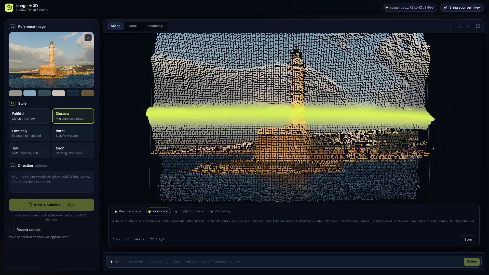
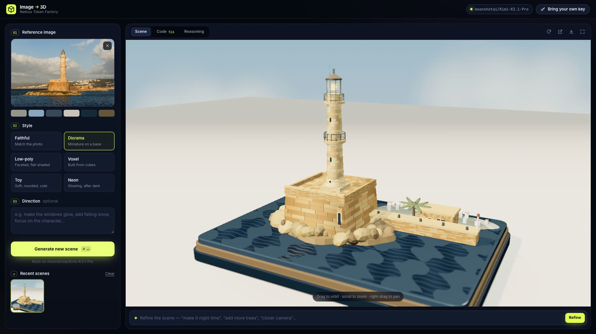
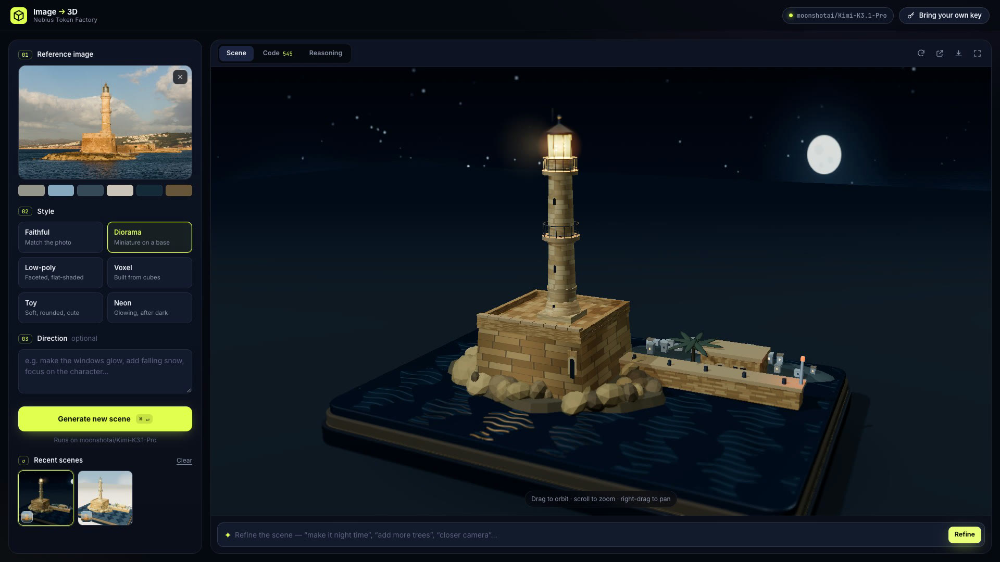

[Cookbook](../../README.md) / [Applications](../README.md) / Image to 3D

# Turn a photo into a 3D scene with Kimi

Image to 3D sends a photo to Kimi K3.1 Pro on Nebius Token Factory. Kimi studies its shape, light and depth, then writes a real-time Three.js scene you can orbit, refine with plain-language instructions, and download as a single HTML file. The app is a zero-dependency Node.js server and a static front end, and it supports bring-your-own-key (BYOK).

## What you will build

| Kimi reasons about the photo | The finished diorama | Refined: "make it night time and switch on the lighthouse beam" |
| --- | --- | --- |
|  |  |  |

1. **Image intake.** The browser downscales the image to 1024 px, samples a six-colour palette and shows an animated point-cloud relief while Kimi works.
2. **Generation.** `server.js` proxies a streaming `chat/completions` request (image plus a style brief) to Token Factory. Kimi's reasoning and code stream into the **Reasoning** and **Code** tabs.
3. **Rendering.** The generated HTML runs in a sandboxed iframe (`sandbox="allow-scripts"`). A small injected harness reports runtime errors and the first rendered frame, and takes a thumbnail for history.
4. **Self-repair.** If the scene throws or the output is cut off, **Ask Kimi to fix it** sends the code and the error back to Kimi.
5. **Refine.** Follow-up instructions, such as "add snow" or "closer camera", edit the current scene.
6. **History.** Scenes that render successfully are kept in the browser's IndexedDB (last 24).

Styles: Faithful, Diorama, Low-poly, Voxel, Toy and Neon.

## Requirements

- Node.js 20.12 or later. There are no npm dependencies.
- A WebGL-capable browser with internet access. Generated scenes load Three.js r160 from jsDelivr.
- For new generations, a Token Factory API key with access to `moonshotai/Kimi-K3.1-Pro`. Each generation or refinement is one paid request; check current pricing in the [model catalog](https://tokenfactory.nebius.com/models). Opening the saved examples makes no inference requests.

## Setup

From this directory:

```bash
cp .env.example .env
```

Set `NEBIUS_API_KEY` in `.env`, or leave it blank so that every user brings their own key in the UI. Keep `.env` out of source control.

| Variable | Default |
| --- | --- |
| `NEBIUS_API_KEY` | Blank: users must bring their own key |
| `NEBIUS_MODEL` | `moonshotai/Kimi-K3.1-Pro` |
| `NEBIUS_BASE_URL` | `https://api.tokenfactory.nebius.com/v1` |
| `PORT` | `5173` |

See the [Kimi K3.1 Pro guide](../../models/kimi-k3.1-pro.md) for model details.

## Run

```bash
npm start
# Open http://localhost:5173
```

Drop in a photo, pick a style and select **Generate new scene**. Kimi reasons before it writes code, so expect a generation to take around 5 to 10 minutes; the progress panel shows the phase, elapsed time, tokens and throughput. When the scene appears, drag to orbit, scroll to zoom, and type a refinement in the bar under the stage.

To see results without a key, open either saved example directly in a browser. Both were generated by Kimi K3.1 Pro through this app from [a photo of the Chania lighthouse](https://commons.wikimedia.org/wiki/File:Lighthouse_Chania_evening_sun.jpg) (CC0):

- [`examples/chania-lighthouse-diorama.html`](examples/chania-lighthouse-diorama.html): Diorama style, 516 lines, generated in about 10 minutes.
- [`examples/chania-lighthouse-night.html`](examples/chania-lighthouse-night.html): the refinement "make it night time and switch on the lighthouse beam", 545 lines, about 7 minutes.

### Bring your own key

Select **Bring your own key** in the top bar to use your own Token Factory key. You can also override the model and base URL there, and **Test key** checks the key against `/v1/models`.

- The key stays in the browser: in `localStorage`, or in `sessionStorage` if **Remember on this device** is cleared.
- It is sent in an `x-nebius-key` header with that user's requests only, forwarded to Token Factory, and never stored or logged by the server.
- A user's key takes priority over the server's `NEBIUS_API_KEY`.
- Base URL overrides must be `https://*.nebius.com`, so the proxy cannot be used as an open relay.

## Validate

Credential-free checks, which make no requests to Token Factory:

```bash
npm test
```

The tests start the server without a key and check that it serves the app, reports its configuration without exposing a key, requires a key, rejects base URLs outside `https://*.nebius.com`, validates the request body and refuses paths outside `public/`.

Live generation and refinement were verified with `moonshotai/Kimi-K3.1-Pro` on `https://api.tokenfactory.nebius.com/v1`. The saved examples are unedited output from those runs.

## Limitations and cleanup

- Generated code runs in a sandboxed iframe, but it is still model-written JavaScript. Review a scene before you host it elsewhere.
- The server is meant for local use or a trusted deployment. It has no authentication or rate limiting, so if it holds a server key, anyone who can reach it spends that key.
- Long generations can occasionally be cut off at the token limit; use **Ask Kimi to fix it** to complete them.
- History lives in the browser. Select **Clear** under **Recent scenes** to remove it. The app creates no external resources.

## Source and license

Built by [Amrrs](https://github.com/amrrs) for this cookbook. Released under the repository [license](../../LICENSE).
