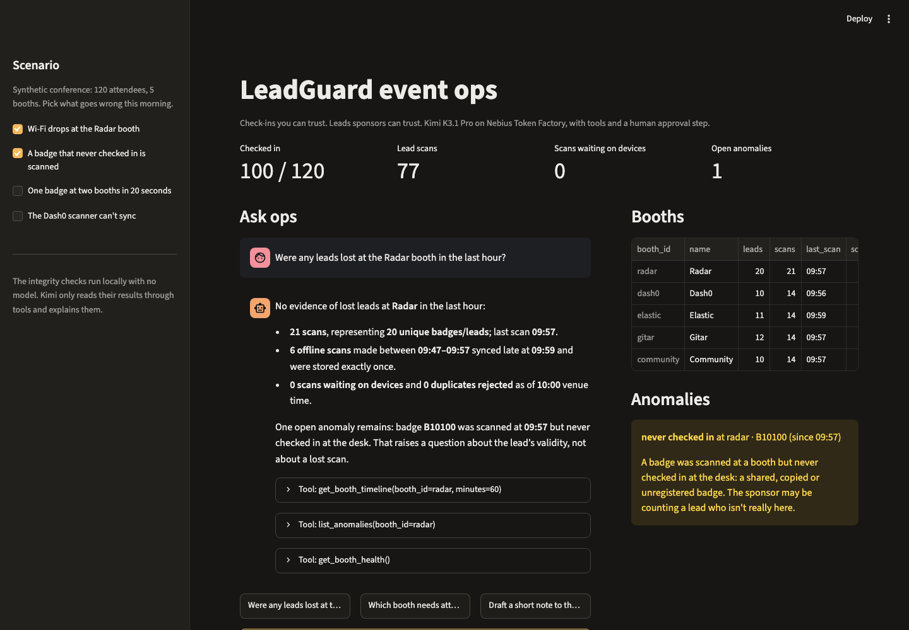
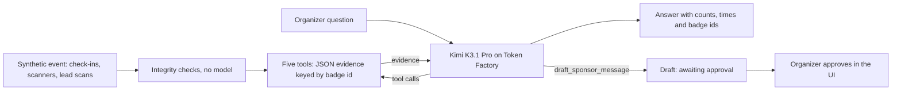

[Cookbook](../../README.md) / [Applications and demos](../README.md) / LeadGuard event ops

# LeadGuard event ops

Ask Kimi K3.1 Pro on Nebius Token Factory what is happening at a conference's sponsor booths. It answers from evidence it gathers with tool calls, and it can draft a message to a sponsor that waits for a person to approve it.



## What you will build

Conference organizers told us about two recurring problems. A sponsor says "no leads were generated" because their scanner lost scans on bad Wi-Fi, and nobody can prove what happened. Badges also get scanned at booths by people who never checked in. This recipe is the ops-assistant half of [LeadGuard](https://github.com/shivaylamba/leadguard), reduced to one Streamlit app with no database:



- **`event.py`** builds a deterministic conference (120 attendees, 5 booths) and four scenarios: Wi-Fi drops at a booth, a badge that never checked in is scanned, one badge appears at two booths in 20 seconds, and a scanner can't sync. Its integrity checks are a standard-library port of LeadGuard's: `never_checked_in`, `scanned_before_checkin` (2-minute clock tolerance), `impossible_travel` (faster than 2 m/s between booths), `silent_booth` and `scans_not_syncing`.
- **`tools.py`** exposes five tools: `get_checkin_stats`, `get_booth_health`, `get_booth_timeline` (including scans made offline that synced late), `list_anomalies` and `draft_sponsor_message`. They never return names or emails. The only write is a draft marked `awaiting_approval`, and nothing is ever sent.
- **`agent.py`** runs a Chat Completions tool-calling loop with Kimi K3.1 Pro. It stops after six rounds, and tool errors go back to the model as data.
- **`app.py`** has the scenario switches, headline numbers, booth table and anomalies. Ask ops shows every tool call Kimi made, and drafts appear with an Approve button.

## Requirements

- Python 3.11+ and [uv](https://docs.astral.sh/uv/).
- A Nebius Token Factory API key with access to `moonshotai/Kimi-K3.1-Pro`. If the key can't list that model, the app uses `moonshotai/Kimi-K3`.
- Every question makes 2 to 6 model calls. Nothing else costs money or changes external systems.

## Setup

```bash
cd apps/leadguard-event-ops
uv sync --frozen
cp .streamlit/secrets.toml.example .streamlit/secrets.toml
```

Set `NEBIUS_API_KEY` in `.streamlit/secrets.toml`. To override the preferred model,
uncomment and set `KIMI_MODEL` in the same file. Keep both settings at the top level
(outside any TOML section). The app reads them through `st.secrets` when you ask a
question; the real secrets file is ignored by Git. Restart the app after changing
the configuration.

For Streamlit Community Cloud, paste the same TOML into the app's **Secrets**
settings. See [Streamlit's secrets documentation](https://docs.streamlit.io/develop/concepts/connections/secrets-management).

## Run

```bash
uv run streamlit run app.py
```

Open http://localhost:8501. Two scenarios are on to start: Wi-Fi drops at the Radar booth, and a badge that never checked in is scanned there. Try these questions:

- **"Were any leads lost at the Radar booth in the last hour?"** Kimi calls `get_booth_timeline`, `list_anomalies` and `get_booth_health`. A recorded answer: "No evidence of lost leads at Radar in the last hour: 21 scans, 20 unique badges; 6 offline scans made between 09:47 and 09:57 synced late at 09:59 and were stored exactly once. One open anomaly: badge B10100 was scanned but never checked in."
- **"Draft a short note to the Radar sponsor about this morning."** Kimi gathers evidence, then calls `draft_sponsor_message`. The draft appears on the right as awaiting approval.
- Turn on **The Dash0 scanner can't sync** and ask **"Which booth needs attention right now, and why?"**

## Validate

Credential-free checks, with no network and no Token Factory calls:

```bash
uv run python -m unittest discover -s tests -v
```

The 28 tests cover:
- every scenario raises its anomaly, and a late sync is not treated as one;
- the clock tolerance;
- the tools never return a name or email;
- bad tool arguments come back as errors rather than exceptions, including non-object JSON, malformed JSON, excessive nesting and numeric overflow;
- the agent can correct a failed tool call and retry, while repeated errors still stop at the round limit;
- replayed tool arguments remain valid JSON objects, and mixed successful/failed calls keep their matching result IDs;
- error steps render safely in the UI, including malformed entries already saved in a session;
- drafts stay drafts;
- the agent loop, using a fake client: it feeds tool results back by `tool_call_id` and stops at the step limit;
- Streamlit secrets supply the key and model even when the environment has different values, plus model defaults, fallback selection and invalid configuration.

A live run on Nebius Token Factory with `moonshotai/Kimi-K3.1-Pro` produced the answers quoted above: 13 s and 15 s for the two questions, with 3 and 5 tool calls.

A fresh Streamlit launch on November 12, 2026 also verified the native TOML setup:
with no key or model exported in the environment, a temporary `secrets.toml`
selected `moonshotai/Kimi-K3` and the browser completed the Radar question using
the configured key. The temporary secrets file was removed after the check.

Authenticated recovery checks on the same date deliberately replaced one tool
call's arguments with `[]` (Kimi K3 and K3.1 Pro), or an unknown tool's arguments
with `null` (Kimi K3). Each model received the error, retried a valid check-in
query and correctly answered 100 checked-in attendees within three model calls.
Invalid input stays visible in the audit trail; conversation replay uses a valid
argument object so the API can accept the retry.

## Limitations and cleanup

- The event is synthetic and lives in memory. The full LeadGuard keeps the same records in Elasticsearch, serves these tools over MCP, and runs on Kubernetes; see its [repository](https://github.com/shivaylamba/leadguard).
- Approving a draft only marks it approved. Connect your own email provider before using this with real sponsors.
- The Streamlit server binds to `localhost` (`.streamlit/config.toml`).
- To clean up, stop the app with `Ctrl+C`. It creates no cloud resources. Delete `.streamlit/secrets.toml` when you're done.

## Source and license

Built by [Shivay Lamba](https://github.com/shivaylamba) for the Cloud Native Hackathon (Salt Lake City, 2026), adapted from [LeadGuard](https://github.com/shivaylamba/leadguard). Synthetic names and companies are fictional.
