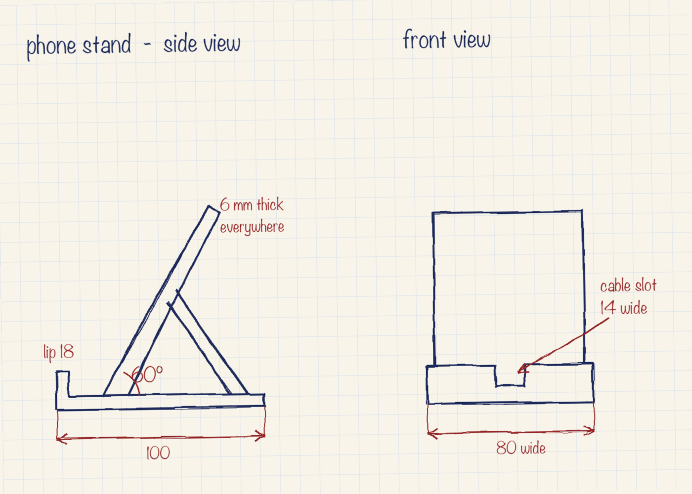
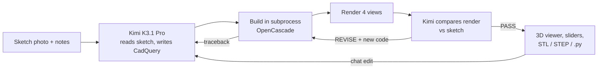

[Cookbook](../../README.md) / [Applications and demos](../README.md) / Napkin to 3D print

# Napkin to 3D print with Kimi K3.1 Pro

Sketch a part on paper, snap a photo, and get a printable, parametric STL.

**Kimi K3.1 Pro** on [Nebius Token Factory](https://tokenfactory.nebius.com/) reads your hand-drawn sketch, including any dimensions you wrote on it, and writes a parametric [CadQuery](https://github.com/CadQuery/cadquery) model. The app builds the solid, renders it from four angles, and shows Kimi its own render next to your sketch. Kimi then signs off or sends corrected code. Build errors go back to Kimi as tracebacks, so it debugs its own CAD code.

| A bundled sample sketch: side and front views with written dimensions |
| --- |
|  |

## What you will build

A Streamlit app that turns one sketch into a part you can print:

1. **Design.** Kimi reads the sketch image and your optional notes and writes one Python module: a `PARAMS` dict of the dimensions worth tweaking and a `build(p)` function that returns a CadQuery solid.
2. **Build.** `cad_runner.py` checks the code against an import allowlist and an AST denylist, builds it in a separate process with a timeout and an empty environment, sits the part on the print bed, and exports STL and STEP. If the build fails, Kimi gets the traceback and up to three tries to fix it.
3. **Review.** `render.py` draws front, right, top and isometric views with the measured size printed on them. Kimi sees the sketch and the render side by side and answers `VERDICT: PASS` or `VERDICT: REVISE` with corrected code. This repeats for the number of self-review rounds you choose.
4. **Use it.** The part prints itself layer by layer in a Three.js viewer. Every `PARAMS` entry becomes a slider that rebuilds the part locally with no model call. A chat box applies edits such as "add a 10 mm cable hole through the back". Download the STL, the STEP, or the CadQuery source.

The app also reports print-readiness checks (watertight mesh, single solid, valid B-rep, size, volume and an estimated PLA weight) and keeps a timeline of every version with Kimi's interpretation, review notes and the build errors it fixed.



### Model and configuration

| Setting | Value |
| --- | --- |
| Endpoint | `https://api.tokenfactory.nebius.com/v1/` (OpenAI-compatible) |
| Preferred model | `moonshotai/Kimi-K3.1-Pro`, override with `KIMI_MODEL` |
| Fallbacks | `moonshotai/Kimi-K3`, then `moonshotai/Kimi-K2.6`, if the key can't use the preferred model. The sidebar says when a fallback is active. |
| Reasoning effort | Sidebar choice, `high` by default |
| Self-review rounds | Sidebar slider, 1 to 4, default 3 |
| Build limits | 120 s per build, up to 3 automatic repairs per version |

### Project layout

```text
napkin-to-3d-print/
├── app.py           # Streamlit UI: input, live progress, viewer, sliders, chat edits, timeline
├── cad_agent.py     # Design, build, render and critique loop, plus all prompts
├── cad_runner.py    # Subprocess that checks, builds and exports the CadQuery model
├── render.py        # Headless four-view renders and mesh checks (Matplotlib, no OpenGL)
├── viewer.py        # Three.js viewer with the layer-by-layer print animation
├── kimi.py          # Token Factory client, model fallback and streaming
├── samples/         # Hand-drawn sample sketches: phone stand, wall hook, pen cup
├── tests/           # Credential-free unit tests
├── .streamlit/      # Binds the server to localhost
├── env.example
├── pyproject.toml
└── uv.lock
```

## Requirements

- Python 3.11 or newer (required by CadQuery 2.8)
- [uv](https://docs.astral.sh/uv/) (or pip)
- A Token Factory API key from [tokenfactory.nebius.com](https://tokenfactory.nebius.com/)
- About 1.6 GB of disk for the environment, mostly CadQuery and OpenCascade

**Paid calls.** Each design is one call with the sketch, plus one call per self-review round (sketch and render images) and one call per automatic build repair. Each chat edit is one more call, plus repairs if the edit doesn't build. Moving a slider makes no model call. The sidebar shows the tokens used in the session.

## Setup

From this directory:

```bash
uv sync
cp env.example .env
```

Set `NEBIUS_API_KEY` in `.env`. The key stays in the Streamlit server process, and the CAD build subprocess never receives it.

With pip instead of uv:

```bash
python -m venv .venv && source .venv/bin/activate
pip install -e .
```

## Run

```bash
uv run streamlit run app.py
```

Open http://localhost:8501, then:

1. Upload a photo of your sketch, take one in the **Camera** tab, or open **Samples** and pick the phone stand, wall hook or pen cup.
2. Optionally add notes, such as "fits an iPhone 16 at 60°" or "M4 screws, 3 mm walls".
3. Click **Model it** and watch Kimi read, build, review and revise.
4. Move the sliders, ask for changes, then download the STL and print it.

Tips:

- Write the important dimensions on the sketch. Kimi reads them and keeps them exact.
- Two views (side and front) work much better than one perspective doodle.
- Use `low` effort for faster chat edits and `max` for tricky parts.

## Validate

Credential-free tests cover the code guard (allowed imports, blocked builtins, dunder access, CadQuery and NumPy file I/O, the runtime import hook), parameter clamping, reply parsing, and a real CadQuery build of a small bracket through the same sandboxed subprocess the app uses, including STL and STEP export, mesh checks and the four-view render. They make no network or Token Factory calls:

```bash
uv sync --frozen
uv run python -m unittest discover -s tests
```

What was verified for this recipe:

- The 8 offline tests pass with Python 3.12 on macOS, using the committed `uv.lock`. The first run after a fresh install can take a few minutes while the OS loads the OpenCascade libraries for the first time; later runs take a few seconds.
- Live Token Factory calls were not re-run for this cookbook copy. Run a design yourself to confirm your key's model access and cost.

## Limitations and cleanup

- **Generated code runs on your machine.** The build step runs model-written Python in a separate process with a 120 s timeout and an empty environment. Before running it, a static check refuses imports other than the top-level `cadquery`, `math` and `numpy` modules, builtins such as `open`, `exec`, `eval` and `getattr` (called or not), dunder names, names and attributes starting with `export`, `import`, `save`, `load`, `read`, `write` or `dump` (the CadQuery and NumPy file I/O methods), and the `cqgi`, `occ_impl`, `OCP` and `ctypeslib` modules. At run time the code also gets a reduced set of builtins whose `__import__` enforces the same import rules. A denylist can't anticipate every path through two large libraries, so this is a guardrail for a local demo, not a security sandbox. Don't expose the app to other people as is. For a shared deployment, run `cad_runner.py` inside a real isolation boundary, such as a container or remote sandbox with no network and a read-only filesystem.
- **Localhost only.** `.streamlit/config.toml` binds the server to `localhost`, and the app has no authentication.
- **Sketch quality matters.** Kimi infers sizes it can't read from the object's purpose. Check the measured size and wall thickness before printing.
- **Fillets and complex lofts can fail** in OpenCascade. The helpers `safe_fillet` and `safe_chamfer` return the part unchanged rather than failing the build, so a rounded edge may be missing.
- **The 3D viewer loads three.js** from the jsDelivr CDN, so it needs the internet.

The app creates no cloud resources. Builds run in temporary directories that are deleted automatically. To clean up:

```bash
rm -rf .venv .env
```

## Source and license

Built by [Arindam Majumder](https://github.com/Arindam200). Kimi K3.1 Pro is by [Moonshot AI](https://www.kimi.ai/blog/kimi-k3-1-pro). Uses [CadQuery](https://github.com/CadQuery/cadquery), [trimesh](https://github.com/mikedh/trimesh) and [three.js](https://threejs.org/).

Released under this repository's [MIT license](../../LICENSE).
