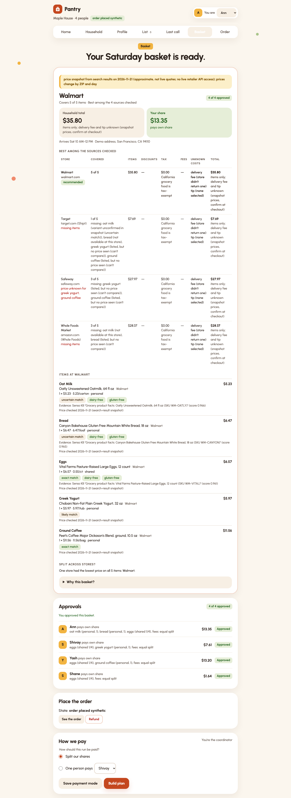

[Cookbook](../../README.md) / [Applications and demos](../README.md) / Pantry

# Pantry

Pantry is a grocery agent for people who share a home. Everyone says what they need in plain words, by chat or voice, from the web app or from their own AI agent over MCP. Kimi K3.1 Pro on Nebius Token Factory runs the conversation and turns each message into a structured request. The agent then compares complete baskets across stores, splits the cost to the cent, and pays only after every person approves their own share. Every step is recorded in an audit trail.

Pantry won second place overall at the Personal Agents Hackathon (San Francisco, November 2026).



## What you will build

A household context layer that several people's agents share:

1. **Who needs what.** Each request keeps its author and whether it is shared or personal.
2. **Each person's rules.** Profile chips (allergies, diets, "always get me" items) become hard rules. A member can share the rule with the household while keeping the detail private.
3. **What is true.** Verified product facts decide hard requirements, not a store's listing.

The household journey:

1. **Make the household.** The coordinator sets the name, schedule, delivery window and payment mode, then invites people by email. Each invite has a single-use join link, and joining issues that person a personal MCP token for their own agent.
2. **Talk to Pantry.** Kimi K3.1 Pro asks one question at a time, only when something is missing, and uses the member's profile instead of asking. For example: "Unsweetened oat milk, like always. Any brand?", then "When do you need it?" (asked once per run) and "Non-fat or whole milk?". Replies that used a profile rule carry a *From your preferences* tag.
3. **Shared list** with Everyone and Mine views.
4. **Last call.** The coordinator brings the cutoff forward and everyone is told no reply is needed. At the cutoff the agent shops without waiting for anyone who stayed silent.
5. **Basket.** The agent compares the same products at every store checked and picks the cheapest complete basket. It also reports whether splitting across stores would save money once fees are counted. Quantities, tax, fees and per-person shares are computed in deterministic code, and shares reconcile to the order total exactly. Each person approves their own share ("N of 4 approved"), and the agent can never approve for anyone.
6. **Pay and order.** Every payer's card is held first and charged only when every hold succeeds. A decline releases the other holds, a repeated request never double-charges, and refunds go to the original payers. Receipts are emailed and the household's Slack channel gets an update.

Each member's own agent (Claude, ChatGPT, Codex) connects to the MCP server with a personal token. Tools include `talk_to_pantry`, `set_profile`, `get_group_context`, `add_request`, `update_request`, `set_preference`, `get_run_snapshot`, `save_plan` and `append_audit_event`. Approving and paying happen only in the web app.

The repository also includes a family-occasions agent at `/`. It starts from calendar events, checks seller claims against verified facts, rejects listings with prompt injections, and buys within a spending mandate.

### Integrations

Every integration is optional. Without its key, a clearly labelled local stand-in runs, so the app and tests work with no credentials.

| Service | Role | Code |
| --- | --- | --- |
| Nebius Token Factory | Kimi K3.1 Pro for the conversation, request extraction and decisions | `app/gchat.py`, `app/grocery.py`, `app/models.py` |
| Senso | Verified product facts; hard requirements are decided from `senso_search` evidence | `app/grocery.py`, `app/senso.py` |
| Cognee | Per-member and household memory, recalled within each member's permissions | `app/memory.py` |
| Firedrill | Synthetic Gmail (invites, receipts), Slack (last call, order updates), Stripe (payments) and Google Calendar, through MCP | `app/firedrill.py` |
| SingleStore | System of record; falls back to a labelled SQLite store | `app/db.py` |
| Superlinked SIE | Embedding scores for product match quality | `app/models.py` |
| Statsig, Amplitude | Agent settings; funnel events with no personal data | `app/telemetry.py` |
| Persona | Sandbox identity check behind a spending mandate | `app/persona.py` |
| Tokens& Observe | Metadata-only telemetry for model and tool calls | `app/tokens.py` |
| Guild AI | Review session for each basket plan | `app/guild.py` |

## Requirements

- Python 3.11 or later and [uv](https://docs.astral.sh/uv/)
- A Nebius Token Factory API key for live model calls. Each chat turn and each decision is a paid chat completion.
- Optional keys for the services above. Firedrill, the Persona sandbox and Stripe test mode do not move real money.
- Voice input uses the browser's speech recognition (Chrome).

## Setup

From this directory:

```bash
uv sync
cp env.example .env
chmod 600 .env
# Fill in NEBIUS_API_KEY and any optional integrations you want to use.
```

[`env.example`](env.example) lists every variable the app reads. Only `NEBIUS_API_KEY` is needed for live model calls; a line left commented out or blank uses the default.

## Run

```bash
./run.sh
```

`run.sh` starts the web app on port 8700 and the MCP server on port 8701. Both listen on `127.0.0.1` only, because the app has no sign-in. On first start it also writes a personal MCP token to `MEMBER_TOKENS` in `.env` for each member of the default household (Ann, Shivay, Yash and Shane) and for Dad, who belongs to the occasions agent.

1. Reset to an empty household: `curl -X POST "localhost:8700/api/g/reset?fresh=1"`.
2. Open `http://localhost:8700/group`. On **Household**, create the household and invite people. Open each join link to join as that person.
3. On **Profile**, pick allergy and diet chips. On **Home**, tell Pantry what you need, for example "We need milk." The agent asks follow-up questions only when something is missing.
4. On **Last call**, send a two-minute last call. At the cutoff the basket is built automatically.
5. On **Basket**, each person approves their own share using the **You are** menu. Then click **Authorize payments and place order**.

To connect a member's own agent, you need that member's token:

- Someone who joins by invite sees a personal agent link (`http://localhost:8701/mcp?token=...`) on the welcome card.
- Ann, the coordinator, never joins by invite. Her token is the `ann:` entry of `MEMBER_TOKENS` in `.env`, as are the tokens of the other default members.

Then add the server to the agent, for example in Claude Code:

```bash
claude mcp add --transport http pantry-ann "http://localhost:8701/mcp" --header "Authorization: Bearer <token>"
```

A hosted agent, such as a custom connector in Claude, can't reach `localhost`. For that, put the MCP port behind a tunnel, set `PANTRY_HOST=0.0.0.0` and set `PUBLIC_MCP_URL` to the tunnel's URL so the personal agent links point at it.

To watch a scripted agent use the tools, run it as a member who has joined. Here it adds a dozen eggs for the house as Shivay:

```bash
set -a; . ./.env; set +a
uv run python scripts/member_agent.py http://localhost:8701 shivay
```

To run the whole household script against a running server (live calls to every configured service):

```bash
uv run python scripts/ann_script_live.py http://localhost:8700
```

## Validate

Credential-free checks:

```bash
uv run pytest -q tests
```

The 28 tests cover:
- the conversation's follow-up questions;
- household invites, single-use join links and personal agent links, including two people with the same name;
- shared and personal allocation, with exact reconciliation in both payment modes;
- the split-basket check, last-call cutoff, approval versioning and duplicate execution;
- a declined card releasing other holds, and refunds;
- private profiles and group isolation;
- the occasions agent's safety rules: allergens, false shipping claims, counterfeit sellers, prompt injection and spending limits.

Live verification on 2026-11-22 with `moonshotai/Kimi-K3.1-Pro`: `scripts/ann_script_live.py` ran the full household journey with SingleStore, Firedrill, Senso, Cognee, SIE, Statsig, Amplitude, Tokens& and Guild configured. It covered:
- three invites and joins;
- every scripted conversation turn, with the expected follow-up questions;
- the automatic shop at the cutoff;
- the cheapest complete basket, with shares of $13.35, $7.61, $13.20 and $1.64 reconciling to $35.80;
- four approvals, four captured payments, four emailed receipts and a Slack update;
- a duplicate request with no second charge, and four refunds.

The Persona identity step is part of the occasions agent and was not exercised in that run.

## Limitations and cleanup

- **Prices are a snapshot.** Store prices come from a dated search-result snapshot of five national products at Walmart, Target, Safeway and Whole Foods Market. They aren't live quotes. Listings that weren't found, prices that weren't seen and fees that weren't returned are labelled, never treated as zero.
- **No real checkout.** No live retailer API was available, so orders are marked synthetic and never shown as purchased or delivered. There is no delivery tracking.
- **No sign-in.** The web app uses a demo member switcher, so anyone who can reach port 8700 can act as any member, reset the run or start the payment flow. Both servers therefore listen on `127.0.0.1` by default. Set `PANTRY_HOST=0.0.0.0` only on a network you trust. MCP access uses a personal token per member.
- **Firedrill is temporary.** Its URLs point to a local bridge tied to a temporary session.
- **Cleanup:**
  - Stop the servers with `pkill -f "uvicorn app.server:app"` and `pkill -f "python -m app.mcp_server"`.
  - Delete `data/` and `logs/` to remove local state.
  - Documents the app loads into Senso and Cognee stay in those accounts until you delete them there.

## Source and license

Built by Shivay Lamba and team for the Personal Agents Hackathon. Source: [shivaylamba/occasions-agent](https://github.com/shivaylamba/occasions-agent) at revision `9bfaecb`.

Cookbook changes:
- Guild workspace and agent IDs moved to environment variables;
- `pyproject.toml` and `uv.lock` added;
- an environment template, [`env.example`](env.example);
- both servers listen on `127.0.0.1` by default;
- personal MCP tokens for the whole default household, and a personal agent link on every join;
- an invite never replaces an existing member with the same name;
- `scripts/member_agent.py`, a scripted MCP client for a household member.

The upstream project already uses Kimi K3.1 Pro as its default model.

MIT, under this cookbook's [LICENSE](../../LICENSE).
