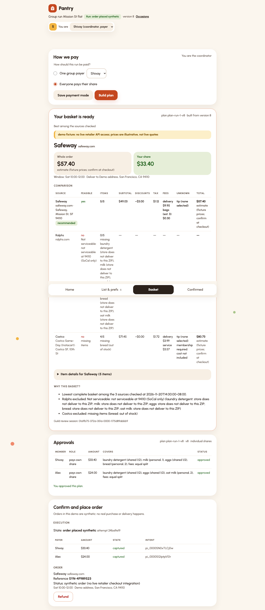

[Cookbook](../../README.md) / [Applications and demos](../README.md) / Pantry

# Pantry

Pantry is a grocery agent for people who share a home. Everyone adds what they need in plain words, from the web app or from their own AI agent over MCP. Kimi K3.1 Pro on Nebius Token Factory turns each message into a structured request. The agent then compares complete baskets, splits the cost to the cent, and pays only after every payer approves their own share. Every step is recorded in an audit trail.

Pantry won second place overall at the Personal Agents Hackathon (San Francisco, November 2026).



## What you will build

A household context layer that several people's agents share:

1. **Who needs what.** Each request keeps its author and whether it is shared or personal.
2. **Each person's rules.** A rule such as "detergent must be fragrance-free" is shared with the household; the reason behind it stays private to that person.
3. **What is true.** Verified product facts decide hard requirements, not a store's listing.

On top of that context, the agent:

- turns plain-language requests into structured ones with **Kimi K3.1 Pro** (`moonshotai/Kimi-K3.1-Pro`) through the Token Factory OpenAI-compatible API;
- merges shared supplies and keeps personal quantities with the person who asked;
- compares complete baskets at every store it checked. A basket missing an item is infeasible, and unknown fees stay unknown;
- computes pack counts, tax, fees and per-person shares in deterministic code, so shares reconcile to the order total exactly;
- binds each approval to one plan version. Any change voids earlier approvals, and the agent can never approve for anyone;
- holds every payer's card, charges only when every hold succeeds, releases the others if one is declined, ignores duplicate requests and refunds the original payers.

Each member's own agent (Claude, ChatGPT, Codex) connects to the MCP server with a personal token. Tools: `get_group_context`, `add_request`, `update_request`, `set_preference`, `get_run_snapshot`, `save_plan`, `append_audit_event`. Approving and paying happen only in the web app.

The repository also includes a family-occasions agent at `/`. It starts from calendar events, checks seller claims against verified facts, rejects listings with prompt injections, and buys within a spending mandate.

### Integrations

Every integration is optional. Without its key, a clearly labelled local stand-in runs, so the app and tests work with no credentials.

| Service | Role | Code |
| --- | --- | --- |
| Nebius Token Factory | Kimi K3.1 Pro for request extraction and decisions | `app/models.py`, `app/grocery.py` |
| Senso | Verified product facts; hard requirements are decided from `senso_search` evidence | `app/senso.py`, `app/grocery.py` |
| Cognee | Per-member and household memory, recalled within each member's permissions | `app/memory.py` |
| Firedrill | Synthetic Google Calendar, Stripe, Gmail and Slack through MCP | `app/firedrill.py` |
| SingleStore | System of record; falls back to a labelled SQLite store | `app/db.py` |
| Superlinked SIE | Embedding scores for product match quality | `app/models.py` |
| Statsig, Amplitude | Agent settings; funnel events with no personal data | `app/telemetry.py` |
| Persona | Sandbox identity check behind a spending mandate | `app/persona.py` |
| Tokens& Observe | Metadata-only telemetry for model and tool calls | `app/tokens.py` |
| Guild AI | Review session for each basket plan | `app/guild.py` |

## Requirements

- Python 3.11 or later and [uv](https://docs.astral.sh/uv/)
- A Nebius Token Factory API key for live model calls. Each request extraction and each decision is one paid chat completion.
- Optional keys for the services above. Firedrill, Persona sandbox and Stripe test mode do not move real money.

## Setup

From this directory:

```bash
uv sync
cp .env.example .env
chmod 600 .env
# Fill in NEBIUS_API_KEY and any optional integrations you want to use.
```

## Run

```bash
./run.sh
```

`run.sh` starts the web app on port 8700 and the MCP server on port 8701, and generates a personal MCP token for each member in `.env` on first start.

- Open `http://localhost:8700/group` for the group grocery run, or `http://localhost:8700/` for family occasions.
- Add requests such as `We need laundry detergent for the flat` and `2 cartons of oat milk for me`. Each one appears in the shared list within a few seconds.
- On the Basket tab, choose **Everyone pays their share**, click **Build plan**, approve as each member with the **You are** menu, then click **Authorize payments and place order**.

To connect a member's own agent, add `http://<host>:8701/mcp?token=<that member's token>` as a custom connector in Claude, or run:

```bash
claude mcp add --transport http pantry-alex "http://localhost:8701/mcp" --header "Authorization: Bearer <token>"
```

To run the full group flow against a running server (live calls to every configured service):

```bash
bash scripts/e2e_group.sh
```

## Validate

Credential-free checks:

```bash
uv run pytest -q tests
```

The 23 tests cover allocation reconciliation in both payment modes, approval versioning, duplicate execution, a declined card releasing other holds, refunds, private preferences, group isolation, and the occasions agent's safety rules (allergens, false shipping claims, counterfeit sellers, prompt injection, spending limits).

Live verification on 2026-11-22 with `moonshotai/Kimi-K3.1-Pro`: request extraction returned correct item, quantity, unit, shared or personal, and constraints for four sample requests in 4 to 6 seconds each, and the gift decision cited the household's facts. The hackathon run itself used `nvidia/Nemotron-3_5-Lightning`; the full end-to-end flow with every integration was verified on that run and has not been repeated with Kimi K3.1 Pro.

## Limitations and cleanup

- Store prices, stock and coupons come from a labelled demo fixture. No live retailer API was available, so orders are marked synthetic and never shown as purchased or delivered. There is no delivery tracking.
- The web app uses a demo member switcher instead of sign-in. MCP access uses a personal token per member.
- Firedrill URLs point to a local bridge tied to a temporary session.
- Stop the servers with `pkill -f "uvicorn app.server:app"` and `pkill -f "python -m app.mcp_server"`. Delete `data/` and `logs/` to remove local state. Documents loaded into Senso and Cognee by the app remain in those accounts until you delete them there.

## Source and license

Built by Shivay Lamba and team for the Personal Agents Hackathon. Source: [shivaylamba/occasions-agent](https://github.com/shivaylamba/occasions-agent) at revision `13dcfad`. Cookbook changes: Kimi K3.1 Pro as the default model, Guild workspace and agent IDs moved to environment variables, `pyproject.toml` and `uv.lock` added, and an environment template.
