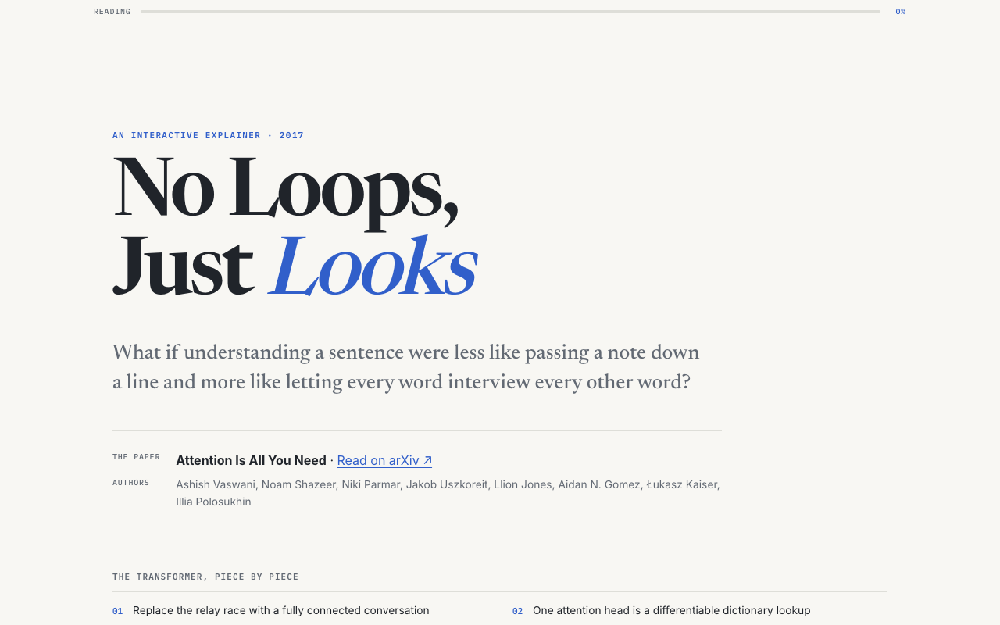
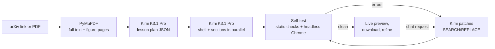
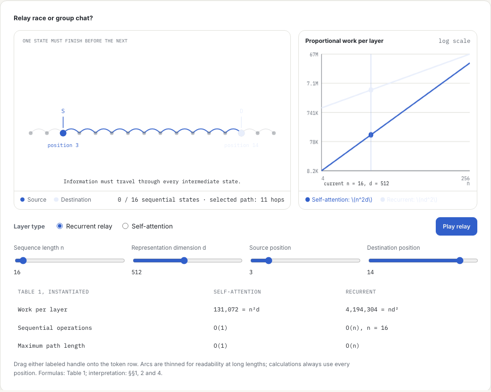

[Cookbook](../../README.md) / [Applications and demos](../README.md) / Paper to interactive explainer

# Paper to interactive explainer with Kimi K3.1 Pro

Paste an arXiv link or upload a PDF and get a Distill-style explainer: one HTML page where every core idea of the paper is something you can drag, slide or step through.

**Kimi K3.1 Pro** on [Nebius Token Factory](https://tokenfactory.nebius.com/) reads the whole paper in one request, figure pages included, using its long context and vision input. It designs a lesson, writes the page, and then fixes the JavaScript errors that a headless Chrome self-test finds before you see the result.



## What you will build

A Streamlit app that runs a four-step loop:

1. **Read.** `paper.py` downloads the PDF from arXiv (or takes your upload), extracts the text of every page with PyMuPDF and renders up to eight pages that contain figures.
2. **Plan.** Kimi receives the full text and the figure renders in one request and returns a JSON lesson plan: four to six sections, one interactive widget per idea, key results quoted from the paper, limitations, a glossary and a quiz.
3. **Build.** One Kimi call writes the page shell (design system, hero, quiz) while one call per section writes that section's prose and widget, all in parallel against a shared CSS and JavaScript contract. The app stitches them into a single self-contained HTML file. A writer that hits the output limit is asked to continue where it stopped.
4. **Self-test.** Static checks catch truncation and missing sections. If Playwright is installed, the page is loaded in headless Chrome, scrolled and poked, and any page or console errors go back to Kimi, which returns SEARCH/REPLACE patches. Kimi gets up to two fix passes.

After that you can ask for changes in plain English ("let me type my own sentence into the attention widget"). Each request becomes a patch, a re-test and a new saved version.



| An interactive widget from the same generated explainer |
| --- |
|  |

### Model and configuration

| Setting | Value |
| --- | --- |
| Endpoint | `https://api.tokenfactory.nebius.com/v1/` (OpenAI-compatible) |
| Preferred model | `moonshotai/Kimi-K3.1-Pro`, override with `KIMI_MODEL` |
| Fallbacks | `moonshotai/Kimi-K3`, then `moonshotai/Kimi-K2.6`, if the key can't use the preferred model. The sidebar says when a fallback is active. |
| Reasoning effort | Sidebar choice for the plan and patches (`high` by default). Parallel section writers use `low`. |
| Output limit | 32,000 tokens for the plan, 20,000 per section writer, 64,000 for patches |

### Project layout

```text
paper-to-interactive-explainer/
├── app.py               # Streamlit UI: input, live progress, plan cards, preview, refine, versions
├── explainer_agent.py   # Plan, parallel build, self-test and patch loop, plus all prompts
├── paper.py             # arXiv and PDF loading, text extraction, figure-page renders
├── qa.py                # Headless Chrome self-test (Playwright), run as a subprocess
├── kimi.py              # Token Factory client, model fallback and streaming
├── tests/               # Credential-free unit tests
├── .streamlit/          # Binds the server to localhost
├── screenshots/         # README images
├── env.example
├── pyproject.toml
└── uv.lock
```

## Requirements

- Python 3.10 or newer
- [uv](https://docs.astral.sh/uv/) (or pip)
- A Token Factory API key from [tokenfactory.nebius.com](https://tokenfactory.nebius.com/)
- Optional: Playwright and Chromium for the browser self-test (about 150 MB)
- Network access to `export.arxiv.org` and `arxiv.org` when you load papers by link

**Paid calls.** Building one explainer makes one planning call that carries the whole paper (up to about 150k tokens of text plus up to eight page images), one shell call, one call per section (each with up to about 40k tokens of the paper), and up to two patch calls. Every refine request is one more patch call. Check current pricing on the [model page](https://tokenfactory.nebius.com/?modals=endpoint-details&model-id=moonshotai/Kimi-K3.1-Pro) before running it on long papers.

## Setup

From this directory:

```bash
uv sync
cp env.example .env
```

Set `NEBIUS_API_KEY` in `.env`. The key stays on the server: the browser UI never asks for it.

Optional, recommended: enable the headless Chrome self-test.

```bash
uv sync --extra qa
uv run playwright install chromium
```

With pip instead of uv:

```bash
python -m venv .venv && source .venv/bin/activate
pip install -e ".[qa]"
playwright install chromium
```

## Run

```bash
uv run streamlit run app.py
```

Open http://localhost:8501, then:

1. Paste an arXiv link or ID (for example `1706.03762`), click one of the example papers, or upload a PDF.
2. Pick an audience in the sidebar: curious beginner, software engineer or researcher.
3. Click **Build the explainer**. You'll see the paper card, the lesson plan, each section being written in parallel, and the self-test.
4. Play with the explainer inline, download it as one `.html` file, or ask for changes under **Refine it**.

A full build at `high` effort usually takes a few minutes because Kimi writes a lot of code. Use `low` for faster refinements. Every version is saved to `outputs/`.

## Validate

Credential-free tests cover arXiv ID parsing, PDF text and figure-page extraction (on a PDF generated in memory), plan JSON parsing, section assembly and the SEARCH/REPLACE patcher and the sandboxed preview wrapper. They make no network or Token Factory calls:

```bash
uv sync --frozen
uv run python -m unittest discover -s tests
```

What was verified for this recipe:

- The 14 offline tests pass with Python 3.12 on macOS, using the committed `uv.lock`.
- The screenshots above come from an explainer this app generated for arXiv 1706.03762 during development in November 2026. The page was rendered in headless Chrome to take them.
- Live Token Factory calls were not re-run for this cookbook copy. Run a build yourself to confirm your key's model access and cost.

## Limitations and cleanup

- **Accuracy.** Kimi is told to use only numbers that appear in the paper and to cite the table or section they come from. Explainers are a teaching aid, not a substitute for the paper. Check important claims against the original.
- **Long papers.** Text beyond 600,000 characters is cut, and at most eight figure pages are sent. Each parallel section writer sees the first 160,000 characters.
- **Generated pages need the internet.** They load fonts, KaTeX and sometimes three.js from public CDNs.
- **Generated code runs in your browser.** The explainer is model-written HTML and JavaScript, and a paper could carry prompt-injected instructions. The in-app preview runs it in a sandboxed iframe with an opaque origin (`sandbox="allow-scripts"` without `allow-same-origin`), so its scripts can't reach the Streamlit page, its cookies or its storage. A downloaded `.html` file has no such sandbox when you open it, so review a page before you open it outside the app or publish it.
- **Local demo.** The app has no authentication, and anyone who can reach the Streamlit port can spend your key. `.streamlit/config.toml` binds the server to `localhost`; keep it that way, or put the app behind your own auth.

The app creates no cloud resources. To clean up, delete generated pages and the environment:

```bash
rm -rf outputs .venv .env
```

## Source and license

Built by [Arindam Majumder](https://github.com/Arindam200). Inspired by [Distill](https://distill.pub/) and [Bartosz Ciechanowski](https://ciechanow.ski/)'s interactive essays. Kimi K3.1 Pro is by [Moonshot AI](https://www.kimi.ai/blog/kimi-k3-1-pro).

Released under this repository's [MIT license](../../LICENSE).
