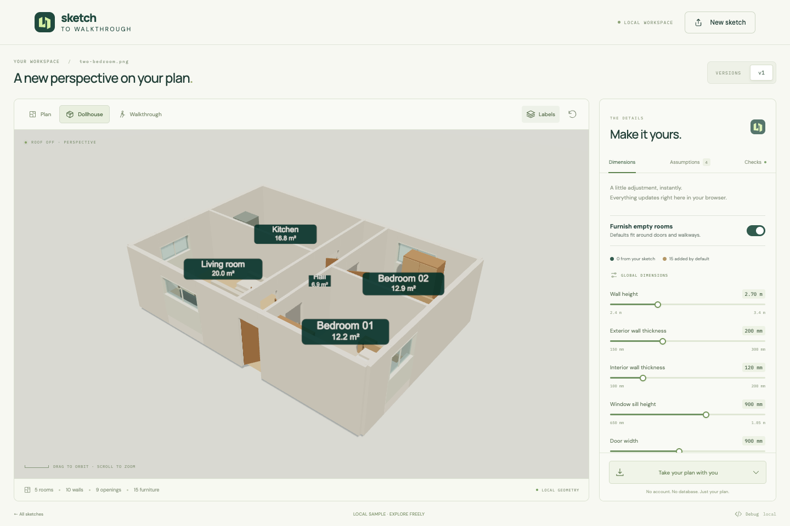
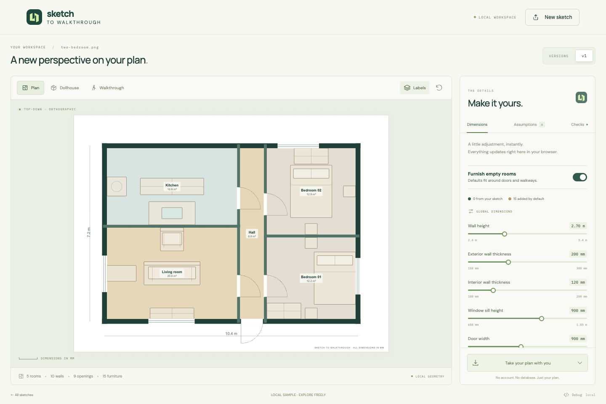
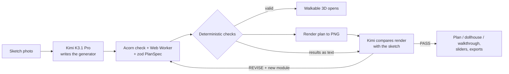
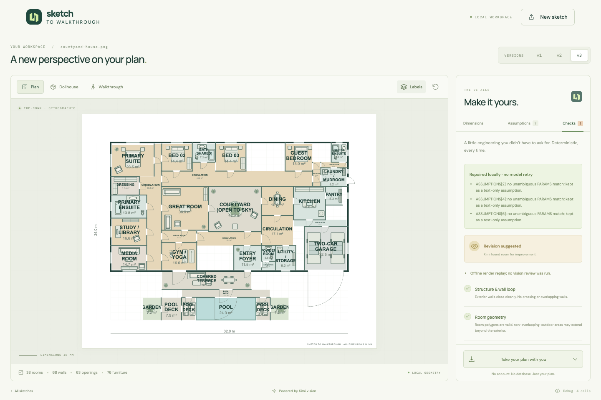

[Cookbook](../../README.md) / [Applications and demos](../README.md) / Sketch to Walkthrough

# Sketch to Walkthrough with Kimi K3.1 Pro

Upload a photo of a hand-drawn floor plan and walk through it in 3D in your browser.

**Kimi K3.1 Pro** on [Nebius Token Factory](https://tokenfactory.nebius.com/) reads the sketch, including every dimension written on it, and writes a small JavaScript layout generator. The app runs that generator in a sandbox, checks the result with deterministic engineering checks, renders a plan, and shows Kimi its own render next to your sketch. Kimi then signs off or sends a corrected generator. Kimi controls the layout; the renderer, the checks and the furniture library are fixed, tested code.

| Dollhouse view with labelled rooms and furniture | The same plan, top-down |
| --- | --- |
|  |  |

## What you will build

A Vite + React + Three.js app with a small Hono server that keeps the API key:

1. **Generate.** The sketch goes to Kimi with [`prompts/generate.md`](prompts/generate.md). Kimi lists every written dimension and room schedule entry, converts units exactly, and returns a module that exports `PARAMS` (every dimension, with min and max), `ASSUMPTIONS` (what it filled in where the sketch was silent) and `buildPlan(P)`. `buildPlan` returns a `PlanSpec`: walls, rooms, openings, furniture, written room sizes and room neighbours, all in millimetres.
2. **Build in a sandbox.** The source is parsed with Acorn and rejected if it uses imports, globals, dynamic code or prototype access. It then runs in a disposable Web Worker with a 500 ms limit, and the result is validated with zod. Small slips, such as a parameter outside its range, are repaired locally and listed in the UI.
3. **Check.** Deterministic checks run on every version: a closed exterior, valid non-overlapping rooms, room sizes within ±10% of the written sizes, rooms touching the neighbours the sketch shows, no leftover space inside the house, openings that fit their walls, every room reachable from the entry, and furniture that stays inside its room and clear of door swings with a 600 mm path.
4. **Review.** The plan is rendered to PNG. Kimi gets the sketch, the render, the check results and the source with [`prompts/review.md`](prompts/review.md), and answers `PASS` or `REVISE` with a corrected module. The app keeps up to three versions.
5. **Use it.** The first version that passes the checks opens straight away while review continues in the background. Explore it as a plan, a dollhouse or a first-person walkthrough with collision. Every `PARAMS` entry becomes a slider that rebuilds the plan locally with no model call. Download `.glb`, `plan.json`, `plan.js` or `plan.svg`.



It also handles detailed plans. [`samples/courtyard-house.png`](samples/courtyard-house.png) is a 32 m × 21 m house with about 21 dimensioned rooms, an open courtyard, a terrace and a pool:



### Model and configuration

| Setting | Value |
| --- | --- |
| Endpoint | `https://api.tokenfactory.nebius.com/v1` (OpenAI-compatible), override with `NEBIUS_BASE_URL` |
| Model | `moonshotai/Kimi-K3.1-Pro`, override with `MODEL` (any vision model that accepts `image_url` parts) |
| Reasoning effort | `low` for generation, `medium` for review (`GENERATE_REASONING_EFFORT`, `REVIEW_REASONING_EFFORT`) |
| Output budget | 64,000 tokens for generation, 96,000 for review (`GENERATE_MAX_TOKENS`, `REVIEW_MAX_TOKENS`) |
| Timeout | 20 minutes per streamed request (`MODEL_REQUEST_TIMEOUT_MS`) |

Responses are streamed. If a stream drops, the server resumes from the last complete line and joins the parts.

### Project layout

```text
sketch-to-walkthrough/
├── server/
│   ├── index.js           # Hono API: key handling and streamed model calls
│   └── stitch.js          # Joins a resumed stream
├── prompts/               # generate.md and review.md
├── src/
│   ├── App.tsx            # Upload, versions, model loop, inspector
│   ├── lib/plan.ts        # zod PlanSpec schema
│   ├── lib/module.ts      # Source validation, sandboxed evaluation, local repairs
│   ├── lib/checks.ts      # Deterministic checks
│   ├── lib/furniture*.ts  # 25-type furniture catalogue, auto-furnish, 3D and SVG symbols
│   ├── lib/world.ts       # Three.js scene from a PlanSpec
│   └── three/PlanViewer.tsx  # Plan, dollhouse and walkthrough modes
├── public/samples/        # Sample sketches shown in the app
├── samples/               # A detailed courtyard house sketch
├── scripts/               # Browser checks and sample generation
├── screenshots/           # Images used in this README
├── env.example
├── package.json
└── package-lock.json
```

## Requirements

- Node.js 20.19+ or 22.12+
- A Token Factory API key from [tokenfactory.nebius.com](https://tokenfactory.nebius.com/) with access to `moonshotai/Kimi-K3.1-Pro`
- A browser with WebGL

**Paid calls.** Each sketch is one generation call plus up to three review calls, each with the sketch image. Moving a slider makes no model call, and the built-in local sample needs no key. At Kimi K3.1 Pro's list price ($2 per million input and $10 per million output tokens), a small two-bedroom sketch used about 80,000 tokens, roughly $0.60, and the detailed courtyard house about $2.

## Setup

From this directory:

```bash
npm ci
cp env.example .env
```

Set `NEBIUS_API_KEY` in `.env`. Only `server/index.js` reads it; it is never sent to the browser.

## Run

```bash
npm run dev
```

Open http://127.0.0.1:5180. The API server runs on 127.0.0.1:8787, and Vite proxies `/api` to it.

1. Click the round arrow on the two-bedroom sample for an instant local example with no model call, or click a sample image to run the full Kimi loop.
2. Or click **New sketch** and upload a photo of your own plan. Write the dimensions on it; Kimi reads them and keeps them exact.
3. Switch between **Plan**, **Dollhouse** and **Walkthrough** (WASD and mouse, or a joystick on mobile). Use the sliders and the **Assumptions** tab to adjust what Kimi inferred, and the **Checks** tab to see every check.

A small sketch takes a few minutes to the first walkable version; a large, detailed plan can take much longer.

## Validate

These checks need no credentials:

```bash
npm test          # Unit tests: schema, sandbox rules, every check, furniture, stream joining
npm run build     # TypeScript and production build
npm run dev &     # then, with the dev server running:
npm run qa        # Browser checks with mocked model responses; writes screenshots/
```

`npm run qa` needs a Chromium that renders WebGL headless (`npx playwright install chromium`). If the canvas is black, set `CHROME_PATH` to a full Chromium or Chrome for Testing binary.

What was verified for this recipe:

- `npm ci`, `npm test` (112 tests), `npm run build` and `npm audit --omit=dev --audit-level=high` pass on Node.js 24.
- `npm run qa` passed all 51 browser checks in full headless Chromium on macOS, with no runtime or WebGL errors.
- The full loop was run against `moonshotai/Kimi-K3.1-Pro` on Token Factory with the bundled two-bedroom sample and the courtyard house sketch.

## Limitations and cleanup

- **Large plans are slower and less exact.** Room sizes follow the written dimensions, but on big plans Kimi may add circulation space or need more than one review.
- **The checks are for exploration,** not structural, building-code, fire-safety or accessibility certification. The output is not a construction document.
- **Not supported:** curved walls, multiple storeys, stairs or roofs.
- **Generated code runs in your browser.** It is source-checked and run in a disposable worker with a time limit. That is a guardrail for a local demo, not a hardened sandbox for untrusted code.
- **Localhost only.** Both servers bind to 127.0.0.1, and the API has no authentication and sends no CORS headers. Don't expose it to other people as is, because it spends your key.
- Sessions are not saved; reloading the page loses the current plan.

The app creates no cloud resources and stores no sketches on disk. To clean up:

```bash
rm -rf node_modules dist screenshots/*.json .env
```

## Source and license

Built by [Shivay Lamba](https://github.com/shivaylamba) with Kimi K3.1 Pro by [Moonshot AI](https://www.kimi.ai/blog/kimi-k3-1-pro). Upstream: [Studio1-OSS/sketch-to-walkthrough](https://github.com/Studio1-OSS/sketch-to-walkthrough), MIT licensed ([LICENSE](LICENSE)). Uses [three.js](https://threejs.org/), [React](https://react.dev/), [Hono](https://hono.dev/), [zod](https://zod.dev/) and [Acorn](https://github.com/acornjs/acorn).

Cookbook-specific changes: `.env.example` is now `env.example`, because the root `.gitignore` ignores `.env*`; the README follows the recipe template; and development-only evaluation scripts were left out.

Released under this repository's [MIT license](../../LICENSE).
