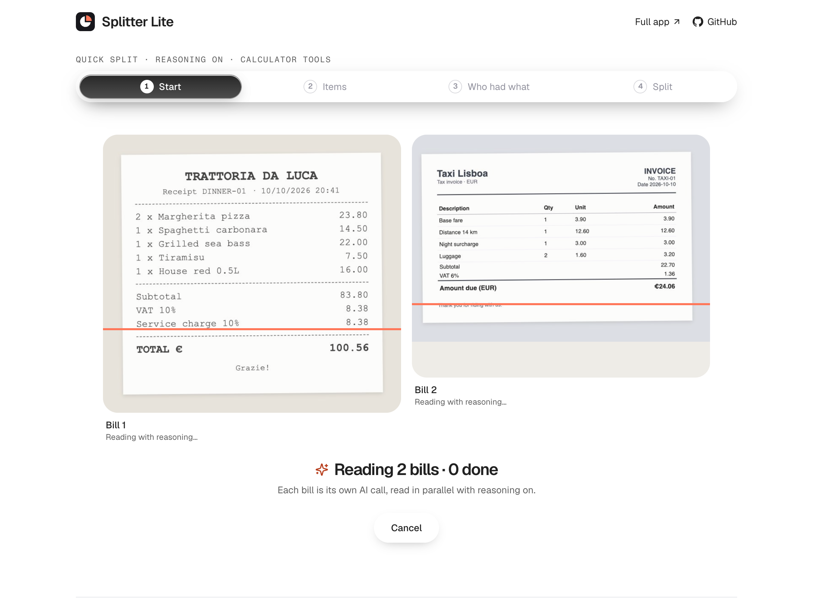
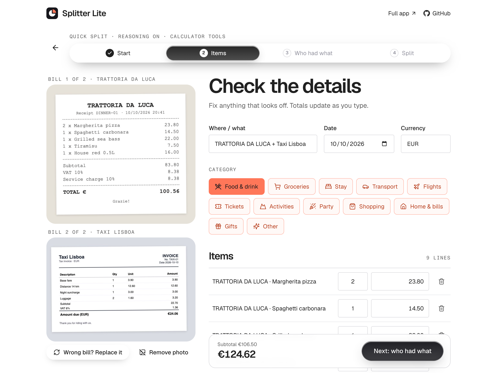
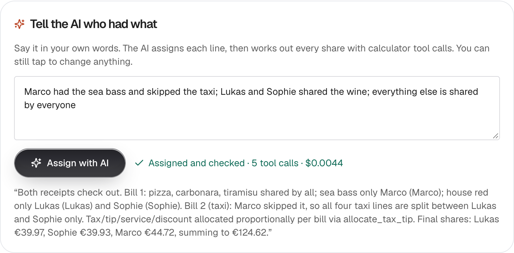
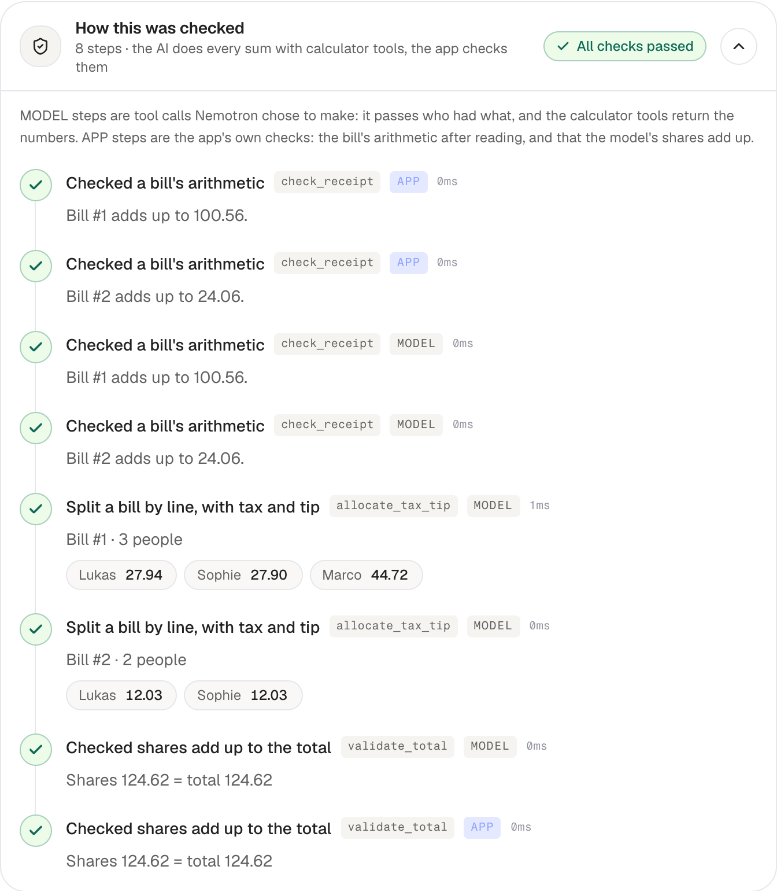
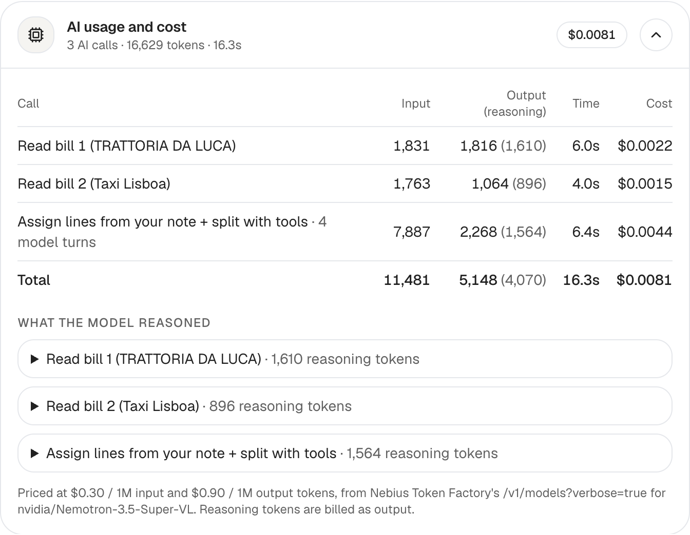
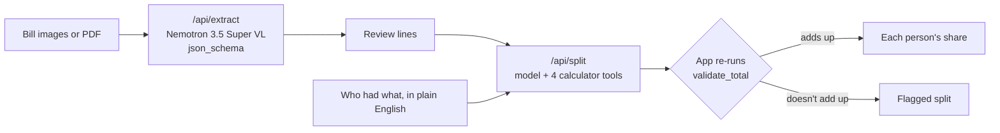

# Splitter Lite: split bills with Nemotron 3.5 Super VL and its own tool calls

Upload one bill, or two from the same night out, say who had what in plain English, and get each person's share.

**NVIDIA Nemotron 3.5 Super VL** on [Nebius Token Factory](https://tokenfactory.nebius.com) reads every line of every bill into structured JSON with reasoning on. It then works out each share by **calling calculator tools for every number**. The app never computes the split for the model; it only checks the model's result.


## What you'll build

A Next.js app with three steps:

1. **Read.** Each bill image goes to the model with a JSON schema, and the model returns structured JSON: every line, plus tax, tip, service charge, discount and the printed total. Two bills, such as dinner and the taxi home, are read in parallel and combined. Each line keeps a label showing which bill it came from.
2. **Split.** You add the people, then either tap who had each line or describe it ("Marco skipped the taxi"). The model assigns the lines and calls the tools:

  | Tool                                          | What it does                                                                                      |
  | --------------------------------------------- | ------------------------------------------------------------------------------------------------- |
  | `check_receipt(bill)`                         | Checks that the lines, tax, tip and fees add up to the printed total                              |
  | `allocate_tax_tip(bill, lines)`               | Splits one bill by who had which line, and spreads that bill's tax, tip and fees in integer cents |
  | `calculate_split(amount, mode, participants)` | Splits an amount equally, by shares or by exact amounts                                           |
  | `validate_total(total, shares)`               | Checks that the shares add up to the total                                                        |

3. **Validate.** The app runs `validate_total` again on the model's shares. If the model skips a tool or its shares don't add up, the split is flagged instead of being shown as the model's.

| Both bills read in parallel                                       | Review what the model read                                                        |
| ----------------------------------------------------------------- | --------------------------------------------------------------------------------- |
|  |  |

| Tell the AI who had what                                                            | Every tool call, marked MODEL or APP        |
| ----------------------------------------------------------------------------------- | ------------------------------------------- |
|  |  |



## How it works



The tools work in integer cents with largest-remainder rounding ([`src/lib/money/`](src/lib/money/)), so shares always add up to the total exactly.

## Setup

Requirements: Node.js 22.13 or newer, and a [Nebius Token Factory](https://tokenfactory.nebius.com) API key.

```bash
cd apps/splitter-lite
npm install
cp env.example .env          # add NEBIUS_API_KEY
npm run dev                  # http://localhost:3100
```

Then try it with the sample bills in [`samples/`](samples/). Or run the same pipeline from the terminal:

```bash
npm run agent -- samples/groceries-21.png "Sophie had the Coffee beans 500g, Lukas had the Dish soap, everything else shared" Lukas,Sophie
npm run agent -- samples/dinner-01.png samples/taxi-01.png "Marco had the Grilled sea bass and skipped the taxi; Lukas and Sophie shared the House red; everything else is shared by everyone" Lukas,Sophie,Marco
npm run check-samples        # the sample bills against their answer keys (real calls, about $0.02)
npm test                     # unit tests for the money math, tools and agent loop (no API calls)
```

## Exact model and configuration

| Setting      | Value                                                                                                                                                                     |
| ------------ | ------------------------------------------------------------------------------------------------------------------------------------------------------------------------- |
| Model        | `nvidia/Nemotron-3.5-Super-VL` ([model page](https://tokenfactory.nebius.com/?modals=endpoint-details&model-id=nvidia/Nemotron-3.5-Super-VL))                             |
| Endpoint     | `https://api.tokenfactory.us-north1.nebius.com/v1/`, through the OpenAI-compatible `openai` SDK                                                                           |
| Reasoning    | **On.** This is Token Factory's default for this model, so no `reasoning_effort` or `chat_template_kwargs` is sent. The reasoning text comes back in `reasoning_content`. |
| Sampling     | Nothing is sent: `temperature` and `top_p` stay at Token Factory's defaults                                                                                               |
| `max_tokens` | 16,384 per call (reasoning tokens count toward this)                                                                                                                      |
| Bill read    | `response_format: json_schema` (strict), falling back to `json_object`; the result is validated with zod                                                                  |
| Split        | the four tools above, `tool_choice: "auto"`, plus one repair turn if the final JSON is malformed                                                                          |
| Uploads      | up to 2 bills per split and up to 4 pages per bill (JPEG, PNG or WebP, 4 MB per request in total). PDFs are converted to images in the browser.                           |
| Price        | read live from `GET /v1/models?verbose=true`. At the time of writing: $0.30 per 1M input tokens and $0.90 per 1M output tokens, with reasoning tokens billed as output.           |

## Project layout

| Path                                                           | What's in it                                                                    |
| -------------------------------------------------------------- | ------------------------------------------------------------------------------- |
| [`src/server/ai/nebius.ts`](src/server/ai/nebius.ts)           | The Token Factory client: the only file to change to swap the model or provider |
| [`src/server/ai/receipt.ts`](src/server/ai/receipt.ts)         | The bill-reading prompt, JSON schema and zod validation                         |
| [`src/server/ai/split-agent.ts`](src/server/ai/split-agent.ts) | The tool-calling loop and the app's final check                                 |
| [`src/server/ai/tools.ts`](src/server/ai/tools.ts)             | The four calculator tools                                                       |
| [`src/app/api/`](src/app/api/)                                 | The `extract`, `split` and `model` routes                                       |
| [`scripts/`](scripts/)                                         | `agent.mts` (terminal version) and `check-samples.mts` (answer-key check)       |
| [`samples/`](samples/)                                         | Synthetic bills and their answer keys in `answers.json`                         |

## A real run

`npm run check-samples` with the sample bills in `samples/`. **All 4 splits matched the answer keys to the cent**, for $0.017 in total:

```text
✓ groceries-21         read ✓ · tool calls 3 · app check ✓   Lukas 14.82, Sophie 23.30
✓ dinner-01            read ✓ · tool calls 3 · app check ✓   Lukas 27.94, Sophie 27.90, Marco 44.72
✓ taxi-01              read ✓ · tool calls 3 · app check ✓   Lukas 12.03, Sophie 12.03
✓ dinner-01 + taxi-01  read ✓ · tool calls 5 · app check ✓   Lukas 39.97, Sophie 39.93, Marco 44.72
```

Here are the two sample bills from one night out, from `npm run agent`. The answer key is Lukas €39.97, Sophie €39.93, Marco €44.72:

```text
1 · READ
  samples/dinner-01.png: TRATTORIA DA LUCA · 5 lines · printed total 100.56 EUR
  samples/taxi-01.png: Taxi Lisboa · 4 lines · printed total 24.06 EUR
  Split together: 9 lines across 2 bills, total 124.62 EUR

2 · SPLIT (6.0s, 4 model turns)
  ✓ MODEL check_receipt({"bill":1})   → {"ok":true,"linesTotal":83.8,"printedTotal":100.56}
  ✓ MODEL check_receipt({"bill":2})   → {"ok":true,"linesTotal":22.7,"printedTotal":24.06}
  ✓ MODEL allocate_tax_tip({"bill":1, …"line":3,"members":["Marco"]…})
          → {"bill":1,"total":100.56,"shares":{"Lukas":27.94,"Sophie":27.9,"Marco":44.72}}
  ✓ MODEL allocate_tax_tip({"bill":2, …"members":["Lukas","Sophie"]…})
          → {"bill":2,"total":24.06,"shares":{"Lukas":12.03,"Sophie":12.03}}
  ✓ MODEL validate_total(…)  → {"ok":true,"total":124.62,"diff":0}
  ✓ APP   validate_total(…)  → {"ok":true,"total":124.62,"diff":0}

AI usage
  read dinner-01.png    1831 in   1166 out (960 reasoning)    4.0s  $0.00160
  read taxi-01.png      1763 in    827 out (659 reasoning)    3.8s  $0.00127
  split with tools      7687 in   2142 out (1377 reasoning)   6.0s  $0.00423
  total                11281 in   4135 out (2996 reasoning)  13.7s  $0.00711
```

The model calls `allocate_tax_tip` once per bill, so the dinner's VAT and service charge stay with the dinner, and Marco pays nothing towards the taxi. The full output is in [`output-example.md`](output-example.md).

## Limitations

- **Speed.** With reasoning on, a bill takes about 4–15 s to read, and the split takes another 4–10 s.
- **Photos.** Creased, faded or rotated receipts are misread more often than the clean samples, so check the lines on the review step.
- **Intent.** The tools check the sums, not who had what. Check the model's assignment before you look at the split.
- **Scope.** Two bills per split. This is a local demo with no accounts and nothing saved, so don't expose it publicly with your own API key.
- **More features.** Groups, running balances, invite links, payments, notifications and Settle with AI across many bills are in [Splitter](https://github.com/Studio1-OSS/Splitter). You can [try it live](https://ten-splitter.vercel.app).

## Credits

Built by [Amitesh Anand](https://github.com/Astrodevil), based on [Splitter](https://github.com/Studio1-OSS/Splitter).

## License

MIT, under this cookbook's [LICENSE](../../LICENSE).
