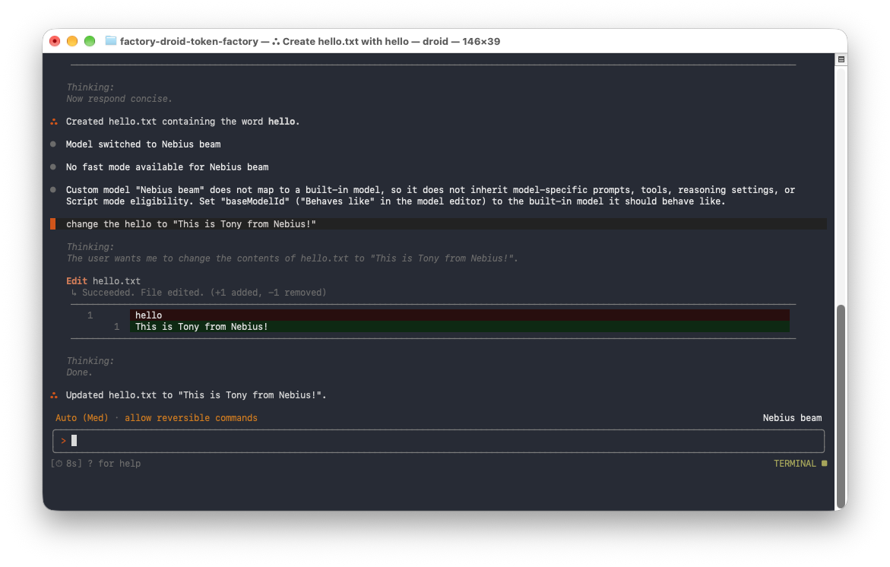

[Cookbook](../../README.md) / [Coding agents](../README.md) / Factory Droid

# Factory Droid with Nebius Token Factory

Run [Droid](https://docs.factory.com/droid-cli/quickstart), Factory's coding
agent, on open models hosted on
[Nebius Token Factory](https://tokenfactory.nebius.com). Droid takes any
OpenAI-compatible endpoint as a
[custom model](https://docs.factory.com/model-independence/byok), so there is no
proxy and no plugin: a few lines of settings point it at Token Factory.

> Run end to end on 2026-11-23 with Droid 1.18.0 on macOS, headless and
> interactive. [RESULTS.md](RESULTS.md) records what worked and what did not,
> model by model.

## What you will build

```
Droid ──/v1/chat/completions──▶ Token Factory
```

A settings file that adds the Token Factory models you choose to Droid, built
from the live catalog, and a smoke test that makes Droid fix a real bug on each
of them.

Nothing in this recipe names a model. Token Factory retires models regularly
and does not reroute retired IDs, so the scripts read the live catalog and you
choose from what is being served today.

## Requirements

- Droid installed (`droid --version`). Tested with 1.18.0.
- Python 3.10 or newer. The scripts use the standard library only.
- A Token Factory account and API key. See [Getting started](../../start-here/setup.md).
- A Factory account for interactive sessions; Factory's free plan is
  "bring your own inference". `droid exec` with a custom model ran without
  signing in.

Every prompt is a paid Token Factory request. Droid sends about 8,000 tokens of
instructions and tool definitions with each one. Factory bills nothing for
custom models: every run here reported `factory_credits: 0`.

## Setup

Run everything from this folder.

**1. Create your `.env`:**

```bash
cp env.example .env
```

Fill in `NEBIUS_API_KEY` and save the file. The scripts read `.env` each time
they run, so an edit takes effect on the next command.

**2. Pick models from the live catalog:**

```bash
python3 scripts/list_models.py
```

This prints every live text model that advertises tool calling. Put the IDs you
want in `TF_MODELS` in `.env`, comma separated, and save.

Check your choice against the
[deprecation notices](https://docs.tokenfactory.nebius.com/llms.txt). A model
can still be listed for a while after its notice date. Factory also
[advises against](https://docs.factory.com/model-independence/byok) models
under 30 billion parameters for agentic coding.

**3. Generate the Droid settings:**

```bash
python3 scripts/make_settings.py --install
```

It checks your IDs against the live catalog, writes `droid_settings.json` here,
and merges the same entries into `~/.factory/settings.json` so they show up in
Droid's model picker. Your other settings are kept, a `settings.json.bak` copy
is saved first, and running it again replaces only the Token Factory entries.
Leave out `--install` to write `droid_settings.json` only and pass it per run
with `--settings`.

No key is written to either file. Each entry looks like this:

```json
{
  "model": "<a live Token Factory model ID>",
  "displayName": "Nebius <model name>",
  "baseUrl": "https://api.tokenfactory.nebius.com/v1",
  "apiKey": "${NEBIUS_API_KEY}",
  "provider": "generic-chat-completion-api",
  "maxOutputTokens": 16384,
  "maxContextLimit": 1032192,
  "noImageSupport": false
}
```

`generic-chat-completion-api` is Droid's Chat Completions provider type.
`maxContextLimit` is the model's live context window minus the output budget,
because Token Factory counts both against the same window.

## Run

Droid reads the key from the environment of the terminal it starts in, not from
`.env`. Load it once per terminal, or export `NEBIUS_API_KEY` in your shell
profile:

```bash
set -a; source .env; set +a
```

**One-off, from the project you want to work in:**

```bash
droid exec -m <model-id> "explain what this repository does"
```

`droid exec` is read-only by default. Add `--auto low` to let it edit files and
`--auto medium` to let it run commands such as your test suite. The model ID is
the same one you put in `TF_MODELS`.

Without `--install`, name the settings file:

```bash
droid exec --settings /path/to/droid_settings.json -m <model-id> "explain what this repository does"
```

**Interactive:**

```bash
droid
```

Sign in to Factory when asked and trust the folder. Run `/model` and pick one
of the **Nebius ...** entries under **Custom Models**:


From there it is ordinary Droid. Here a Token Factory model creates a file
through Droid's own tools:


`/stats` shows your usage, with these sessions counted as BYOK.

### Map a model to a Droid built-in

Droid ships tuned prompts and reasoning handling for the models Factory hosts
itself. It applies them to a custom model when it recognizes the model ID. When
it does not, it says so as you select the model:



If Factory lists the same model under another name, tell Droid. Run
`droid exec -m x "hi"` to print the built-in IDs, then add a pair to
`TF_BASE_MODEL_IDS` in `.env`:

```
TF_BASE_MODEL_IDS=<token-factory-model-id>=<droid-built-in-id>
```

Run `make_settings.py --install` again. The entry gains a `baseModelId` field.

## Validate

Offline, no key and no Droid needed:

```bash
python3 -m unittest discover -s tests
```

Live, a few paid requests per model:

```bash
python3 scripts/smoke_test.py
```

For each model in `TF_MODELS` it creates a throwaway two-file Python project
with one failing test, asks Droid to fix it with `--auto medium`, then runs the
tests itself. A model passes only if the tests pass afterwards and the test file
is untouched. `--runs 3` repeats each model, and model IDs on the command line
limit the run.

```
MODEL             RESULT  PASSED  SECONDS  TOOL CALLS
<model-id>        ok      1/1         9.5         2.0
```

What was verified on 2026-11-23 is in [RESULTS.md](RESULTS.md): 19 live models
through this task, three runs each, with `droid exec`, and an interactive
session on two of them. Image input, missions and subagents were not tested.

## Limitations and cleanup

- Custom models work in the Droid CLI and the Factory desktop app. They do not
  appear in Factory's hosted web or mobile apps.
- Factory tests Droid fully only against the official Anthropic and OpenAI
  APIs. Expect differences between open models; run the smoke test on the ones
  you plan to use.
- For a custom model it does not recognize, Droid does not send the model's
  earlier reasoning back to it. Most models carry on regardless; see
  Troubleshooting for one that does not.
- Model IDs go stale. When Token Factory retires a model, update `TF_MODELS`
  and run `make_settings.py --install` again.

To remove everything: delete the entries whose `baseUrl` is the Token Factory
URL from `~/.factory/settings.json` (or restore `settings.json.bak`), and delete
`droid_settings.json` and `.env` here.

## Troubleshooting

### `Custom model credentials reference an environment variable that is not set`

`NEBIUS_API_KEY` is not in the environment Droid started from. Load `.env` in
that terminal, as shown under [Run](#run), and start Droid again. The smoke
test passes the key to Droid itself, so it can pass while this still fails.

### `/cost` does nothing

Factory's documentation mentions `/cost`; Droid 1.18.0 has no such command. Use
`/stats`.

### `Invalid model`

Droid prints the custom models it knows about under the error. If yours are
missing, run `make_settings.py --install`, or pass `--settings`.

### `400 The assistant turn ... is missing its reasoning`

The model requires its previous reasoning in every request, and Droid is not
sending it. Two fixes, in order of preference:

1. If Droid has a built-in version of the model, map to it with
   `TF_BASE_MODEL_IDS` as described under
   [Map a model to a Droid built-in](#map-a-model-to-a-droid-built-in). Droid
   then handles the model's reasoning itself.
2. Otherwise add the model's ID to `TF_ALLOW_MISSING_THINKING` in `.env`. That
   tells Token Factory to accept the request as it is, by adding this to the
   model's entry:

   ```json
   "extraArgs": { "chat_template_kwargs": { "allow_missing_thinking": true } }
   ```

Run `make_settings.py --install` again after either change.

### `Tool call rejected: arguments were not a valid JSON object`

The model produced a malformed tool call. Droid asks it to try again, which
sometimes recovers. If the smoke test keeps failing, choose another model.

### `404` or `403` from Token Factory

The model was retired or your key cannot use it. Pick a current ID with
`list_models.py`.

## Source and license

Written for this cookbook. Droid is a product of
[Factory](https://factory.com); its custom-model settings are documented at
[Custom Models (BYOK)](https://docs.factory.com/model-independence/byok).
