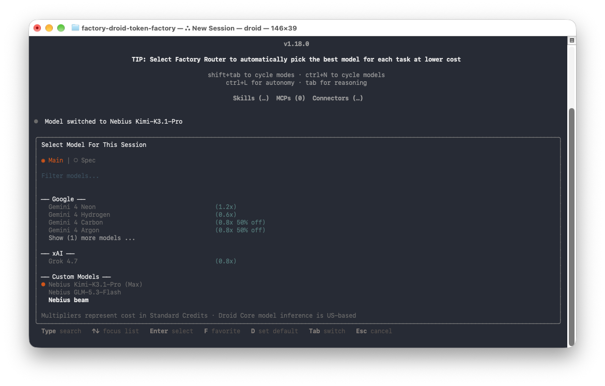
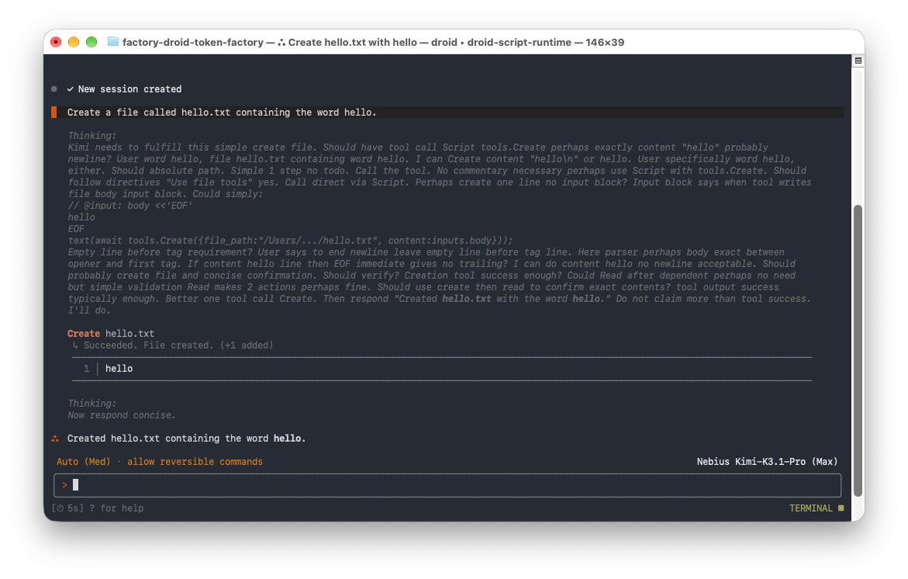

[Cookbook](../../README.md) / [Coding agents](../README.md) / Factory Droid

# Factory Droid with Nebius Token Factory

Run [Droid](https://docs.factory.com/droid-cli/quickstart), Factory's coding
agent, on open models from
[Nebius Token Factory](https://tokenfactory.nebius.com). Droid accepts any
OpenAI-compatible endpoint as a
[custom model](https://docs.factory.com/model-independence/byok), so this needs
no proxy and no plugin.

Tested on 2026-11-23 with Droid 1.18.0 on macOS. Per-model results are in
[RESULTS.md](RESULTS.md).

Setting this up with a coding agent? Point it at [AGENTS.md](AGENTS.md).

## What you will build

A Droid settings file generated from the live Token Factory catalog, and a
smoke test that has Droid fix a failing test on each model you chose. No model
ID is hardcoded; you pick from what is live.

## Requirements

- Droid (`droid --version`). Tested with 1.18.0.
- Python 3.10 or newer. There are no packages to install.
- A Token Factory API key. See [Getting started](../../start-here/setup.md).
- A Factory account for interactive sessions. Factory's free plan is "bring
  your own inference". `droid exec` ran without signing in.

Every prompt is a paid Token Factory request, and Droid adds about 8,000 tokens
of its own instructions to each one.

## Setup

Run everything from this folder.

1. Create `.env` and put your key in `NEBIUS_API_KEY`.

   ```bash
   cp env.example .env
   ```

2. List the live models that support tool calling, then put the IDs you want
   in `TF_MODELS` in `.env`, comma separated.

   ```bash
   python3 scripts/list_models.py
   ```

   Skip any model with a
   [deprecation notice](https://docs.tokenfactory.nebius.com/llms.txt). Factory
   [advises against](https://docs.factory.com/model-independence/byok) models
   under 30 billion parameters for agentic coding.

3. Generate the settings.

   ```bash
   python3 scripts/make_settings.py --install
   ```

   This checks your IDs against the live catalog, writes `droid_settings.json`
   here and merges the same entries into `~/.factory/settings.json`, keeping
   your other settings and saving the old file as `settings.json.bak`. Without
   `--install`, only `droid_settings.json` is written.

Each entry looks like this. The key is referred to by name, never written:

```json
{
  "model": "<a live Token Factory model ID>",
  "displayName": "Nebius <model name>",
  "baseUrl": "https://api.tokenfactory.nebius.com/v1",
  "apiKey": "${NEBIUS_API_KEY}",
  "provider": "generic-chat-completion-api",
  "maxOutputTokens": 16384,
  "maxContextLimit": 1032192,
  "noImageSupport": false
}
```

## Run

Droid reads the key from the terminal's environment, not from `.env`. Load it
in each terminal, or export `NEBIUS_API_KEY` in your shell profile.

```bash
set -a; source .env; set +a
```

One-off, from the project you want to work on:

```bash
droid exec -m <model-id> "explain what this repository does"
```

`droid exec` is read-only by default. `--auto low` lets it edit files;
`--auto medium` also lets it install dependencies, build, test, commit and
push. If you skipped `--install`, add `--settings /path/to/droid_settings.json`.

Interactive:

```bash
droid
```

Sign in to Factory, trust the folder, run `/model` and pick a **Nebius ...**
entry under **Custom Models**.





`/stats` shows your usage, with these sessions counted as BYOK.

### Map a model to a Droid built-in

When Droid recognizes a custom model's ID as one of its built-in models, it
applies that model's reasoning levels. When it does not, it says so:


If Droid has the same model built in under another ID, add the pair to `.env`
and run `make_settings.py --install` again. `droid exec -m x "hi"` prints the
built-in IDs.

```
TF_BASE_MODEL_IDS=<token-factory-model-id>=<droid-built-in-id>
```

## Validate

Offline, with no key and no Droid:

```bash
python3 -m unittest discover -s tests
```

Live, a few paid requests per model:

```bash
python3 scripts/smoke_test.py
```

For each model in `TF_MODELS`, Droid gets a throwaway Python project with one
failing test and `--auto medium`. The script then runs the tests itself and
prints `ok` only if they pass and the test file is unchanged. `--runs 3`
repeats each model, and model IDs as arguments limit the run.

Verified on 2026-11-23: 19 live models, three runs each, through `droid exec`,
and an interactive session on two of them. Not tested: the Factory desktop
app, image input, missions, subagents and platforms other than macOS.

## Limitations and cleanup

- Custom models work in the Droid CLI and the Factory desktop app, not in
  Factory's hosted web or mobile apps.
- Factory fully tests Droid only against the official Anthropic and OpenAI
  APIs. Open models differ, so smoke-test the ones you plan to use.
- When Token Factory retires a model, update `TF_MODELS` and run
  `make_settings.py --install` again.

To remove everything, delete the entries whose `baseUrl` is the Token Factory
URL from `~/.factory/settings.json`, and delete `droid_settings.json` and
`.env` here.

## Troubleshooting

| Symptom | Fix |
| --- | --- |
| `Custom model credentials reference an environment variable that is not set` | Load `.env` in that terminal as shown under [Run](#run), then start Droid again. The smoke test can pass while this fails, because it hands the key to Droid itself. |
| `Invalid model` | Run `make_settings.py --install`, or pass `--settings`. |
| `400 The assistant turn ... is missing its reasoning` | [Map the model to a Droid built-in](#map-a-model-to-a-droid-built-in). If Droid has none, add the model ID to `TF_ALLOW_MISSING_THINKING` in `.env`. Run `make_settings.py --install` again after either. |
| `Tool call rejected: arguments were not a valid JSON object` | The model produced a malformed tool call. If the smoke test keeps failing, choose another model. |
| `404` or `403` from Token Factory | The model was retired or your key cannot use it. Pick a current ID with `list_models.py`. |
| `/cost` does nothing | Droid 1.18.0 has no `/cost`. Use `/stats`. |

## Source and license

Written for this cookbook. Droid is a product of
[Factory](https://factory.com). Its custom-model settings are documented at
[Custom Models (BYOK)](https://docs.factory.com/model-independence/byok).
