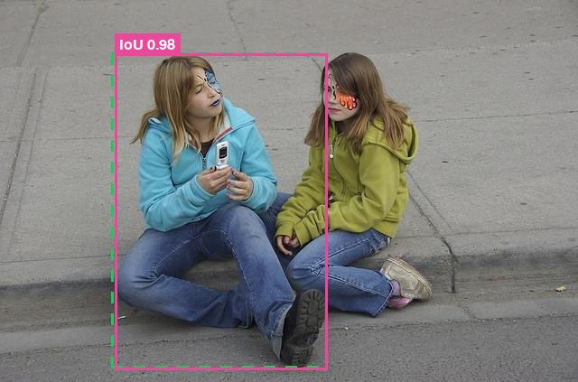
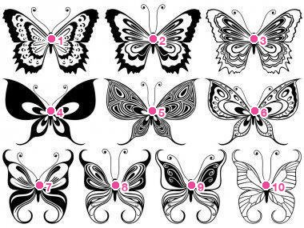
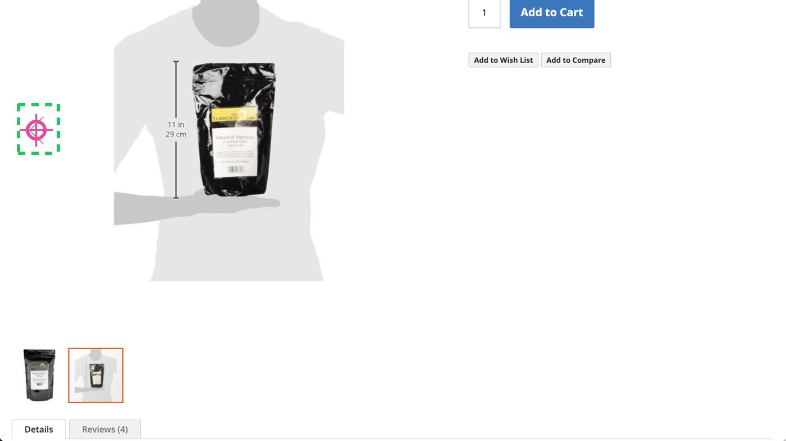

[Cookbook](../../README.md) / [Model guides](../README.md) / Kimi K3.1 Pro vision showcase

# Run Kimi K3.1 Pro on ten vision tasks and score it against benchmark labels

This recipe sends 60 images from ten published vision-language benchmarks to Kimi K3.1 Pro on Nebius Token Factory, scores each answer against the benchmark's ground truth, and draws an overlay of what the model said next to what the label says. The recorded run is committed, so you can read the results, re-score them and rebuild the report without an API key.

**Recorded result: 48 of 60 hits** (2 partial, 10 miss) on November 5, 2026. Three of the twelve non-hits look like benchmark label problems on inspection. The full write-up, with a note on every partial and miss, is in [RECORD.md](RECORD.md).

| Referring-expression grounding (RefCOCO) | Counting with pointing (CountBench) | GUI click grounding (ScreenSpot) |
| --- | --- | --- |
|  |  |  |

Green dashed = benchmark ground truth, magenta = Kimi.

## What you will build

A four-step pipeline of plain Python scripts:

1. `scripts/fetch_samples.py` draws six random samples (seed 31) from each benchmark's public evaluation split through the Hugging Face datasets server and writes `data/manifest.json` with the ground truth.
2. `scripts/run_kimi.py` sends each image as base64 with a task prompt that asks for a JSON answer in the image's own pixel frame (boxes, points, counts, short answers). It saves the answer, reasoning, token usage and latency to `results/raw/`.
3. `scripts/score.py` scores each answer with the benchmark's usual rule and draws `results/viz/` overlays.
4. `scripts/build_record.py` writes `RECORD.md` and a self-contained gallery, `results/record.html`.

| # | Task | Benchmark | Scoring rule | Recorded hits |
| --- | --- | --- | --- | --- |
| 1 | Object detection | COCO val2017 | F1 at IoU 0.5, class-matched | 5/6 |
| 2 | Referring-expression grounding | RefCOCO val | IoU >= 0.5 | 5/6 |
| 3 | Object counting | CountBench | Exact count | 5/6 |
| 4 | Scene-text VQA | TextVQA val | VQA accuracy | 5/6 |
| 5 | Document VQA | DocVQA val | ANLS | 5/6 |
| 6 | Chart QA | ChartQA test | Relaxed accuracy (5%) | 6/6 |
| 7 | Visual math reasoning | MathVista testmini | Exact answer | 5/6 |
| 8 | Spatial-relation reasoning | VSR test | True/false accuracy | 4/6 |
| 9 | Object hallucination probe | POPE adversarial | Yes/no accuracy | 3/6 |
| 10 | GUI element grounding | ScreenSpot test | Click inside target | 5/6 |

- **Model:** `moonshotai/Kimi-K3.1-Pro`
- **Endpoint:** `https://api.tokenfactory.nebius.com/v1/chat/completions` (OpenAI-compatible), called with `requests`
- **Settings:** one request per sample, default sampling, `max_tokens` 24000, a single attempt

## Requirements

- Python 3.9 or newer.
- A Token Factory API key with access to Kimi K3.1 Pro, only for `run_kimi.py`. Every other step runs without a key.
- Internet access to `datasets-server.huggingface.co` for `fetch_samples.py`.

`run_kimi.py` makes 60 paid inference requests. The recorded run used 66,514 completion tokens in total, most of them reasoning. Check the [model details](https://tokenfactory.nebius.com/?modals=endpoint-details&model-id=moonshotai/Kimi-K3.1-Pro) for current prices. The recipe creates no cloud resources.

## Setup

From this directory:

```bash
python3 -m venv .venv
.venv/bin/pip install -r requirements.txt
```

## Run

### Rebuild the report from the recorded run (no key)

The benchmark images are not committed, so fetch them first. The sampling is seeded: with the default seed and six samples per task, the script picks the same 60 samples as the recorded run, provided the source datasets have not changed. It rewrites `data/manifest.json`, so check `git diff data/manifest.json` before you re-score. Expect the fetch to take several minutes; the Hugging Face datasets server rate-limits it.

```bash
.venv/bin/python scripts/fetch_samples.py
.venv/bin/python scripts/score.py
.venv/bin/python scripts/build_record.py
```

`score.py` should end with `overall hits 48 / 60`. `build_record.py` rewrites `RECORD.md` and writes `results/record.html`, a gallery you can open in a browser.

### Make a new run (needs a key)

The recorded responses are in `results/raw/`, and `run_kimi.py` skips any sample that already has a response there. Move them aside before a new run:

```bash
mv results/raw results/raw.recorded
export NEBIUS_API_KEY="your-key"
.venv/bin/python scripts/run_kimi.py
.venv/bin/python scripts/score.py
.venv/bin/python scripts/build_record.py
```

`run_kimi.py` prints one line per sample with its latency. In the recorded run the median request took 12.4 s; detection prompts took 45-90 s because the model reasons through every box, and the slowest request took 375 s. Pass task names or sample IDs to run a subset, for example `.venv/bin/python scripts/run_kimi.py chartqa screenspot`.

Wording, boxes and verdicts vary between runs. `data/audit.json` holds the manual review notes for the recorded run's non-hits; `build_record.py` attaches them by sample ID, so review the notes again after a new run.

| Variable | Default | Used by | Purpose |
| --- | --- | --- | --- |
| `NEBIUS_API_KEY` | required | `run_kimi.py` | Token Factory API key |
| `NEBIUS_BASE_URL` | `https://api.tokenfactory.nebius.com/v1` | `run_kimi.py` | API base URL |
| `NEBIUS_MODEL` | `moonshotai/Kimi-K3.1-Pro` | `run_kimi.py` | Model ID |
| `WORKERS` | `8` | `run_kimi.py` | Concurrent requests |
| `N_PER_TASK` | `6` | `fetch_samples.py` | Samples per task; any other value selects a different set than the recorded run |

## Validate

```bash
.venv/bin/python -m unittest discover -s tests -v
```

The tests need no key and no network. They re-score every committed response in `results/raw/` against `data/manifest.json` and check that each verdict and metric matches `results/scored.json`, and they cover the JSON-answer parser and the IoU and ANLS metrics.

For this contribution, the recorded responses were re-scored and the report rebuilt offline: all 60 verdicts and metrics matched the original run. A new live run was not made.

## Limitations and cleanup

- **This is a demonstration, not a benchmark score.** Six samples per task is far too few to estimate accuracy. The samples are random, not hand-picked, but a different seed will give different numbers.
- The scoring rules follow each benchmark's usual metric in simplified form. For example, TextVQA accuracy is min(matches / 3, 1) with a simple text normalisation rather than the official averaging over annotator subsets, and detection uses a per-image F1 instead of COCO mAP.
- Disputed labels are reported in `RECORD.md`, but the official count does not change for them.
- The Hugging Face datasets server is occasionally rate limited; `fetch_samples.py` retries with backoff and caches responses in `data/_hf_cache.json`.

To clean up, delete the downloaded images and caches, the virtual environment, and the key from your shell:

```bash
rm -rf .venv data/*/ data/_hf_cache.json results/record.html
unset NEBIUS_API_KEY
```

## Source and license

Written for this cookbook by [amrrs](https://github.com/amrrs). The scripts are covered by the repository [license](../../LICENSE).

The images and labels belong to the benchmark datasets, under their own licenses. They are fetched from the Hugging Face datasets server at run time and not stored here; the committed overlays in `results/viz/` are downscaled copies with annotations, included to illustrate the recorded results.

| Benchmark | Hugging Face dataset | Paper |
| --- | --- | --- |
| COCO | `detection-datasets/coco` | Lin et al., ECCV 2014 |
| RefCOCO | `lmms-lab-encoder/RefCOCO` | Kazemzadeh et al., EMNLP 2014; Yu et al., ECCV 2016 |
| CountBench | `vikhyatk/CountBenchQA` | Paiss et al., ICCV 2023 |
| TextVQA | `lmms-lab-encoder/textvqa` | Singh et al., CVPR 2019 |
| DocVQA | `lmms-lab-encoder/DocVQA` | Mathew et al., WACV 2021 |
| ChartQA | `HuggingFaceM4/ChartQA` | Masry et al., ACL Findings 2022 |
| MathVista | `AI4Math/MathVista` | Lu et al., ICLR 2024 |
| VSR | `cambridgeltl/vsr_random` | Liu et al., TACL 2023 |
| POPE | `lmms-lab-encoder/POPE` | Li et al., EMNLP 2023 |
| ScreenSpot | `bevaya/ScreenSpot` | Cheng et al., ACL 2024 (SeeClick) |
