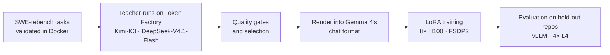

# Post-train Gemma 4 for efficient agentic coding with Kimi and DeepSeek as teachers

Gemma 4 31B can already work as a coding agent: give it a repository and a bug report, and it fixes most real bugs with shell commands and file edits. But it takes the long way. In a median run, its first edit is its 9th tool call, and it makes 9 more calls after its last edit.

This recipe distills a quicker way of working from two open frontier models on Nebius Token Factory. Kimi-K3 and DeepSeek-V4.1-Flash solve bug-fix tasks inside the same agent loop that Gemma uses. The runs whose fixes pass the repository's tests become training data. Then a LoRA trained on Nebius AI Cloud teaches Gemma 4 the teachers' rhythm.

What we measured on 45 bugs from 17 repositories that were not in the training data. Each row is one run, with one attempt per task, on 4× NVIDIA L4:

| Gemma 4 31B | Solved | Tool calls / task | Model calls / task | Seconds / task |
| --- | --- | --- | --- | --- |
| Base model | 36/45 | 22.9 | 26.4 | 255 |
| + LoRA, 1 epoch | 36/45 | 16.5 (−28%) | 17.3 (−35%) | 180 (−29%) |
| + LoRA, 2 epochs | 36/45 | 18.4 (−20%) | 19.0 (−28%) | 214 (−16%) |

The accuracy is the same, with fewer calls. With the one-epoch adapter, the same server fixes 41% more bugs per hour. The LoRA does not raise the solve rate: it makes Gemma 4 a more economical agent, not a stronger one.

## What you will build



1. **Tasks with tests.** Real Python bug fixes from [SWE-rebench](https://huggingface.co/datasets/nebius/SWE-rebench). Each task has a reference fix, the tests that fail before it and pass after it, and a prebuilt Docker image.
2. **Teacher trajectories.** Kimi-K3 and DeepSeek-V4.1-Flash fix the tasks through the Token Factory API, in the *student's* agent loop: the same prompt, tools and tool-call limit.
3. **Rejection sampling and quality gates.** Keep only runs whose fix passes the tests, then prefer the ones with good habits.
4. **SFT data.** Render the kept runs with Gemma 4's own chat template, with loss on the model's turns only.
5. **LoRA training** on an 8× H100 VM, then evaluation against the base model on repositories held out from training.

Token Factory and vLLM both serve an OpenAI-compatible API, so one agent loop collects the teacher data and evaluates the student. Only `base_url` and `model` change. That match between collection, training and evaluation is the core idea of the recipe.

## What's in this folder

| File | What it does |
| --- | --- |
| [`tasks.py`](tasks.py) | Loads SWE-rebench, runs each task in its Docker image, checks a patch against the task's tests, and writes validated task files |
| [`agent.py`](agent.py), [`prompt.md`](prompt.md) | The agent loop: six tools, per-task limits, any OpenAI-compatible endpoint, trajectory recording |
| [`collect.py`](collect.py) | Runs every task with every teacher on Token Factory, in parallel, resumable |
| [`select_sft.py`](select_sft.py) | Quality gates and selection of the trajectories to train on |
| [`render.py`](render.py) | Renders trajectories into Gemma 4's chat format, with labels on the model's own turns only |
| [`dequant_base.py`](dequant_base.py) | Turns the 4-bit checkpoint into bf16 weights, so the adapter fits exactly the weights vLLM serves |
| [`train_lora.py`](train_lora.py) | LoRA training with FSDP2 and spot-safe checkpoints |
| [`evaluate.py`](evaluate.py) | Runs a model over held-out tasks and compares two runs task by task |
| [`tests/`](tests/) | Offline tests with a scripted model and a local git repository: no Docker, no key, no GPU |

## The agent and its limits

The agent gets the issue and the repository at `/workspace`. It has six tools: `run_command`, `read_file`, `edit_file`, `write_file`, `get_status` and `submit_patch`. The system prompt in [`prompt.md`](prompt.md) asks for the smallest source change, a short list of exact strings from the issue, a targeted search, an early edit and one re-test.

| Limit | Default | How it is counted |
| --- | --- | --- |
| Tool calls | 28 | Every call except `submit_patch` and `get_status`. When 10 or fewer remain, a warning is added to the tool output |
| Agent time | 8 min | Wall-clock time of the whole loop. The tests run afterwards with their own 600 s limit |
| Model calls | 80 | Hard cap on LLM calls per task |
| One shell command | 300 s | Per `run_command` |
| Tool output | 5,000 characters | Each for stdout and stderr. `read_file` returns at most 150 lines or 10,000 characters |

When any limit is hit, the working-tree diff is tested as it is, even without `submit_patch`. A task is solved when the diff applies to a fresh checkout and every fail-to-pass and pass-to-pass test passes. Each task gets one attempt.

Teachers run with the same 28-call limit but 16 minutes instead of 8, to absorb API latency. The system prompt always says 28 calls and 8 minutes. The task message is generated from `Limits` in `agent.py`, so it states the real limits if you change them.

## Prerequisites

- **For tasks, teacher runs and evaluation:** an x86_64 Linux machine with Docker. SWE-rebench images are x86_64, and every task has its own image, so plan disk space for the images you pull. You also need Python 3.10 or newer and [uv](https://docs.astral.sh/uv/).
- **A Token Factory API key.** See the [setup guide](../../start-here/setup.md). Teacher runs are the main cost of the recipe. At the list prices of 2026-10-30, an attempt cost us about $0.24 with Kimi-K3 and about $0.03 with DeepSeek-V4.1-Flash on average:

  | Teacher | Model ID | $ per 1M tokens: input / cached input / output |
  | --- | --- | --- |
  | Kimi-K3 | `moonshotai/Kimi-K3` | 3.00 / 0.30 / 15.00 |
  | DeepSeek-V4.1-Flash | `deepseek-ai/DeepSeek-V4.1-Flash-1017` | 0.30 / 0.006 / 1.20 |

  Check the [live model catalog](https://tokenfactory.nebius.com/models) for current prices before you plan a large run.
- **For training:** a VM with 8× H100 80 GB on [Nebius AI Cloud](https://docs.nebius.com/compute/virtual-machines/manage). A [preemptible VM](https://docs.nebius.com/compute/virtual-machines/preemptible) works well with the checkpointing below. Plan disk space for the 4-bit checkpoint plus 65 GB of bf16 weights.
- **For evaluation:** vLLM 0.19.1 on GPUs that can hold Gemma 4 31B in 4-bit with a LoRA. We used 4× L4 (24 GB each).
- The student model is [`google/gemma-4-31B-it-qat-w4a16-ct`](https://huggingface.co/google/gemma-4-31B-it-qat-w4a16-ct), released under the [Gemma 4 license](https://ai.google.dev/gemma/docs/gemma_4_license) (Apache 2.0).

## Set up and test offline

```bash
git clone https://github.com/nebius/token-factory-cookbook.git
cd token-factory-cookbook/post-training/gemma-4-agentic-coding
uv sync
uv run python -m pytest -q -p no:cacheprovider
```

```text
..............                                                           [100%]
14 passed
```

The tests replace Docker with a local git repository and the model with a scripted one, so they need no key and no GPU. They check that:
- the loop counts tool calls, leaves `submit_patch` and `get_status` free, adds the budget warning and stops at each limit;
- the loop keeps the model's reasoning in the history;
- a rejected request ends the run with its patch intact;
- the gates reject failed, leaking and test-editing runs;
- the selection prefers runs that re-test after their last edit;
- the run comparison counts gains and losses.

The rendering tests download the Gemma 4 tokenizer from Hugging Face, a few MB. Set `GEMMA_TOKENIZER` to a local copy to run them offline.

## Run

Steps 1, 2 and 6 need Docker. Step 5 runs on the 8× H100 VM, and step 6 also needs GPUs for vLLM. Every command runs from this directory.

### 1. Tasks with tests

First, choose the repositories you will evaluate on, and keep them out of training. Write them one per line, in `owner/name` form, to `heldout_repos.txt`. Then write both task files:

```bash
uv run python tasks.py --exclude-repos heldout_repos.txt --per-repo 3 --limit 100 --out tasks.jsonl
uv run python tasks.py --repos heldout_repos.txt --per-repo 10 --out heldout.jsonl
```

`tasks.py` validates every task before it writes it. The reference fix must pass and an empty patch must fail, so you never pay teacher tokens for a task that cannot be solved or needs no change. Validation pulls each task's image and starts two containers per task. At most 3 tasks per repository keeps a few large projects from dominating the data. Our run used 978 SWE-rebench tasks from 603 repositories, plus 786 tasks from two other Python bug-fix collections.

### 2. Teacher trajectories on Token Factory

```bash
cp env.example .env        # then add your NEBIUS_API_KEY
uv run --env-file .env python collect.py tasks.jsonl trajectories --workers 32
```

Each attempt gets its own container. The OpenAI client retries rate limits and server errors, and finished attempts are skipped, so you can re-run the same command after an interruption. At the end, it prints attempts, solved tasks and token usage per teacher.

Our run made 3,777 attempts: Kimi-K3 and DeepSeek-V4.1-Flash on every task, and GLM-5.3 on 249 tasks the other two had failed. 1,864 (49%) of them were solved. DeepSeek-V4.1-Flash solved slightly more tasks than Kimi-K3 (946 vs 896) for an eighth of the cost:

| Teacher | Prompt tokens (cached) | Output tokens | Cost at list prices |
| --- | --- | --- | --- |
| Kimi-K3 | 231.3M (81%) | 15.3M | $418 |
| DeepSeek-V4.1-Flash | 270.5M (59%) | 13.0M | $50 |
| GLM-5.3 | 57.8M (80%) | 4.6M | $48 |

An agent loop re-sends its growing history on every call, so prompt caching matters. Without caching, the same tokens would have cost $1,121 instead of $516.

### 3. Quality gates and selection

```bash
find trajectories -name '*.json' > all.txt
uv run python render.py all.txt --count tokens.json
uv run python select_sft.py trajectories --exclude-repos heldout_repos.txt --tokens tokens.json --out selected.txt
```

A trajectory is used only if it passes every gate:

| Gate | Rule |
| --- | --- |
| Resolved | The fix passes the task's tests |
| Tools | Only the six agent tools |
| Budget | At most 28 tool calls |
| Length | Not cut before its last edit when rendered at 24,576 tokens |
| Patch | Non-empty. Does not touch tests, `conftest.py`, `pyproject.toml`, `setup.cfg`, `tox.ini` or scratch files |
| Errors | Tool-error rate at most 25%, at most 3 identical repeated calls |
| Leak | Repository not in `heldout_repos.txt` |

For each task, selection keeps one primary trajectory. It prefers one that re-tested after its last edit, then fewer tool calls, then fewer tokens. A second trajectory from the other teacher is kept for hard tasks, where some teacher attempt failed, and for tasks from small repositories. Caps of 40 tasks and 50 examples per repository stop a few large projects from dominating. Our run kept 1,102 trajectories over 795 tasks and 332 repositories.

### 4. Render into Gemma 4's chat format

```bash
uv run python render.py selected.txt --out train.jsonl
```

`render.py` lets the tokenizer's own chat template do the rendering. For each assistant turn, it renders the conversation up to that turn and the conversation including it. The difference is exactly what the model generated: its thought, the tool call and the stop token. Only those tokens get labels; the system prompt, the task and the tool results get `-100`.

Three details matter:
- **Teacher text next to a tool call** goes into Gemma's thought channel. Otherwise Gemma's template would place it after the tool results and close the turn, which Gemma never does.
- **Some turns stay in the context but carry no loss:** repeated calls, failed tool calls, empty turns, and thoughts longer than 3,000 tokens. A failing test run is not a failed tool call: it is how the agent learns its fix is wrong.
- **Render and serve with the same tokenizer revision.** The Gemma 4 chat template on Hugging Face has changed since the checkpoint we served; for example, it now opens the thought channel in the prompt after a tool result. `render.py` handles both versions, but training and serving must use the same one.

Examples are capped at 24,576 tokens. With a LoRA loaded, a 4× L4 server has room for about 27.7k tokens of KV cache, a figure reported by other developers on this setup, and training on contexts you cannot serve teaches a regime the model never sees.

### 5. Train the LoRA on Nebius AI Cloud

On the 8× H100 VM, with `train.jsonl` copied over:

```bash
uv sync --group train
uv run hf download google/gemma-4-31B-it-qat-w4a16-ct --local-dir gemma-4-31B-it-qat-w4a16-ct
uv run python dequant_base.py --src gemma-4-31B-it-qat-w4a16-ct --dst base_bf16
uv run accelerate launch --multi_gpu --num_processes 8 train_lora.py --base base_bf16 --train train.jsonl --eval '' \
    --out runs/r16 --epochs 2 --save-every-epoch --warmup-steps 10 --max-len 24576 --ckpt-every-min 5 --resume
```

`dequant_base.py` runs on the CPU in about 2 minutes. It turns every quantized layer into bf16 weights, so the adapter is fitted to exactly the weights vLLM serves, and the adapter is then served on the 4-bit checkpoint. This is the training command we ran. It writes `runs/r16/epoch1` and `runs/r16/epoch2`; we recommend `epoch1`, which gave the larger gains.

| Setting | Value |
| --- | --- |
| LoRA | Rank 16, alpha 32, dropout 0.05 on `q_proj k_proj v_proj o_proj gate_proj up_proj down_proj` of the language model. The vision and audio towers are dropped |
| Parallelism | FSDP2 across 8 GPUs, 1 example per GPU per step, global batch 8 |
| Schedule | Learning rate 1e-4, 10 warmup steps, cosine decay to 1e-5, gradient clip 1.0 |
| Memory | Loss only at labelled positions, in checkpointed chunks. Sliding-window attention in 1,024-token blocks and gradient checkpointing per layer: 24,576-token sequences fit in about 45 GB per H100 |

**Spot instances.** Every 5 minutes, the script saves the adapter and the next step index. Create `runs/r16/SAVE_NOW` to force a save before a planned stop. After a restart, the same command resumes: `--resume` skips the finished steps, and the optimizer state starts fresh.

Our run took 276 steps, with a median of 30 s per step: 2.2 hours of training. The preemptible VM stopped 6 times and was billed for 228 minutes, or $42.60 at $11.20 per hour.

### 6. Evaluate on the held-out repositories

Serve the base model and the adapter from one vLLM server:

```bash
uv tool install vllm==0.19.1
vllm serve google/gemma-4-31B-it-qat-w4a16-ct --served-model-name gemma-4-31b --tensor-parallel-size 4 \
    --max-model-len 32768 --dtype bfloat16 --gpu-memory-utilization 0.90 \
    --enable-auto-tool-choice --tool-call-parser gemma4 --reasoning-parser gemma4 \
    --enable-lora --max-lora-rank 16 --lora-modules gemma-lora=runs/r16/epoch1
```

Then run both models and compare them:

```bash
uv run python evaluate.py heldout.jsonl --model gemma-4-31b --out base.jsonl
uv run python evaluate.py heldout.jsonl --model gemma-lora --out lora.jsonl
uv run python evaluate.py --compare base.jsonl lora.jsonl
```

`evaluate.py` runs one task at a time, so the timings are comparable, and uses Gemma's sampling settings: temperature 1.0, top-p 0.95, top-k 64, thinking on. The comparison uses a paired bootstrap over tasks. On our base and one-epoch runs, it printed:

```text
solved: 36/45 -> 36/45; gained 4, lost 4
tool_calls   -28%  (95% CI -37% to -18%)
model_calls  -35%  (95% CI -43% to -26%)
seconds      -29%  (95% CI -41% to -17%)
```

## Our recorded results

**The test set.** We evaluated on [OOD-45](https://www.kaggle.com/datasets/rodrigospalma/ood45-bugfix-split) by Rodrigo Stachlewski Palma (CC BY 4.0). It holds 45 real bugs fixed in 17 open-source Python projects, merged upstream between 2026-09-18 and 2026-10-03, after Gemma 4 was released. None of the 17 repositories was in our teacher tasks. The upstream fixes are small: a median of 6 changed lines in 1 file.

**Efficiency.** Bootstrap 95% intervals for the change in totals over the 45 tasks:

| | 1 epoch | 2 epochs |
| --- | --- | --- |
| Tool calls | −28% (−37% to −18%) | −20% (−29% to −10%) |
| Model calls | −35% (−43% to −26%) | −28% (−36% to −18%) |
| Wall time | −29% (−41% to −17%) | −16% (−29% to −1%) |
| Bugs fixed per hour | +41% (+21% to +69%) | +19% (+1% to +41%) |

**Solve rate.** All three runs solved 36/45, but not the same 36: each LoRA run gained 4 tasks and lost 4. With one run per model on 45 tasks, that is consistent with noise.

**Behaviour.** The student picked up the teachers' rhythm almost exactly. Medians per run, with tool calls excluding `submit_patch` and `get_status`:

| | Base | LoRA, 1 epoch | LoRA, 2 epochs | Teacher training data |
| --- | --- | --- | --- | --- |
| Tool call of the first edit | 9 | 6 | 6 | 6 |
| Tool calls after the last edit | 9 | 3 | 5 | 3 |
| Ran a test or check after the last edit | 39/45 | 38/45 | 39/45 | 93% |
| Used all 28 tool calls | 18/45 | 9/45 | 10/45 | |

Base Gemma already re-tested after its last edit, so this habit was not new. What changed is the pace: the student edits 3 calls sooner, and after its last edit it runs one check and submits instead of continuing for 9 more calls. The cost of stopping earlier: 1 of 45 runs with the one-epoch adapter ended with no fix at all, against none for the base model.

**More room.** With 40 tool calls and 10 minutes per task, the one-epoch adapter solved 40/45. We did not run the base model with those limits, so this gain cannot be credited to the LoRA.

## Validate

What we verified:
- The 14 offline tests above pass. We ran the rendering tests against both versions of the Gemma 4 chat template.
- The renderer was also checked on a real Kimi-K3 trajectory with the Gemma 4 tokenizer.
- `evaluate.py --compare` reproduces the one-epoch numbers above from our run logs.
- `train_lora.py` and `dequant_base.py` are the scripts we trained with; only their default paths changed.

What is not verified: our recorded results come from an agent harness built on Google's Agent Development Kit, with the same six tools, limits, system prompt and JSON tool results. `agent.py` is a minimal re-implementation with our own tool descriptions and task message, and it has not yet been run end to end against Docker, Token Factory and vLLM. Expect your numbers to differ somewhat from ours. Before a full run, build a task file with `tasks.py --limit 3` and run it through every step.

## Limitations

- **Efficiency, not accuracy.** Neither this LoRA nor an earlier one trained mostly on Gemma's own successful runs raised the solve rate on unseen repositories.
- **One run per model.** The intervals are paired bootstraps over tasks; they do not cover run-to-run variation. Two runs of the same base model disagreed on 4–12 of 61 tasks in our earlier tests.
- **No context compaction.** Our harness summarized older turns once a prompt reached 14,336 tokens. `agent.py` does not, so a run whose history outgrows the server's context ends early, and its working tree is tested as it is.
- **Third-party figure.** The KV-cache size in step 4 comes from other developers; vLLM prints yours at start-up (`GPU KV cache size: ... tokens`).

## Clean up

Remove the task containers and images:

```bash
docker ps -aq --filter name=task- | xargs -r docker rm -f
docker images -q --filter 'reference=swerebench/*' | xargs -r docker rmi
```

Delete the GPU VMs and their boot disks as soon as training and evaluation finish: a stopped VM's disks are still billed. See [managing VMs](https://docs.nebius.com/compute/virtual-machines/manage). Then remove the local environment and the key file:

```bash
rm -rf .venv .env
```

## Source and license

The code and the system prompt are MIT licensed, like the rest of the repository.
- Training tasks: [SWE-rebench](https://huggingface.co/datasets/nebius/SWE-rebench) by Nebius, CC BY 4.0.
- Evaluation tasks: [OOD-45](https://www.kaggle.com/datasets/rodrigospalma/ood45-bugfix-split) by Rodrigo Stachlewski Palma, CC BY 4.0.
- The student model: Gemma 4, under the [Gemma 4 license](https://ai.google.dev/gemma/docs/gemma_4_license).

Before you train on a teacher's outputs, check that model's license terms.
