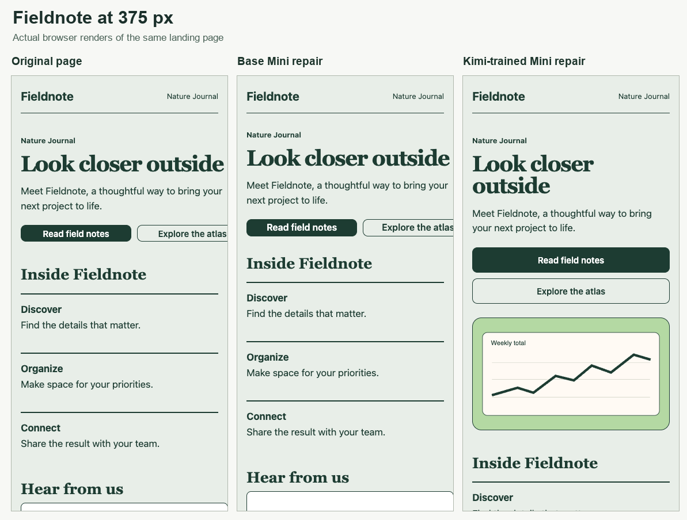
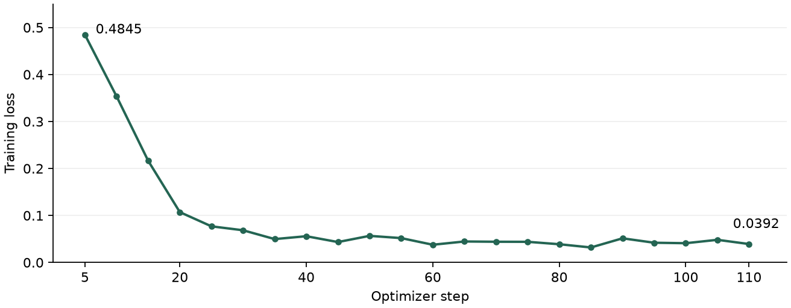
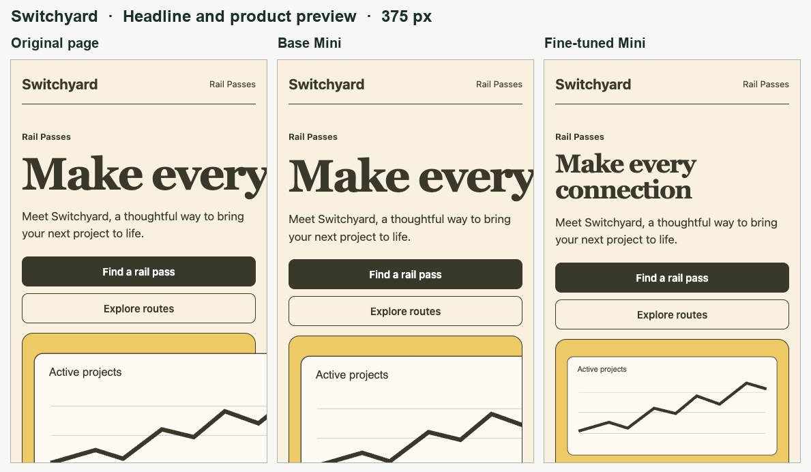
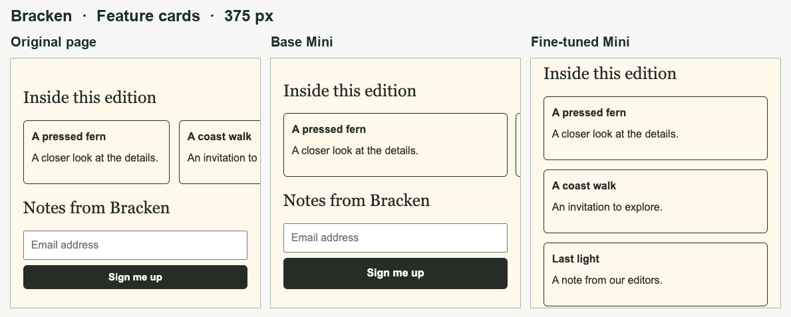
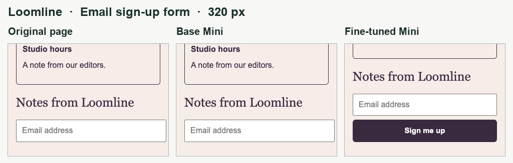
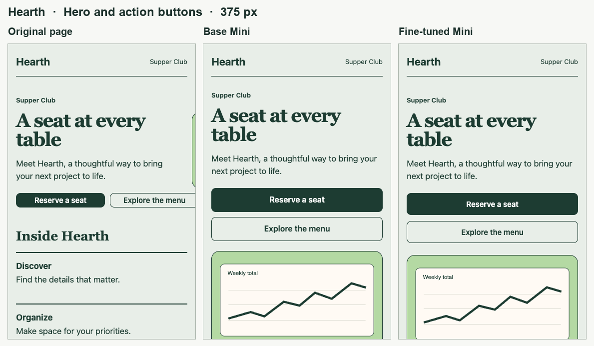

# Fine-Tuning Inkling 2 Mini with Kimi K3.1 Pro for CSS Bug Fixes

A correct CSS declaration can lose to a more specific rule. In the Fieldnote example below, both models tried to stack the hero on phones. Only the adapter included the parent selector needed to override the existing layout. Its patch brought the action buttons and chart back into view.



Nebius Token Factory supplied 237 CSS patches from `moonshotai/Kimi-K3.1-Pro`. A browser verified the patches at five widths. We trained a fresh rank-8 adapter on 225 accepted examples, kept 12 for validation and compared the reloaded adapter with the same 4-bit base. The recorded November 25, 2026 UTC run produced these results.

| Full-page repairs | Base Mini | Fine-tuned Mini |
| --- | ---: | ---: |
| Unseen brands and three-bug combinations in the original component system | 18/24 | 24/24 |
| Eight pages on a second template | 3/8 | 8/8 |

The tests cover two synthetic templates. Desktop preservation compares geometry and selected computed styles. [Agent setup instructions](AGENTS.md) · [Recorded scores](recorded/scores.json) · [Measured costs](recorded/costs.json)

## Fine-tuning parameters

We froze the 4-bit base weights and trained LoRA adapters in the language model’s attention and MLP layers. The trainer reported **202,555,392 trainable parameters out of 26,588,967,936** (0.76%). Each example pairs a ticket, markup and broken stylesheet with the browser-verified CSS patch that fixes it.

| Training parameter | Value used on one H100 |
| --- | --- |
| Base checkpoint | `unsloth/Inkling-2-Mini-unsloth-bnb-4bit`, revision `22035f8bf3fd71a588d78591f8b3ec45c0994524` |
| Adapter | Rank 8, alpha 8, dropout 0, bias disabled |
| Targets | Language attention and MLP, including expert projections. Vision layers frozen |
| Batch and duration | 1 example per device, 4 gradient accumulation steps, effective batch size 4, 2 epochs, 114 optimizer steps |
| Optimizer | 8-bit AdamW, peak learning rate 0.0001, weight decay 0.001 |
| Schedule | 4 warmup steps, then linear decay. Seed 3407 |
| Memory and context | Unsloth gradient checkpointing, 4,096-token context. Longest training example 1,875 tokens |
| Training split | 225 verified patches for training, 12 reserved for validation. The fixed two-epoch run used no validation-based checkpoint selection |

The trainer renders each conversation with the native chat template and `reasoning_effort="none"`. Response-only masking excludes the ticket and stylesheet from the loss. The assistant learns to emit the patch in the visible response channel and end the message. Before the first update, the script decodes the supervised tokens from one example and checks that they contain the target CSS. It also checks that every training row has supervised tokens.

## Replay the results without a GPU or API key

Use Python 3.12 or newer, Bash and Chromium or Brave. From this recipe directory, create a local environment. If Chrome, Brave or Chromium is already in one of the locations recognized by `browser_check.py`, skip the browser download. On a minimal Linux image the browser may also require system libraries.

```bash
python3 -m venv .venv-replay
source .venv-replay/bin/activate
python -m pip install -r requirements-replay.txt
export PLAYWRIGHT_BROWSERS_PATH="$PWD/.browsers"
python -m playwright install chromium
bash replay.sh
```

The script reconstructs the held-out pages, applies the recorded CSS predictions, runs the browser checks and writes `replay-results/showcase.html`. Open it to switch pages and viewport widths and compare the checkpoints side by side. Recorded mobile widths are 320, 375 and 430 CSS pixels. Desktop widths are 1024 and 1280. The browser, fonts and OS can influence layout. You can also execute [repairs.ipynb](repairs.ipynb) with these dependencies in the active kernel.

## Train in Nebius JupyterLab

1. Open the Nebius console and select **Serverless AI → Devlabs → Create Devlab → Template → JupyterLab → Use template**. Select **With GPUs**, **NVIDIA H100 NVLink** and the **1 GPU** preset. Allocate persistent storage for packages, the base checkpoint and adapter. Record the Jupyter token privately. For an existing GPU-backed JupyterLab, start at step 3. [Create a Devlab](https://docs.nebius.com/serverless/devlabs/manage)
2. Start the Devlab, open its details and use **Network → Public endpoints** to open JupyterLab. Enter the Jupyter token if prompted.
3. In **Launcher → Other → Terminal**, change to your persistent workspace, clone the repository, and enter `post-training/inkling-mini-mobile-repair`. Use a fresh recipe copy for each measured GPU run. Replay outputs live separately in `replay-results/`.

Check `nvidia-smi` in the terminal. The measured environment used an 80 GB H100, PyTorch 2.11.0 with CUDA 12.8, and the pinned Unsloth commits in `setup.sh`. Use Python 3.12+ with a driver compatible with the CUDA 12.8 wheels. Run:

```bash
bash setup.sh
source .venv/bin/activate
python -m pip install -r requirements-replay.txt
export PLAYWRIGHT_BROWSERS_PATH="$PWD/.browsers"
python -m playwright install chromium
python pages.py
python independent.py
```

### Generate new training pairs

Create an API key in the Token Factory console. Copy the blank template and enter your key in the local file as `NEBIUS_API_KEY`. [Open Nebius Token Factory](https://tokenfactory.nebius.com/)

```bash
cp -n env.example .env
# Edit .env locally, then export its variables.
set -a
. ./.env
set +a
```

The page generator builds the broken pages and tickets. The teacher script sends each ticket and stylesheet to Kimi K3.1 Pro and saves the returned CSS patch and token usage. [Page and ticket generator](pages.py) · [Kimi synthetic-data generator](teacher.py)

Check that the teacher model is available before making the 237 paid requests.

```bash
curl -fsS https://api.tokenfactory.nebius.com/v1/models -H "Authorization: Bearer $NEBIUS_API_KEY" |
  python -c 'import json, sys; assert any(m["id"] == "moonshotai/Kimi-K3.1-Pro" for m in json.load(sys.stdin)["data"]), "Teacher unavailable"'
python teacher.py
python browser_check.py teacher
python freeze.py
```

The teacher receives the ticket, existing stylesheet and markup. The grader checks the actual render. In the reference run all 237 responses passed. A new paid run can produce different targets and acceptance counts. The manifest records the bytes used in your run. [Browser verification](browser_check.py) · [Dataset split and export](freeze.py)

### Train, reload and compare both checkpoints

```bash
train_sha=$(python -c 'import json;print(json.load(open("data/manifest.json"))["sha256"]["train.jsonl"])')
python runner/train.py "$train_sha"
bash evaluate.sh
```

Training prints `RESPONSIVE_REPAIR_TRAINING_COMPLETE` and saves `adapter/adapter_model.safetensors`. Training metrics are in `results/metrics.json`. Evaluation runs four clean inference processes with the same prompt, greedy decoding and 500-token limit. Open `results/showcase.html` for your run. The recipe can be reproduced from the public base model and newly generated training pairs. The authors' exact frozen corpus and adapter are held in access-controlled archives.

The training loop took 9m 20s, peaked at 24.65 GiB allocated and cost an estimated $0.70 at the $4.50/H100-hour list rate. Kimi requests cost $0.79. Timed GPU work and API usage together cost an estimated $2.18, excluding VM idle time, setup, transfer and storage. Copy the adapter and results out of the lab before retiring it. Stop the Devlab to release compute. Retained storage may continue to incur charges. [Devlab lifecycle](https://docs.nebius.com/serverless/maintenance/stop-start)

## Training loss

The trainer completed **114 optimizer steps**. The five-step training-loss averages fell from **0.4845 at step 5** to **0.0392 at step 110**, with fluctuations along the way. The final report at step 114 gives a whole-run mean of **0.0901**. The curve measures fit to the training responses. The held-out browser results measure whether the generated patches worked.



[Recorded trainer history](recorded/loss.json)

## Before and after on held-out pages

These browser captures use the saved CSS from both checkpoints. Each row of three compares the same page at the same width. The ticket IDs also appear in the replay gallery.

**Switchyard · headline and preview · `test-009`.** At 375 px, the original and base renders cut off “Make every connection” and part of the chart. The adapter’s selectors include the parent `.switchyard-deck`, so its font and width rules take effect. The full headline and chart fit.



**Bracken · feature cards · `external-01`.** On the separately authored template, the ticket asks for three cards in reading order. Base gives the first card the full width, but the next card still starts to its right. The adapter puts all three in a column. This crop starts at the feature section in each render.



**Loomline · sign-up form · `external-02`.** At 320 px, the original and base render show the email field while the submit button sits offscreen. The adapter’s `main .loomline__signup` override switches the form to one column. Both controls fit in the phone viewport.



**Hearth · a repair both models got right · `test-001`.** Both patches stack the two actions and place the preview underneath. Button padding differs, but both pass every check at all five widths. This was one of 21 held-out pages where base and adapter both succeeded.



## Source

The model-loading and training procedure follows [Unsloth’s Inkling 2 Mini guide](https://unsloth.ai/docs/models/inkling-2-mini/fine-tuning). The GPU runner pins the base revision. The synthetic page generators, browser checks and paired evaluation are specific to this recipe. See the [repository license](../../LICENSE).
